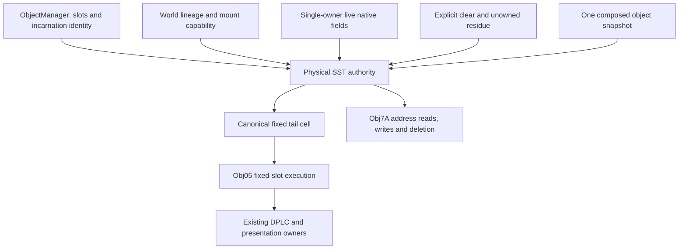

# S2 Sideways: physical storage across object lifetimes

Status: council synthesis and recommended target, **not implementation-ready**.
No runtime change or repair qualification is included. Source baseline:
`d3fa3d519f6acb7285d538b5f972807036f1019e`.

Use one physical SST authority mounted in each ObjectManager, with a canonical
64-byte fixed tail cell and complete contracts for the fields of every supported
occupant. Native links denote coordinates for successful and failed allocation.
Existing logical fields may remain their sole authoritative values when an exact
native-width view and cross-write can be proved; do not add synchronized copies.
Empty/unowned storage retains explicitly recorded bytes. Missing representation
must fail completeness checks before activation, never throw on a supported
runtime reuse path.

This takes Opus's address-based shape, Astra's distinction between storage,
incarnation and authority, Sol's controlled restore composition, and Fable's
literal fixed-cell operations. All four initial proposals had unresolved
completion gates. Their useful components do not constitute a tested repair.
The [known bug](../../status/known-bugs.md) remains open. The
[rewind audit](../audits/2026-10-24-rewind-disposition-review.md) records accepted
native observations, the animation prerequisite, and the rejected candidate's
17 passing controls and two failing raw-deletion/reuse controls.

## What the native program requires

`AllocateObjectAfterCurrent` exhausts the dynamic range with A1 at `$FFFFD000`,
the fixed `Tails_Tails` cell. Obj7A skips child initialization but still writes
links, bounds and X there. A rejected Java child cannot represent that result;
strict rewind correctly rejects its dangling identity.

The long write at tail `$3C` overwrites Obj05's parent word at `$3E`. A parent in
SST127 leaves `$CFC0`, sign-extended by `movea.w`. Word arithmetic wraps at native
width without modifying adjacent fractional bytes. The fixed cell is 64 bytes,
not 80. Native `DeleteObject2` clears all 64; zero then follows an actual write.
Obj02 installation writes ID and parent only and must not clear other bytes.

Obj05 reads thirteen bytes in eight parent fields: art word `$02`, X/Y words
`$08/$0C`, velocity words `$10/$12`, and animation/status/angle bytes
`$1C/$22/$26`. A replacement's aliases must be interpreted as those same bytes,
regardless of its Java class or their meaning in its own routine.

**Successful pairs also need physical links.** The child reads its parent's X
and toggles byte `$36` through the address in `loc_2953E`. If a supported engine
operation retires only the parent, the child subsequently reads/writes the empty
or reused slot. Conversely, parent endpoint cleanup deletes the current occupant
of its child's coordinate. Keeping an admitted-pair Java reference would retain
stale incarnation behavior. Byte `$36` and physical endpoint deletion therefore
belong in the domain alongside the thirteen-byte tail read, even though they
were not needed by the first failed-allocation control.

Pinned reference owners, at S2 disassembly
`34fc7f130a96db171e1a1c43e28e0bad81cd6ca7`:

- `AllocateObjectAfterCurrent` (s2.asm:33705-33725).
- `Obj7A_SubObjectLoop` (s2.asm:56313-56351).
- `loc_294C4` (s2.asm:56374-56387) and `loc_2953E` (s2.asm:56428-56440).
- `DeleteObject2` (s2.asm:30334-30345).
- `Obj02_Init_Continued` (s2.asm:38934-38946).
- `Obj05_Main` (s2.asm:41723-41764).

Model `FixBugs = 0`. A natural sidekick death does not itself reinstall Obj05;
the accepted reinstallation observation used declared synthetic setup. It still
qualifies the literal write interaction, not every engine installation caller.

## Storage and lifetime authority

The proposed `NativeSstAuthority` is an ObjectManager component and a component
of its existing snapshot. It owns the complete fixed cell, explicit clear/residue
state, coordinate resolution and physical cross-operations. This avoids a new
independently ordered rewind adapter and a wholesale move of player physics and
all object fields into a central byte array.

Its three identities are distinct:

- A physical address is the native coordinate, interpreted within an explicit
  world lineage. It survives occupant reuse.
- `ObjectRefId` identifies a Java incarnation for reconstruction and other strict
  graphs; it cannot decide which occupant a native pointer addresses.
- An engine-issued capability authorizes access for the current lineage,
  manager mount epoch and live owner. Retirement, remount and destructive restore
  revoke old capabilities, even if restored IDs and coordinates are equal.

Manager ownership does **not** mean manager replacement clears RAM. A native
clear is a named operation in the load contract. Same-world preservation carries
one immutable image and remounts fresh capabilities; the retired manager cannot
remain a live writer. Parking preserves the manager/inventory image together.
New-world replacement creates a distinct lineage. No controller resolves an
ambient current manager to regain authority.



## Complete occupant contracts

A contract identifies the existing canonical field or storage atom for every
native byte this domain can observe or modify. It must preserve big-endian byte
lanes, aliases, signed interpretation, partial writes, initialization order and
read-before-write residue. A getter that returns a plausible class default is
not such a contract. Neither is a list of fields the class sometimes writes:
conditional writes and pre-initialization reads still need exact state.

For a modeled live atom, the native view reads the actual authoritative field,
and an in-domain cross-write mutates that owner. No per-frame export, second live
header, or restore copy-back is allowed. If a needed atom is absent, add it to
its real owner or revise the boundary; an adapter cannot invent it. Unowned
bytes belong to explicit residue storage. At admission the authority transfers
any required residue into the new field owner once, before native initialization;
it does not overwrite unwritten bytes with constructor defaults. Stage 0 must
prove this binding order without a hidden journal of constructor activity.

Vacate clears the represented storage through the modeled operation and revokes
the occupant. A missing live object is not by itself evidence of a clear:
reserved slots, native subobjects and unowned storage must have declared states.
Engine raw retirement currently follows a zero-slot policy; ObjectManager's
removal comments and the S3K MonkeyDudeArm precedent support that **engine policy**.
They do not prove native reachability or exact representation of arbitrary
replacement occupants. Record the clear when it happens, rather than fabricating
zero during a later failed lookup.

Stock registry entries, donor/player roles, reserved-slot participants and
supported creators must all satisfy this contract before activation. Derive the
coverage check from actual registrations, not a parallel exception allowlist.
A runtime unknown-class throw cannot be reclassified as a successful repair.

**Creator policy proposed by this design:** engine-issued own-body semantics
supply position, art priority and native status components; velocity, animation,
angle and other bytes are written only where their semantic owner provides an
explicit operation. Unwritten bytes retain modeled residue. Do not treat a live
creator's position as opaque zero, trust creator-supplied ownership, or infer
unmodeled fields from defaults. Existing getter-overriding creators require an
explicit migration or a proved fault-scoped field binding. This is a candidate
API contract change if current interfaces cannot express it; audit examples,
descriptor and normalized pins together. It is not already supported behavior.

## Caller shape

These are proposed interfaces, not executable code or verified API signatures.
The complete admission operation hides reserve/bind/construct ordering.

```java
NativeAdmission child = objects.admitAfter(parentCapability, childRecipe);
switch (child) {
    case Admitted(var address) -> s2Sideways.initializePair(parentAddress, address);
    case Exhausted(var returnedAddress) ->
            s2Sideways.applyFailedStores(parentAddress, returnedAddress);
}
// Both outcomes retain a physical coordinate, not a Java child handle.

s2Sideways.moveChild(childCapability, linkedAddress); // native X read and $36 XOR
s2Sideways.retireAtEndpoint(parentCapability, linkedAddress); // delete current target

nativeSst.dispatchTail(nativeBoundary, dynamicArtOwner);
// No playable/renderer prerequisite for native execution or DPLC decisions.

registry.restore(snapshot); // one existing public restore entry point
```

Reservation occurs before construction so exhaustion builds no rejected child.
Preserve the established slot order and later-in-the-same-walk execution. Keep
unmanaged standalone objects explicit; a detached pair has no physical allocator
failure. Existing preconstructed admission APIs need a documented compatibility
path before migration, not silent default-header transfer.

Keep byte offsets and native instructions in S2-owned code. Shared admission and
lifecycle code consumes a module-supplied capability rather than a game-name
condition. Creator callers cannot obtain another actor's raw address or writer.

## Fixed execution, ROM reads and presentation

Obj05's animation state lives in the 64-byte cell. Preserve the landed independent
`anim`/`prev_anim` and `$FD` return. Host-native installation is explicit; character
class, renderer creation and donated art do not install a fixed object.
Detached S3K, extra-team, puppet, bonus and standalone tails retain their own
state and can share the animation implementation without sharing RAM ownership.

The cross-review inspected the Obj05 animation paths and found parent reads in
the thirteen-byte domain and self reads within the 64-byte cell. An unsigned
parent animation byte can index beyond `Obj05AniSelection`; the subsequent
signed ROM-table displacement remains a ROM read, not additional parent RAM.
Clamping at `$20` or substituting Blank is unjustified. Use address-faithful reads
from the ROM pipeline. The remaining mapping/DPLC/DMA range and published VRAM
consequences still require the Stage 0 proof; source inspection of the animation
routine is not pixel qualification.

Fixed-slot dispatch follows the native loop and cell ID even when the original
player or renderer is absent. It submits art decisions to the existing
`DynamicArtLifecycleService`. Drawing derives position, flags, mapping and art
from the cell, not its former parent's Java position. Cell deletion does not
clear the separate native DPLC dedup register, cancel accepted DMA work or reset
renderer caches indiscriminately. Art resource rebinding cannot reinstall RAM.

## Clear, carry and restore contract

| Event | Required behavior |
| --- | --- |
| Native level RAM clear | Named clear operation at the verified load boundary; invalidate old cell capabilities. |
| Obj02 install | Write only ID and parent; execute after the last real clear and before the first fixed dispatch. |
| Camera-snap, bootstrap or prelude reset | Classify its actual semantics; do not equate every `reset*` with RAM clear. |
| Same-world manager replacement or exact carry | Carry the represented image and inventory explicitly; retire old authority and issue fresh mount capabilities. |
| New world | New lineage; prior handles cannot address it. |
| Park/editor stash and reopen | Preserve a coherent inventory/storage image; restoration is distinct from starting a fresh level. |
| Art/ending resource binding | Change presentation binding only for a bound native cell; detached mode preserves its existing state contract. |
| Raw/Stageplay retirement | Explicitly clear the retired slot under engine policy; no invented linked-target cascade. |
| Obj7A endpoint retirement | Apply native physical deletion to the current linked occupant, then the parent's native cleanup. |
| Roster change | Preserve or retire/install through the explicit native-role policy; surviving fixed execution does not require a Tails presentation. |
| Destructive rewind | Reconstruct under suspended effects, restore canonical fields/residue/cell once, then publish fresh bindings. |

Art initialization currently precedes ObjectManager construction. Therefore a
controller built there cannot capture a manager cell as an incidental constructor
side effect. Bind through the later explicit native lifecycle and retain a typed
unbound/private/manager-owned state, with validated transitions.

Inside ObjectManager restore, reconstruct identities and ordinary canonical
fields under suspended publication, restore residue and the fixed image, and
then expose fresh capabilities. Assert that reconstruction has not replayed
native initialization stores such as Obj7A's X addition. Resource callbacks must
not write the cell afterward. The image has one restore owner; object fields and
residue have disjoint ownership, not overlapping copies whose ordering happens
to win.

Use an explicit snapshot ownership variant such as `Private(state)` versus
`ManagerOwned(binding)`. `restoreRewindState(null)` currently resets a tail, so
null cannot silently acquire an ignore meaning. Remove bound RAM copies from
player/native-art/ending adapters; preserve detached snapshot semantics.
Direct controller restore in bound mode must fail clearly or be unavailable in
the revised API, rather than become a second writer. This is a deliberate
compatibility obligation, not a reason to hide a signature change.

## Council decisions and rejected approaches

Four independent designs came from GPT-6 Astra, Claude Fable 5.1, GPT-6.1 Sol and
Claude Opus 5.5. A fresh Opus cross-review read all four and checked the pinned
source. Parent synthesis accepts its physical-link finding and narrower target,
with stricter lifecycle provenance and byte-ownership conditions. No ranking or
model vote substitutes for those conditions.

| Candidate | Retained contribution | Rejected or unresolved element |
| --- | --- | --- |
| Astra: world-owned header storage | Coordinates/incarnations/capabilities; single authority; alias and lifecycle gates. | Moving all shared/player fields into one world array is not yet justified; admitted Java pair links miss physical reuse. |
| Sol: canonical header authority | Restore staging, parking and separate art/dedup ownership. | Constructor journals and a second bound animation restore path; broad migration without a complete census. |
| Fable: fixed-cell authority | Literal fixed cell, explicit install and direct native deletion. | Unsupported occupants, lookup-time zero, construct-before-admission and implicit reset assumptions. |
| Opus: coordinates and ports | Physical links for both outcomes, typed exhaustion, cross-delete/XOR residue. | Runtime unknown-owner failure, creator opacity, animation cap, null/no-op restore and renderer-gated DPLC. |

The initial fixed-tail designs were honest partials, not complete repairs.
The selected target requires total contracts before activation. If live field
views cannot satisfy that requirement without synchronized state, revisit a
canonical field migration for the demonstrated atoms; do not quietly add a
fallback. A general CPU/RAM emulator and a blanket rewrite of all private state
remain unjustified.

## Stage 0: required before runtime implementation

Record these proof products in the existing audit/design, not new report types:

1. **Consumers:** finish the address-based ROM mapping/DPLC/DMA proof after the
   animation paths. Identify every mutable read/write and bound each access.
   Published VRAM behavior is a separate qualification obligation.
2. **Writers and aliases:** derive a per-native-ID inventory for the thirteen
   parent bytes plus `$36` and physical deletion. Check it against actual stock,
   donor, reserved-slot and creator admission. Map conditional/partial writes,
   read-before-write residue and cross-write aliases to one canonical owner.
   A generated disassembly write list is a starting aid, not semantic proof.
3. **Lifecycle:** classify construction/reset/rebuild, camera re-reset, teardown,
   trace bootstrap, Stageplay/editor, park/reopen and carry callers as native
   clear, preserve/carry, snapshot restore, engine-retire-zero or presentation.
   Prove native installation follows the last clear and precedes dispatch.
4. **Snapshots and authority:** enumerate all tail/header snapshot writers and
   callbacks; prove reconstruction ordering, disjoint field/residue ownership
   and revocation of stale capabilities through restore and carry.
5. **Creator/API migration:** settle the proposed own-body write contract and
   supported preconstructed callers; enumerate exact interface, descriptor,
   signature and example changes. No silent supported-content narrowing.
6. **Reachability and scope:** explicitly cover supported retirement of either
   admitted pair member. Bound other stale-reference cross-writes that intersect
   this domain. Assess the two-player Obj7A branch separately; the present
   single-camera evidence does not qualify it or justify removing support.

No candidate is ready until this gate passes. An unclassified caller, unsupported
registered occupant or conflicting state owner blocks activation. Thirteen bytes
plus one fixed cell describes an initial consumer footprint, not a proven total
migration size. Natural campaign frequency is still unmeasured.

## Smallest complete implementation after Stage 0

Develop the following together in one isolated branch and qualify the complete
slice before replacing the current known-gap assertions:

1. Canonical fixed cell, explicit empty/residue states, named clear/carry and
   composed snapshot ownership with reconstruction-write assertions.
2. Reservation-before-construction, physical links for both allocation outcomes,
   native failed stores, child X/$36 operations and endpoint deletion.
3. Authority-run Obj05, ROM-addressed animation/mapping behavior, explicit native
   install/bind, independent DPLC execution and typed snapshot ownership.
4. Total occupant contracts and admitted single-member retirement/reuse, including
   supported creator and reserved-slot behavior. Certification is a prerequisite,
   not a runtime unsupported-type branch.

Meaningful controls start with the rejected candidate's two cases: clear without
reuse, and genuine registry-admitted replacement with nonzero fields and aliases.
Use real native occupants covering the required values rather than inventing an
impossible stock object with every byte nonzero. Include animation above `$20`
where the audited native state can produce it, plus explicit raw byte controls
for ROM consumer coverage. Cover parent-only and child-only retirement, a `$36`
write into an empty slot and its subsequent admission, two failed parents,
reinstallation, only-earlier holes, last-slot pressure and admitted same-walk
ordering.

At each boundary, destructively reconstruct and compare forward execution;
check exact bytes, identities and expired external capabilities. Retain the
literal `$FD` prerequisite, detached/S3K behavior and existing tail rendering/
DPLC checks. Deliberately broken controls must expose zero-on-reuse, dropped
residue, replayed X addition, a player/art snapshot overriding the cell, art
refresh clearing it and DPLC suppressed without a renderer.

Reuse the accepted native pressure observations. New native work should target
missing lifecycle, ROM-consumer or presentation facts. Shared admission/lifecycle/
API changes require focused ROM, rewind and candidate-surface checks and one
lead-owned change-based smoke selection; no release-only full suite is prescribed.
The council ran no implementation tests.

Reject the target if a supported occupant needs fabricated bytes, a synchronized
shadow field, a runtime unknown-owner exception, an invented cascade, an
unclassifiable reset or a second restore writer. Preserve the bug and explicit
coverage limits until the full replacement contract is proved.
