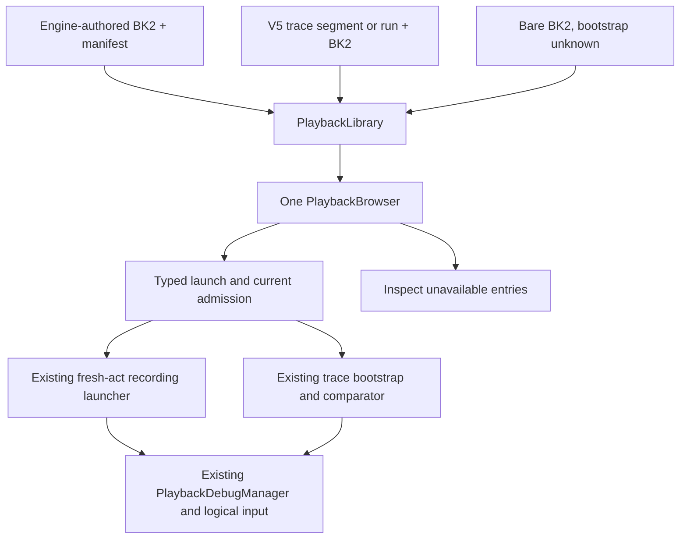

# Unified recording and playback library

The goal is one place to find OpenGGF recordings, BK2 movies, and ROM trace
replays, with shared recording and playback machinery wherever their semantics
agree. This design builds on `feature/ai-menu-design-review` at
`be8ffe7a6f56d43724758f408a623bba904e186d` for `0.7.prerelease`.

## Problem and existing architecture

Engine recordings already use BK2. `UserRecordingWriter` writes the controller
log, a fresh-act `RecordingLaunchContext`, build identity, and an optional
comparison-only desync sidecar into one archive. Authored controller scripts
reuse its input-log encoder. Playback uses `Bk2MovieLoader`, `Bk2Movie`,
`Bk2FrameInput`, and `PlaybackDebugManager`.

Live trace replay uses that same parser, input model, and playback owner.
`TraceReplayDriver` attaches a `LiveTraceComparator` through the existing frame
observer hook. The comparator has different authority from native movie drift
checks. Its expected physics and auxiliary observations never supply gameplay
state. Dedicated timing input retains its separate
[bounded timing contract](2026-07-27-cross-game-hardware-timing-trace-contract.md).

The user-facing split was two catalogs and two lists. The
[original user-recording design](2026-06-29-user-recording-playback-design.md)
explicitly made its menu a sibling of the trace picker. This design supersedes
that navigation decision while retaining the separate launch and verification
contracts.

## Usage from the caller

The selected game's **Playback** action and the configured recording shortcut
open the common browser with a game filter. **Advanced > Playback browser**
opens all games. Automatic trace test mode opens the same browser locked to
traces. The Game and Show controls filter the list without selecting a gameplay
policy.

```java
PlaybackLibrary library = PlaybackLibrary.scan(
        workspace, configuredTraceRoot, configuredMoviePath, AppVersion.identity());
PlaybackBrowser browser = new PlaybackBrowser(
        library, selectedGameId, PlaybackBrowser.Filter.ALL, false, font, launcher);
```

Native movie options produce a typed recording request. A trace selection
produces a different request after its loading page has appeared.

```java
launcher.launch(new PlaybackRequest.Recording(recording, options));
launcher.launch(new PlaybackRequest.Trace(trace));
```

The host supplies the existing GameLoop-wrapped recording starter. That wrapper
resets the last applied playback frame. Dispatch does not bypass it by calling
`UserRecordingSessionLauncher.beginPlayback` directly.

## Shape and ownership

`PlaybackEntry` is a sealed set of recording, trace, and bare-movie variants.
Recording and trace entries retain their existing validated domain objects.
Availability derives from the selected variant and metadata. The list badge,
details, and launch guard read the same result. No separate capability flags
need synchronization.

Extents name their coordinate system. A recording contains BK2 rows, a trace
contains trace frames, and a run reports its total trace frames. A trace's BK2
start offset remains a separate row value. None is the live rewind cursor,
which identifies committed state after a synthetic neutral frame zero.

| Owner | Responsibility |
| --- | --- |
| `game.playback.PlaybackLibrary` | Merge bounded discovery, retain source issues, preserve native newest-first ordering, and deduplicate the same discovered movie. |
| `game.playback.PlaybackEntry` | Artifact kind, derived availability, coordinate extent, and display facts. |
| `game.playback.PlaybackBrowser` | The only list, game/type filters, selection, details, and selected-item navigation. |
| `game.playback.PlaybackLauncher` | Typed dispatch and current input-ownership/test-mode admission. No active session or cursor. |
| `game.recording.menu.UserRecordingMenu` | Options and warnings for one selected recording. It no longer has a list. |
| `testmode.TracePlaybackFeedback` | Presented loading, held launch/run diagnostics, paging, cancellation, and acknowledgment. It no longer has a list. |
| Engine-owned browser selection memory | Restore the selected source across title-screen recreation. Contains no playback state or cursor. |
| Existing recording and trace launchers | Fresh boot, comparator lifetime, rewind binding, completion, and teardown. |
| `debug.playback` | Shared BK2 parsing, controller snapshots, live cursor, prepared edges, and owned input publication. |



The public browser operations hide discovery, selection, and launch routing.
They do not expose parser stages or ask callers to coordinate multiple owners.
The selected recording panel and trace feedback retain real product differences
behind the common list. This is the Model the Domain principle applied to
artifact and page states, and Laziness Protocol applied to playback ownership.

## Discovery and admission boundaries

Discovery reads immediate `recordings/<game>/` folders, the configured trace
catalog, and the optional configured BK2 path. It does not search the whole
repository. Existing trace discovery covers ordinary segments, special stages,
and multi-segment runs. Distinct trace spans sharing one movie remain distinct
entries. Catalog construction retains summaries rather than eager sidecars or
all parsed movie graphs.

The native import owner distinguishes an absent OpenGGF manifest from an invalid
one. An absent manifest becomes a bare movie only after bounded BK2 parsing
succeeds. A malformed manifest stays invalid. Duplicate ZIP entries, inflation,
line, and frame limits remain enforced. Per-file errors and source-level issues
remain visible without discarding healthy entries from other sources.
`TraceCatalog` explicitly forwards directory-read diagnostics to the common
library instead of relying on its historical log-only failures.

A bare BK2 declares input, not a reproducible starting state. The browser shows
**Needs setup** and details. There is no bare-movie launch request. It never
guesses the game, team, zone, act, reset prefix, or input offset from a filename
or a suspended game. A later setup flow must explicitly support a known boot
recipe and prove it with real replay behavior.

Launch reparses the selected source through the existing launch owner. The
dispatcher checks `ExternalFrameOrInputOwnership` at the operation boundary and
rejects native requests during test mode. A scan result cannot reserve input or
authorize a stale file.

`TEST_MODE_ENABLED` is session policy, not a filter. Automatic browsing locks the
type filter to traces. Back, asynchronous cancellation, and failed catalog reads
clear the mode. A partial-source result also releases automatic mode while
retaining a locked trace view and its healthy entries. Selecting a trace from
that view reapplies the automatic trace policy at launch. A failed launch
restores its prior mode. A successful trace launch keeps its mode through the
gameplay handoff. Distinct Back and Launched browser results encode this
difference.

## Other recording systems

These systems share algorithms where their contracts agree. A common browser
does not make every artifact a deterministic gameplay movie.

| System | Shared machinery and retained contract | Browser coverage |
| --- | --- | --- |
| Native input recording | BK2 model, input-log encoder, logical input, live playback, and optional engine drift checks. Fresh-act boot metadata remains required. | Discover, inspect, set playback options, and launch. |
| ROM trace segments and runs | BK2 input and live playback plus trace bootstrap, structural policy, comparison, and bounded timing admission. | Discover and launch with retained loading and diagnostics. |
| Bare BK2 | Same bounded controller parser. No declared bootstrap. | Discover configured files or recording-folder imports and inspect setup requirements. |
| Strict trace tests and trace capture | `RecordingFrameDriver` and `TraceReplayDrive` share strict execution policy. Setup retries do not consume a row; lag preserves the last polled input baseline. | Existing tooling remains. Whole-run capture is still unsupported. |
| Gameplay capture | Production `GameLoop` stepping and shared recorded logical snapshots. | Existing capture tooling remains. |
| Live rewind | Shared input types, `InputSource`, snapshots, and `RewindController`. History remains bounded and tied to world installation identity. | Existing in-session transport, not a portable library file. |
| Time Attack `.ggfinputs` | Canonical hashed route/fingerprint recording and strict frame driver. `AttemptReplayHarness` owns the competitive finish verdict. | A future adapter needs an actual route-host action. Not included in this browser. |
| `.ggfghost` and remote ghosts | Cosmetic pose playback. Positions never become native physics input. | Existing race presentation. Not included in this browser. |
| A/V captures | Shared `CaptureRecorder`, sinks, and encoder. Live audio uses a non-consuming tap on the exact active runtime; offline capture has different ownership. | Exported media is not listed. A future external-open action need not simulate gameplay. |
| Stageplay and presentation replay | Authored scene commands or captured presentation frames, with their existing preview owners. | Existing authoring/preview tools. No conversion to BK2. |

The separate strict executor is evidence-backed. `TraceReplayDrive` documents a
previous capture divergence when routed through the live playback loop. Replacing
it requires matched parity evidence, including input polling, suppressed rows,
setup retries, and transitions. A new interface alone cannot establish that
equivalence.

## Synthesis decision and alternatives

Two independent designs were produced before implementation. Candidate A put a
typed library, browser, and dispatcher over existing owners. Candidate B moved
input admission and lifecycle into a new session workspace before adding the
browser. An independent Claude Opus 5.5 review selected A.

A became the base because current admission already combines trace ownership
with active or scheduled movie playback. Existing recording guards and
suspension checks enforce that boundary. Moving the static trace session and its
many readers would add forwarding layers and disturb teardown without removing
the actual browsing split. B contributed derived availability and explicit
coordinate extents. The review also required the test-mode session policy and
current admission checks described above.

Other rejected shapes were a landing page linking the old lists, which keeps
duplicate browsing ownership; a universal frame executor, which lacks parity
evidence; and a new canonical recording format, which duplicates BK2 and loses
trace or competitive identity. Laziness Protocol changed the implementation to
delete both old lists and retain the existing playback owners.

We accept source-specific boot and verification owners in exchange for preserving
their tested semantics. We accept unavailable bare-movie launch in exchange for
avoiding plausible playback from an invented start. Optional race/media adapters
will be added only with a concrete browse or playback action, without an empty
extension registry.

## Verification and remaining work

Focused checks cover mixed discovery, malformed-versus-absent metadata, import
limits, source isolation, movie deduplication, newest-first recordings, explicit
coordinate labels, dispatch admission, selected options, trace loading before
launch, retained failures/retry, filters, all title entry paths, and test-mode
exit/handoff. Existing recording, catalog, launcher, prepared-input, and ownership
regressions remain part of delivery validation.

`TestPlaybackBrowserPresentation` renders the real browser and selected panels
through configured offscreen OpenGL at 320 and 400 pixels. Its synthetic catalog
summaries are UI evidence, not recording determinism or ROM-parity evidence.
Optional `openggf.playback.captureDir` output produces reviewable PNGs from that
same test. Routine validation stays bounded smoke/focused coverage. No frame
executor, physics algorithm, recording clock, or trace fixture changes in this
delivery.

The next architectural work is an explicit fresh-act launch recipe for bare BK2,
if required, or a concrete Time Attack browse/replay adapter. Both must preserve
the existing authority and frame-coordinate contracts. Neither is implied by
the browser's All filter.

## Delivery evidence

The menu base advanced during implementation. Commit `5822c28de` added transport
polish and recording-replay diagnostics; `cf8dfbe8e` added its handover document.
Both were incorporated without conflicts. The final executable source was
checked at `cdc395cf95c8c6b16f0d37a8fa3c9c681d2c046f`. The later rebase over the
handover changed only the audit document, with an empty diff for `src`, `pom.xml`,
`tools`, `racing`, hooks, and the API policy descriptor.

The change-based plan selected 4,243 smoke candidates because the menu paths were
shared or unclassified. Focused validation replaced that disproportionate plan
for this bounded discovery/navigation change. No full release suite ran.

Observed outcomes were:

- 270 distinct focused tests across 34 classes passed across completed runs,
  with no failures or skips in their final reports. Coverage included import
  limits, source isolation, options, held diagnostics, title entry paths,
  input ownership, and the existing recording and trace launch contracts.
- `TestUserRecordingDeterminismSmoke` recorded and replayed 120 frames using the
  original Sonic 2 REV01 ROM at an absolute path. Its CRC32 was `7B905383` and
  SHA-1 was `8BCA5DCEF1AF3E00098666FD892DC1C2A76333F9`. It passed without skips.
  This proves its shared core-driver window, not an entire visual route.
- The rebased browser/HUD/diagnostics/ArchUnit selection below passed 78 tests,
  with no failures or skips. The real EGL browser and transport pictures
  executed at 320 and 400 pixels with desktop displays unset.
- A fresh affected-guard selection passed 101 tests with no failures or skips.
  The earlier complete guard selection ran 805 tests and reported four failures.
  All four were reproduced on the unchanged `5822c28de` menu base. Exact test
  identities and assertion messages matched after normalizing the worktree path.
- Changed Markdown file targets, instruction mirrors, whitespace, and commit
  policy checks passed. Existing playback executors and fixture payloads stayed
  unchanged.

The final focused commands used the shared queue from the task worktree:

```bash
env -u DISPLAY -u WAYLAND_DISPLAY LUA_BIN=/usr/bin/lua5.4 \
  python3 tools/testing/maven_queue.py -Dmse=off \
  -Dopenggf.headless.gl=surfaceless-egl \
  '-Dtest=TestMasterTitlePlaybackBrowser,TestMasterTitleTraceRetry,TestUserRecordingControls,TestUserRecordingHud,TestRecordingReplayDiagnostics,TestTransportHud,TestTransportHudPresentation,TestLiveRewindHudOverlayWidescreen,TestPlaybackBrowserPresentation,TestArchUnitRules' test

env -u DISPLAY -u WAYLAND_DISPLAY LUA_BIN=/usr/bin/lua5.4 \
  python3 tools/testing/maven_queue.py -Dmse=off \
  -Dopenggf.headless.gl=surfaceless-egl -Pguards \
  '-Dtest=TestArchitecturalReviewGuard,TestArchitecturalSourceGuard,TestRawGlfwTestSetupGuard' test -B
```

The picture-producing invocation also supplied the optional
`openggf.playback.captureDir` output directory, which writes PNG copies from the
same asserted framebuffer.

The inherited guard failures remain open:

| Test identity | Matched failure |
| --- | --- |
| `TestRewindCoverageGuard.noNewCoverageGapsBeyondBaseline` | `MhzEndBossInstance#objectRef#hitProxy` is absent from the coverage baseline. |
| `TestObjectUpdateClockTerminologyGuard.objectUpdateClockUsesVIntRunCountTerminologyAcrossBoundaryAndFrameworkHooks` | `TestTasS3kWaterSkimLifetime`, `TestTasS3kOffscreenSolid`, and `TestTasS3kOrtExhaustion` use `frame` or `f` at object update boundaries. |
| `TestBuildToolingGuard.s3kStaticSessionStateDebtShouldNotGrow` | Existing `HCZWaterSkimHandler.slotRetired` and `Aiz2BossEndSequenceState.cutsceneKnucklesSlot` are absent from the static-debt baseline. |
| `TestNoAssertionFreeDiagnostics.noAssertionFreeTestMethodsUnderTestsTree` | Existing `TestTestReelExtension#bodyPasses` has no direct assertion oracle. |

Matched baseline checks used `-Pguards` with the exact first two classes, then
`TestBuildToolingGuard#s3kStaticSessionStateDebtShouldNotGrow,TestNoAssertionFreeDiagnostics`.
No unrelated gameplay, guard baseline, or test-reel change was made to hide them.
