# Multiplayer Time Attack: architecture and lifecycle

This reference describes the implemented system, from room discovery through
gameplay, verification, results and teardown. It follows the `0.7.prerelease`
development line. Source review: 2026-10-27, commit
`d2f3ce1e3c3165034b1cbafb4c1792f5472fdc5f`, racing protocol **8**.
Dated designs and validation records describe their own revisions; the linked
source owners below determine current behavior.

Start with the [component view](#component-view) and
[lifecycle](#three-nested-lifetimes). The integration views then separate
[connections](#connection-and-admission-integrations),
[gameplay](#gameplay-and-live-ghost-integration),
[verification](#input-verification),
[results](#results-and-next-round) and [cleanup](#leave-and-failure-recovery).
For player controls and deployment commands, see the
[racing README](../../../racing/README.md),
[server configuration](../../../CONFIGURATION.md#racing-server-master-verifier-settings)
and [deployment guide](../../../racing/deploy/README.md).

## Component view

Each client simulates its own player. The room owns round timing, membership,
stream validation and standings. The master owns discovery, broker admission,
trust and sanctions. A separate verifier process reruns recorded controller
inputs using the matching engine build and operator-supplied ROM.

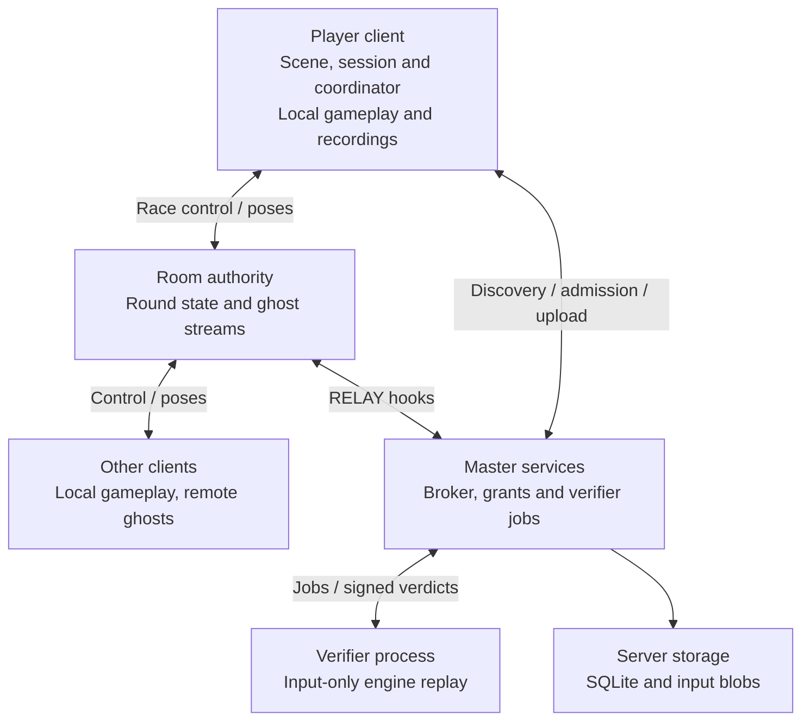

Code ownership is separate from deployment placement:

| Layer | Owners and boundary |
| --- | --- |
| Bundled mod, `racing/time-attack` | Scene/session, gameplay launch, attempt recording, local ghosts, lobby and racing presentation. |
| Shared networking, `src/main/java/com/openggf/net` | Identity, protocol, transports, admission, generic room/round state and ghost aggregation. It does not call gameplay owners or Time Attack code. |
| Operator tools, `racing/server` | Master discovery/trust, server-hosted RELAY rooms, DIRECT tunnels, recording storage, verification queue and workers. |

LAN and DIRECT run the room authority on the player host's machine. RELAY runs
it on the operator's server. Moving DIRECT traffic through a master tunnel does
not change that placement.

The scene and coordinator adopt results on the engine thread. Local room
mutation runs on the JDK room owner; master and RELAY mutation runs on their
broker/room event loops. Connection workers queue results for adoption rather
than touching gameplay directly. Outbound connections use bounded serial writers.

The current bundled Create Room flow requests **unverified rooms with at most
8 players**. The server/protocol also supports verified RELAY rooms and up to
256 RELAY players. Those capabilities are broader than the current creation UI;
DIRECT is capped at 8. Remote poses remain cosmetic in every mode. Because an
unverified room has no independent gameplay authority, it retains finish claims
only for trust accrual and bounded operator spot checks; it does not publish
those claims as shared standings, pages, ranks or round-end results.

## Three nested lifetimes

| Lifetime | States / boundary |
| --- | --- |
| Client session | `IDLE`, `CONNECTING`, `BROWSING`, `LOBBY`, `RACING`. The connection normally survives gameplay runs and round changes. |
| Authoritative room round | `LOBBY`, `COUNTDOWN`, `RUNNING`, `ROUND_END`, `VOTE`. The host clock owns deadlines and round transitions. |
| One local attempt | `ARMED`, `RUNNING`, `FINISHED`, `VOID`. First nonzero gameplay input starts the timed interval; natural act completion finishes it. |

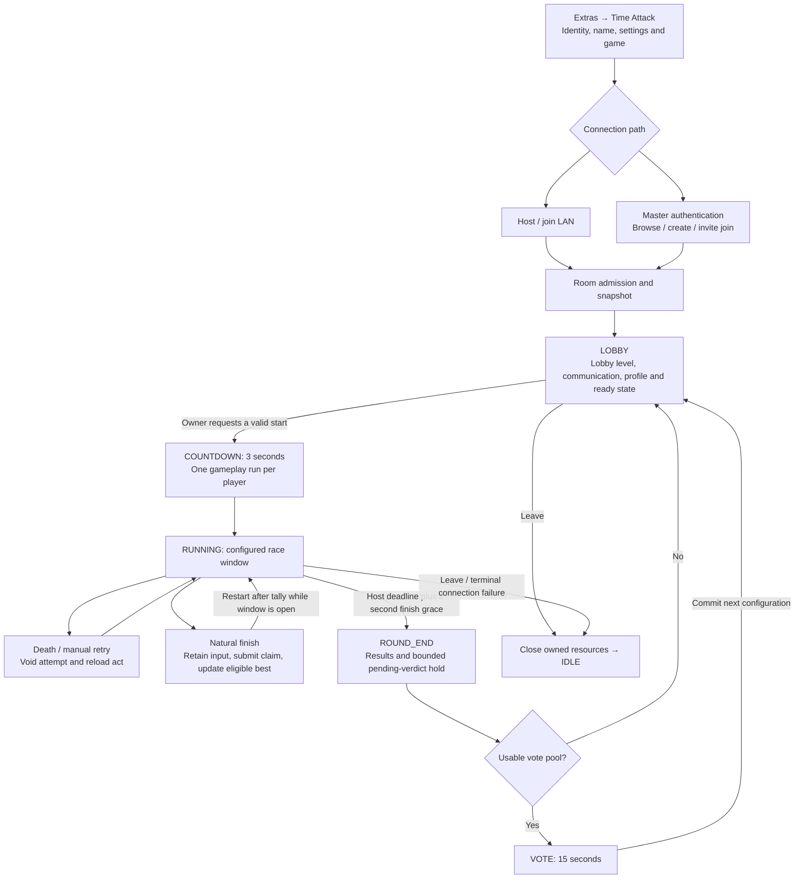

Finishing an act ends one attempt, not the race window. Multiple attempts are
allowed while it remains open. The ready rule is `REQUIRED`, `AUTO`, or
`DEFAULT_BY_SIZE` (required with at most five players; auto-ready with six or
more). No ready rule automatically starts a round.

## Connection and admission integrations

Socket connection, master acceptance, permission to join and actual room
membership are distinct. Room admission checks protocol/build, signed identity,
access/password policy, duplicate identity, profile/state validity and capacity.
A broker grant is not already a player slot.

### LAN and manual hosting

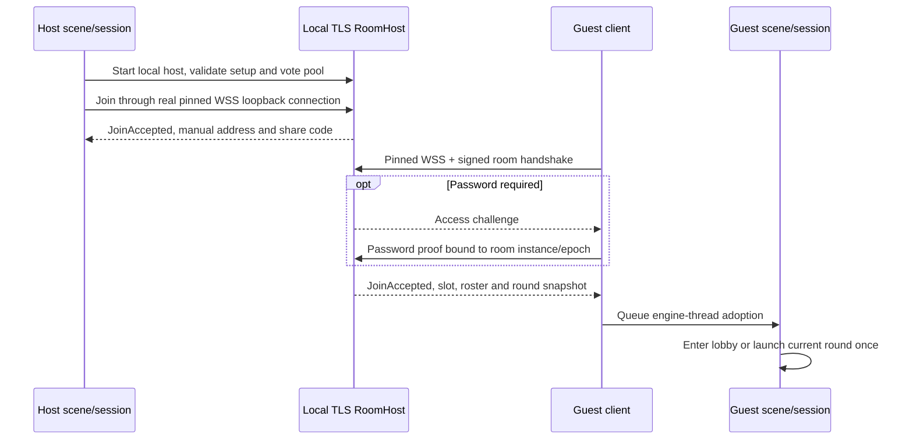

A complete manual invite pins both TLS certificate and host identity. Its
`HOST_IP` placeholder must be replaced with a reachable address. Manual joining
has no master-tunnel fallback. A manual listener does not claim to enforce an
operator's sanctions.

The LAN host can opportunistically register with a configured master. If that
uncertain registration fails, the session retires the listener instance and
creates a fresh manual instance; it does not downgrade the same listener from
broker-required admission to manual admission.

### Master-hosted RELAY

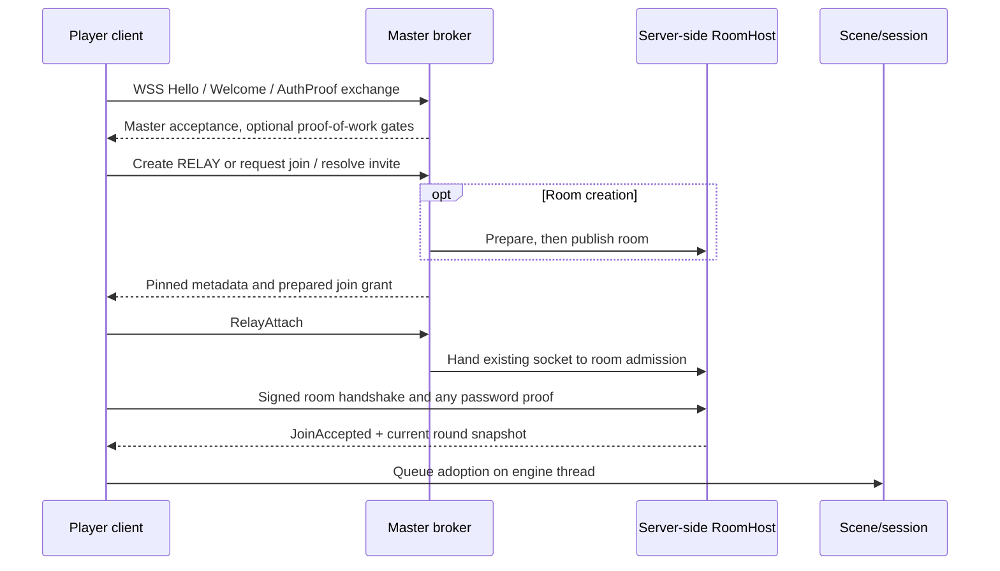

RELAY reuses the master WebSocket as room transport. The operator owns the room
process; the creator's identity remains the round owner.

Master room creation requires `ESTABLISHED` or `TRUSTED`. Verified creation
additionally requires `RELAY`, `TRUSTED` and an available matching verifier.
Verified joining requires `TRUSTED`; joins must match the room's determinism
fingerprint. NEW identities can join unverified rooms below the broker's 80%
occupancy threshold. A visible browser entry alone does not establish eligibility.

### Player-hosted DIRECT and tunnel fallback

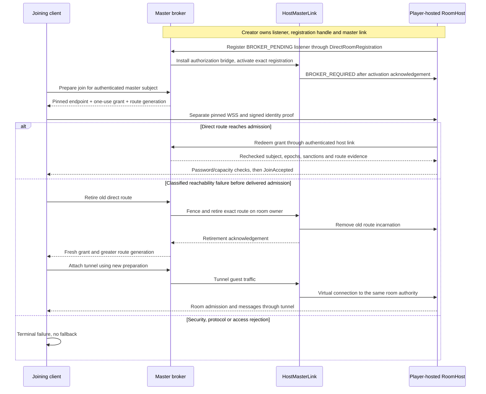

Fallback changes transport, not room authority. It requires a classified
reachability failure and acknowledged retirement of the old route. TLS,
certificate, identity, protocol, password/access and invite failures are terminal;
they do not trigger fallback. Normal DIRECT close also requests release-only
route retirement, and a later preparation waits for that receipt. A failed
retirement remains fenced rather than being treated as successful socket cleanup.

Listener admission is explicit:

| Listener state | New remote admission |
| --- | --- |
| `MANUAL` | Room's pinned identity/TLS/password/capacity policy. |
| `BROKER_PENDING` | Rejected until bridge installation and activation finish. |
| `BROKER_REQUIRED` | Requires authenticated broker evidence as well as room checks. |
| `BROKER_UNAVAILABLE` | Rejected; existing independent direct peers may continue, while tunnel children retire. |

### Private rooms and invites

`PRIVATE` means password required and absent from ordinary discovery. Nonowners
cannot join a private room through the ordinary listed-room lookup. An invite
resolves its pinned metadata; it does not replace password admission.

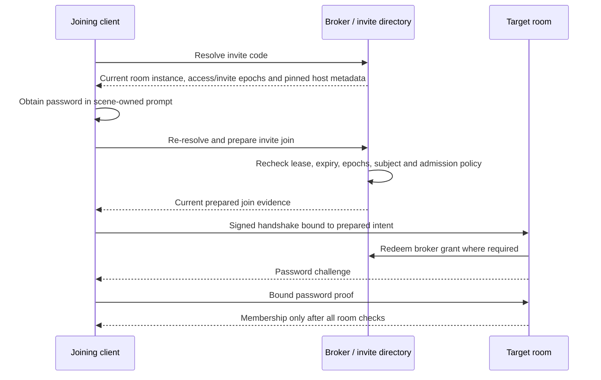

Instance/access/invite epochs prevent a stale invite or access snapshot from
silently becoming authority for a replacement room. Invite expiration is checked
again at join. The master-authenticated identity must also be the room-join
subject. Local manual password joins omit the broker steps.

## Gameplay and live ghost integration

### Host-issued launch

The host freezes a per-participant `ControlMessage.RaceLaunch`, carried in
`RoundStart` or the joining player's `RoundSnapshot`. It binds round ID, plan
revision/configuration, participant/slot/fingerprint, effective character and
deadlines. The client rejects contradictory or mismatched projections.

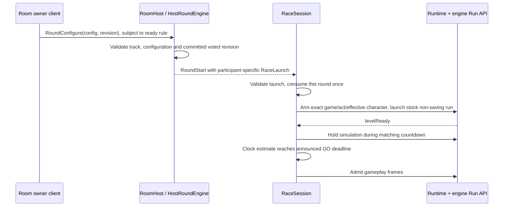

Initial starts still send configuration and revision `0`; voted starts send the
committed configuration and matching revision. Menu preferences are not launch
authority. Unsupported local character/boot fails before `AttemptStart`; the
client does not substitute another character and submit mismatched evidence.

### Frames, finish and retry

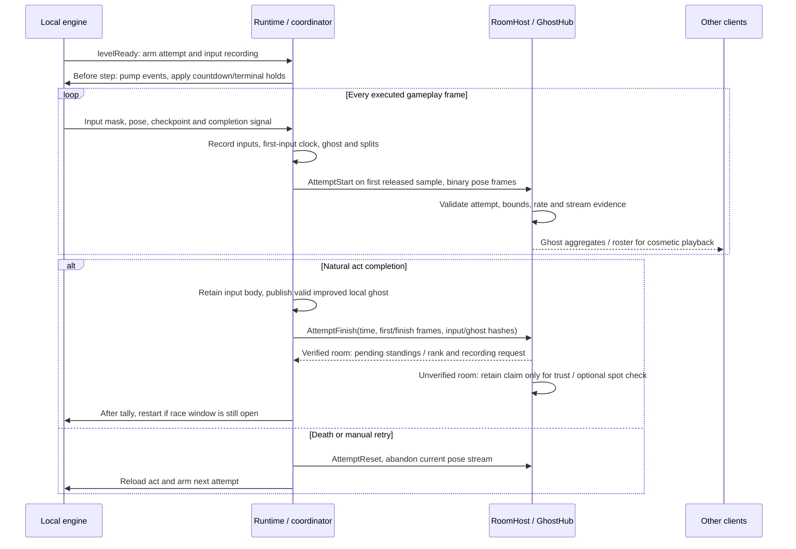

Attempt time is `finishFrame - firstInputFrame`. Spawn idle, reload fade and the
post-death countdown do not add timed input frames. The host accepts an eligible
finish only for the matching active attempt with its streamed finish evidence;
verified standings keep improvements rather than every completed run. Unverified
claims never become peer-visible competitive standings because every field in an
unverified finish remains controlled by its sender.

Input recording and live pose streaming are separate products. Inputs can be
uploaded for replay. Poses are cosmetic presentation data with a stream hash;
they never drive another player's gameplay. Lobby presence uses its own pose
stream between rounds. Communication travels through room control messages,
subject to effective room chat mode and sender limits; local filtering remains
presentation policy. See [communication](../../../racing/README.md#communication).

## Input verification

Verified RELAY rooms request verification for accepted improvements. Unverified
master RELAY rooms can select top-time spot checks when a matching verifier is
available (default top claim, rate-limited per identity), but those claims are not
published as standings. Plain manual LAN has no operator replay verifier and no
shared competitive standings; peers still receive live cosmetic ghosts and
coarse attempt status.

### Verification exchange

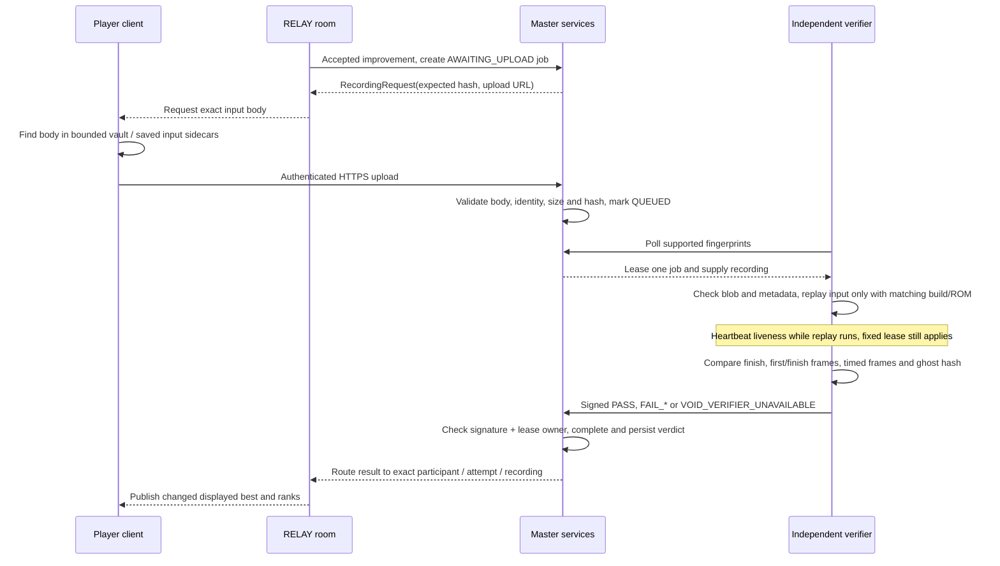

### Verdict outcomes

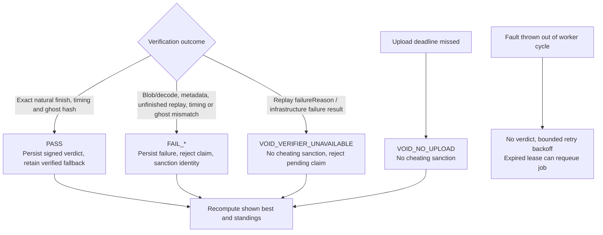

| Outcome | Current consequence |
| --- | --- |
| `PASS` | Keep the fastest verified fallback. Change `PENDING` (`..`) to `VERIFIED` (`*`) if that candidate is displayed; a faster pending candidate can remain shown. PASS itself does not increment trust. |
| `FAIL_DIVERGENT`, `FAIL_TRACK_MISMATCH`, `FAIL_TIME_MISMATCH`, `FAIL_GHOST_HASH` | One accepted signed failure bans that identity on the master, resets clean-round progress and revokes sanctioned master connections. `cheatBanDays: 0` means permanent. A host sanction can remove its owned rooms. |
| `VOID_NO_UPLOAD` | Persist a void without sanction. |
| `VOID_VERIFIER_UNAVAILABLE` | Persist a void without sanction, including a worker's reported infrastructure failure, queue/stall expiry or expiration of an uploaded unresolved claim. |
| Thrown survivable cycle fault | No verdict; loop retries with 2-to-30-second exponential backoff. Worker-scoped `StackOverflowError` and `LinkageError` follow this path. Fatal JVM errors such as `OutOfMemoryError` end the process. |

Replay `failureReason` is currently a non-sanctioning void; an unfinished replay
with no infrastructure failure is divergent evidence. This distinction is owned
by `VerifierWorker.decide`, not inferred from an exception message.

Rejecting a candidate restores another pending candidate or an earlier verified
best; without either, its row disappears. Superseded claims retain their own
pending candidates and job routes. Old/foreign/voided lease verdicts are refused
rather than changing a newer claim. A spot-check verdict is persisted and can
sanction, but does not create or rewrite player-visible standings for the
unverified room.

### Timing boundaries and defaults

| Boundary | Default / owner |
| --- | --- |
| Round countdown / finish-in-transit grace | 3 s / 2 s; `HostRoundEngine`. No new attempt starts after the host deadline. |
| Results linger / vote | 10 s / 15 s; `HostRoundEngine`. |
| Upload deadline | Verified 15 s; spot-check 180 s; `MasterConfig`. |
| Additional pending-results hold | Verified upload window + `verdictGraceMillis` (default 10 s): 25 s extra at default settings. |
| Worker heartbeat / stale threshold | 30 s / default 120 s; heartbeat does not extend the fixed job lease. |
| Job lease | Default 300 s, then requeue; `VerificationJobQueue` / `MasterConfig`. |
| Uploaded stalled-job cap | 1 hour; the room's pending hold can void a claim much sooner. |

## Results and next round

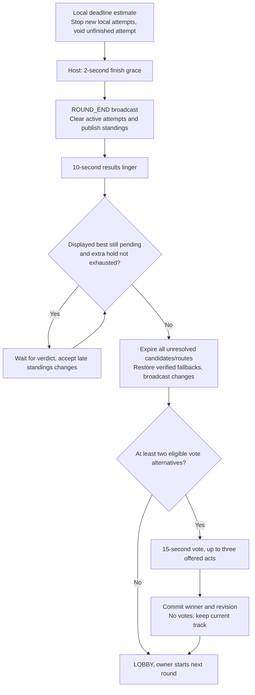

Only a displayed pending best prolongs results; hidden pending candidates still
expire and have their routes accounted for. Equal positive vote totals use offer
order. The voted configuration becomes the next launch plan, not an automatic
start. Without a vote pool, an owner can start directly from `ROUND_END`; that
path expires leftover routes before clearing in the next round.

A local clock estimate alone does not tear down the gameplay run. Unfinished
gameplay leaves on the host closure/new-round signal. A finished attempt can
retain its tally until it exits naturally. `RaceSession.runEnded()` resumes the
connected lobby; ordinary round completion does not close the room connection.

## Leave and failure recovery

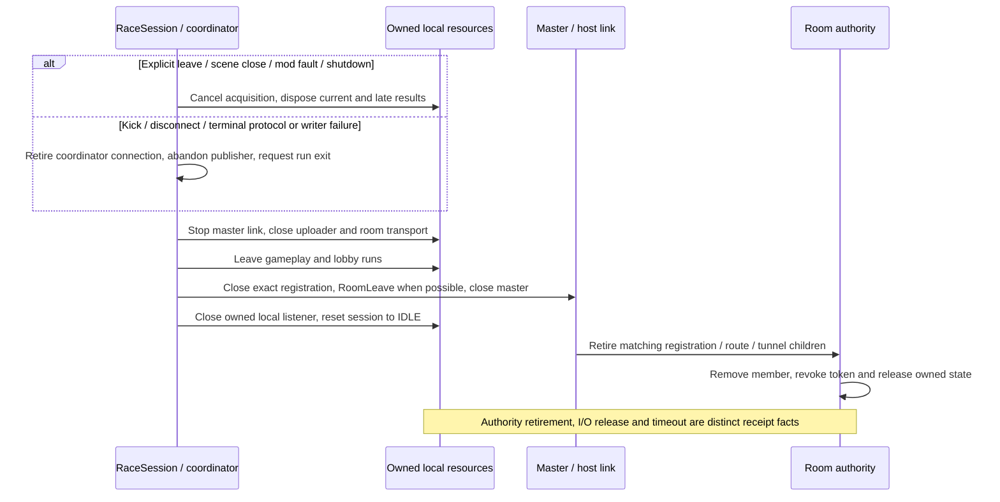

Cancellation and late callbacks are qualified by the current operation,
connection incarnation and generation. Closing an obsolete result cannot
remove a replacement room member or transport. Overflow is terminal for the
affected connection/tunnel; ordered ghost evidence is not silently dropped.

Lobby-level load failure falls back to the menu-only lobby for that room. An
unsupported or failed race launch reports a notice without forging an attempt.
There is no host election or automatic reconnection. Master loss blocks new
broker-required DIRECT admission and retires tunnels; already admitted
independent DIRECT peers can continue. A retirement receipt does not claim I/O
release if its deadline timed out.

## Coverage map and limits

These are test entry points, not a claim that a suite was freshly executed for
this reference. The strongest coverage is protocol/authority/bookkeeping;
gameplay qualification remains narrower than an all-game/act/character matrix.

| Contract | Evidence and scope |
| --- | --- |
| Room and attempt lifecycle | [Verified standings regressions](../../../src/test/java/com/openggf/net/hub/TestHostRoundEngineVerified.java), [multiple-attempt socket integration](../../../racing/server/src/test/java/openggf/racing/e2e/TestMultipleAttemptsEndToEnd.java): pending/verified fallback, superseded claims, expiry and repeated attempts. |
| Broker, private and routed admission | [Private-room broker tests](../../../racing/server/src/test/java/openggf/racing/server/master/TestPrivateRoomBroker.java), [private transport tests](../../../racing/server/src/test/java/openggf/racing/server/master/TestPrivateRoomTransports.java), [fallback integration](../../../racing/server/src/test/java/openggf/racing/e2e/TestRelayFallbackTunnel.java). |
| Verifier decisions and fault handling | [Worker tests](../../../racing/server/src/test/java/openggf/racing/server/verifier/TestVerifierWorker.java), [loop](../../../racing/server/src/test/java/openggf/racing/server/verifier/TestVerifierLoop.java), [shutdown](../../../racing/server/src/test/java/openggf/racing/server/verifier/TestVerifierShutdown.java). Decision tests inject replay results; they do not establish every route's replay correctness. |
| Job and consequence ownership | [Queue tests](../../../racing/server/src/test/java/openggf/racing/server/master/TestVerificationJobQueue.java), [HTTP route tests](../../../racing/server/src/test/java/openggf/racing/server/master/TestMasterHttpRoutes.java), [verdict persistence](../../../racing/server/src/test/java/openggf/racing/server/master/TestVerdictPersistence.java), [relay manager](../../../racing/server/src/test/java/openggf/racing/server/master/TestRelayRoomManager.java). |
| Real engine replay | [Replay harness tests](../../../racing/server/src/test/java/openggf/racing/server/verifier/TestAttemptReplayHarness.java): a 600-frame S3K Sonic segment tests repeatability, changed inputs and fingerprint refusal. Requires a ROM; it does not assert a completed full-route PASS. |
| Verified-room network plumbing | [End-to-end test](../../../racing/server/src/test/java/openggf/racing/e2e/TestVerifiedRoomEndToEnd.java): real upload/lease/signed-verdict/standings flow, with a manually signed PASS rather than an actual replaying worker. |
| Complete replay through deployed services | [Deployment witness](../../../racing/deploy/README.md#deployment-witness) requires natural S1 GHZ1 completion and an independently running worker. The [2026-10-23 qualification](../plans/2026-10-23-racing-docker-deployment.md#validation) records its own source, environment and coverage; it is historical evidence. |

## Source owners

| Concern | Current implementation |
| --- | --- |
| Session acquisition, adoption, launch and teardown | [RaceSession](../../../racing/time-attack/src/main/java/openggf/timeattack/mp/RaceSession.java), [MultiplayerRaceCoordinator](../../../racing/time-attack/src/main/java/openggf/timeattack/mp/MultiplayerRaceCoordinator.java). |
| Local attempt timing and recordings | [TimeAttackRuntime](../../../racing/time-attack/src/main/java/openggf/timeattack/TimeAttackRuntime.java), [TimeAttackAttempt](../../../racing/time-attack/src/main/java/openggf/timeattack/TimeAttackAttempt.java), [AttemptRecordingVault](../../../racing/time-attack/src/main/java/openggf/timeattack/mp/AttemptRecordingVault.java), [RecordingUploader](../../../racing/time-attack/src/main/java/openggf/timeattack/mp/RecordingUploader.java). |
| Admission, round state and live poses | [RoomHost](../../../src/main/java/com/openggf/net/hub/RoomHost.java), [HostRoundEngine](../../../src/main/java/com/openggf/net/hub/HostRoundEngine.java), [GhostHub](../../../src/main/java/com/openggf/net/hub/GhostHub.java), [ControlMessage](../../../src/main/java/com/openggf/net/protocol/ControlMessage.java). |
| Client routing and registered DIRECT lifetime | [MasterClient](../../../src/main/java/com/openggf/net/client/MasterClient.java), [DirectRoomRegistration](../../../src/main/java/com/openggf/net/client/DirectRoomRegistration.java), [HostMasterLink](../../../src/main/java/com/openggf/net/host/HostMasterLink.java). |
| Operator admission, routing and room lifetime | [RoomBroker](../../../racing/server/src/main/java/openggf/racing/server/master/RoomBroker.java), [RelayRoomManager](../../../racing/server/src/main/java/openggf/racing/server/master/RelayRoomManager.java), [GuestTunnelRouter](../../../racing/server/src/main/java/openggf/racing/server/master/GuestTunnelRouter.java). |
| Replay decisions and master consequences | [VerifierWorker](../../../racing/server/src/main/java/openggf/racing/server/verifier/VerifierWorker.java), [AttemptReplayHarness](../../../racing/server/src/main/java/openggf/racing/server/verifier/AttemptReplayHarness.java), [MasterHttpRoutes](../../../racing/server/src/main/java/openggf/racing/server/master/MasterHttpRoutes.java), [VerdictConsequences](../../../racing/server/src/main/java/openggf/racing/server/master/VerdictConsequences.java), [VerdictCodec](../../../src/main/java/com/openggf/net/protocol/VerdictCodec.java). |

The [authority/lifecycle hardening design](../designs/2026-10-26-multiplayer-authority-lifecycle-hardening.md)
explains the ownership decisions. Its pseudocode is design context, not an
additional public `RunLease` API or a replacement for the actual `RaceLaunch`
wire contract.
