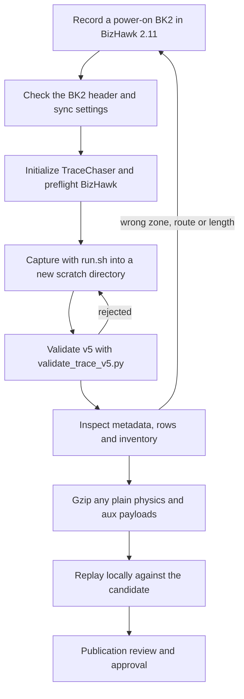

# Making your own traces

A trace records what the original game did on every frame of a BizHawk movie.
OpenGGF replays the same movie and compares its own state against those rows.
This page takes you from a movie you recorded to a trace candidate you can
inspect, replay locally and propose for publication.

Recording is optional. Normal builds do not need TraceChaser or BizHawk.
Existing replay tests use the movies and trace fixtures already in the repository. The commands below come from the pinned
[TraceChaser](../../../tools/tracechaser/docs/native-headless.md) submodule.
When this page and those documents disagree, the submodule wins.



## 1. Record a movie

Record the movie yourself in EmuHawk (the BizHawk GUI). The native harness
reads the BK2's `Header.txt`, `SyncSettings.json` and `Input Log.txt`, and
rejects a movie that breaks the middle four rows below:

| Requirement | Detail |
|---|---|
| BizHawk 2.11 | The capture runtime must be exactly 2.11; preflight rejects 2.11.1 and later. Record the movie with 2.11 too. |
| Genesis Plus GX core | `Header.txt` has `Core Genplus-gx` and `Platform GEN`. |
| Power-on start | `StartsFromSavestate` and `StartsFromSaveRam` are absent or `False`. Use "Record Movie" from power-on, not from a savestate. |
| Pinned controller and region settings | `SyncSettings.json` has `UseSixButton: false`, `ControlTypeLeft: 1`, `ControlTypeRight: 1`, `Region: 0` and `LoadBIOS: false`, among other pinned fields. |
| Both pads in the log | `Input Log.txt` has the `System`, `P1` and `P2` groups, each with its full button set. |
| The verified ROM | Record and capture with the exact dump listed in the root [AGENTS.md](../../../AGENTS.md#rom-and-reference-setup) table. The capture identifies the game from the ROM SHA-1. |

Play from the title screen into the level you want and stop the movie after
the section you care about. Keep the BK2 file name. Complete-run metadata and
run manifests record it as `source_bk2`, and replay looks up a shared movie by
that name.

Check a recorded movie before capturing:

```bash
unzip -p /absolute/path/trace-research/inputs/ghz1-attempt.bk2 Header.txt
unzip -p /absolute/path/trace-research/inputs/ghz1-attempt.bk2 SyncSettings.json
```

The minimal `.bk2` written by `InputLogAuthorTool` has no `SyncSettings.json`,
so the native harness rejects it. Use EmuHawk recordings for traces.

## 2. Set up the capture tools

Native capture runs on Linux x64 under Mono, with no display.

| Prerequisite | Source |
|---|---|
| Python 3 and Mono's `monodis` on `PATH` | [Install BizHawk 2.11](../../../tools/tracechaser/docs/install-bizhawk-2.11.md) |
| Mono 6.12 with `xbuild` and the pinned Roslyn `csc.exe` at `/usr/lib/mono/msbuild/Current/bin/Roslyn/csc.exe` | [Harness requirements](../../../tools/tracechaser/bizhawk-headless/README.md#requirements) |
| Official BizHawk 2.11 Linux x64, preflighted | `fetch_bizhawk_2_11_linux.sh` or `preflight_bizhawk_2_11.sh` |
| Linux `renameat2(RENAME_NOREPLACE)` | Output is published all-or-nothing with it |
| Java 25 and Maven | Only for the replay step ([Dev Setup](dev-setup.md)) |

From the OpenGGF checkout:

```bash
git submodule update --init --recursive tools/tracechaser
tools/tracechaser-bootstrap.sh --check
tools/tracechaser/bizhawk/fetch_bizhawk_2_11_linux.sh
```

The fetch script downloads the locked official archive into the ignored
`tools/tracechaser/.dependencies/BizHawk-2.11-linux-x64`. To use an existing
installation instead, preflight it and export its path:

```bash
tools/tracechaser/bizhawk/preflight_bizhawk_2_11.sh \
  --bizhawk-home /absolute/path/BizHawk-2.11-linux-x64
export BIZHAWK_HOME=/absolute/path/BizHawk-2.11-linux-x64
```

Keep inputs and outputs in a directory outside both repositories. Avoid `/tmp`
for long runs because it may be a small memory filesystem. See
[Scratch and security](../../../tools/tracechaser/docs/scratch-and-security.md).

## 3. Choose a profile

The ROM selects the game. There is no game flag.

| Game | One level | Whole movie |
|---|---|---|
| S1 | Omit `--trace-profile` | `--trace-profile complete_run`, or `--run-id NAME` for a named run with a manifest |
| S2 | `--trace-profile gameplay_unlock` (default). For a later gameplay segment of a multi-segment movie, `--trace-profile level_gated_reset_aware --gameplay-segment N` | `--run-id NAME` |
| S3K | `gameplay_unlock` (default), `aiz_end_to_end` for the AIZ intro through the HCZ handoff, or `level_gated_reset_aware` | `--trace-profile complete_run`, or `--run-id NAME` |

`--run-id` cannot be combined with `--trace-profile` or `--gameplay-segment`.
S1 rejects any profile other than `complete_run`. S3K writes an unrecognised
profile string into metadata but records it with `gameplay_unlock` rules, so
spell the profile exactly. Per-game details are in
[capture-s1](../../../tools/tracechaser/docs/capture-s1.md),
[capture-s2](../../../tools/tracechaser/docs/capture-s2.md) and
[capture-s3k](../../../tools/tracechaser/docs/capture-s3k.md).
Add `--load-queue-state` only when you need per-frame load-queue diagnostics.

## 4. Capture

This example records one Sonic 1 level. Replace the `/absolute/path` paths with your
own absolute paths. `run.sh` requires all four root flags as absolute paths and
refuses an `--output` directory that already exists or sits inside either
repository.

```bash
OPENGGF=/absolute/path/src/OpenGGF
TRACECHASER="$OPENGGF/tools/tracechaser"
WORK=/absolute/path/trace-research
mkdir -p "$WORK/scratch" "$WORK/evidence"
OUT="$WORK/scratch/s1-ghz1-attempt-1"   # must not exist yet

"$TRACECHASER/bizhawk-headless/run.sh" \
  --tracechaser-root "$TRACECHASER" \
  --input-repository-root "$OPENGGF" \
  --fixture-root "$OPENGGF/src/test/resources/traces" \
  --mode trace \
  --rom "$OPENGGF/Sonic The Hedgehog (W) (REV01) [!].gen" \
  --movie "$WORK/inputs/ghz1-attempt.bk2" \
  --output "$OUT"
```

Use whatever file name your verified ROM has. The first run builds the harness
under `tools/tracechaser/bizhawk-headless/bin/`, which Git ignores. A failed
capture leaves no output directory; fix the cause and run again with the same
or a new path.

## 5. Validate and inspect

Validate the whole candidate root. The validator only reads.

```bash
python3 "$TRACECHASER/traces/validate_trace_v5.py" \
  --require-frame-keyed-auxiliary "$OUT"
```

Then look at what you captured:

```bash
find "$OUT" -type f | sort
python3 -m json.tool "$OUT/metadata.json"
zcat -f "$OUT"/physics.csv* | head -3
python3 "$TRACECHASER/traces/trace_fixture_inventory.py" generate "$OUT" \
  --output "$WORK/evidence/s1-ghz1-attempt-1-inventory.json"
```

| Output | Check |
|---|---|
| `metadata.json` | `trace_schema` is `5`, `recorder` is `native-bizhawk-headless`, `recorder_version` is `3.0`. `game`, `zone` and `act` match what you played. `trace_frame_count` fits the route length. `start_x` and `start_y` look like the level start. |
| `physics.csv` or `physics.csv.gz` | Ordinary level rows have 42 columns, or 43 with trailing `life_count`. Special stages have 14 (S1), 48 (S2) or 20 (S3K). |
| `aux_state.jsonl` or `.gz` | Per-frame events. Comparison data only; replay never loads gameplay state from it. |
| `hardware_timing.jsonl` or `.gz` | Present when the recorder emits supported queue timing events. Scheduling outcomes only; see the [timing contract](../../architecture/designs/2026-07-27-cross-game-hardware-timing-trace-contract.md). |
| `run_manifest.json` and segment directories | Named runs, and complete runs with a detour. Segment order matches the movie. |
| Inventory JSON | Stored and logical hashes for every file. Keep it outside the candidate. |

The [trace v5 reference](../../../tools/tracechaser/docs/trace-v5.md) defines
every field.

## 6. Compress payloads for commits

OpenGGF never commits plain `physics*.csv` or `aux_state*.jsonl`. The harness
gzips payloads of 1 MiB or more by default, so a short level can come out
plain. Either capture with `--compress-threshold 0`, or compress each plain
payload deterministically and delete the plain file:

```bash
gzip -9 -n -c "$OUT/physics.csv" > "$OUT/physics.csv.gz" && rm "$OUT/physics.csv"
gzip -9 -n -c "$OUT/aux_state.jsonl" > "$OUT/aux_state.jsonl.gz" && rm "$OUT/aux_state.jsonl"
```

Never leave a plain file beside its `.gz`, because the loader prefers the plain
file. Metadata and manifests stay plain. For timing files, follow the
[compression rules](trace-replay.md#compressing-trace-payloads).
Validate and regenerate the inventory after any compression.

## 7. Replay it, and what that proves

Replay needs a test class that names the trace directory. Follow
[Adding a new trace test](trace-replay.md#adding-a-new-trace-test) to write
one, for example a class returning
`Path.of("src/test/resources/traces/s1/my_route")`.

You can replay the candidate without installing it.
`-Dopenggf.trace.fixtureRoot` maps a path under `src/test/resources/traces` to
the same relative path under another root. Copy the compressed candidate and its
BK2 into that layout, then run your class:

```bash
mkdir -p "$WORK/replay-root/s1"
cp -a "$OUT" "$WORK/replay-root/s1/my_route"
cp "$WORK/inputs/ghz1-attempt.bk2" "$WORK/replay-root/s1/my_route/"

cd "$OPENGGF"
python3 tools/testing/maven_queue.py -Dmse=off \
  -Dopenggf.trace.fixtureRoot="$WORK/replay-root" \
  -Dtest=TestS1MyRouteTraceReplay test
```

`TestS1MyRouteTraceReplay` stands for your own class. The test skips, rather
than fails, when the directory, `metadata.json`, the physics payload or the BK2
is missing, and `@RequiresRom` tests skip without the ROM. Check the surefire
output for a skip before you read the result as a pass. Reports land in
`target/trace-reports/<profile>/<logical-key>-<lane>-<owner-hash>.json`.

Keep these limits in mind:

- A successful capture means the movie ran under the recorder. It is not a
  passing engine test.
- A replay failure is normal for new routes. It reports the first frame and
  field where OpenGGF differs from the ROM. Fix the engine from the
  disassembly, never by editing the trace.
- A green replay covers only that movie's route, character and start. It does
  not certify the level; see the
  [zone and act test standard](level-test-standard.md).
- Comparing the candidate against itself proves nothing. Determinism needs a
  second capture and `compare_trace_v5_candidates.py --mode v5-literal
  --fail-on-difference`.

[Reading divergences](trace-replay.md#reading-divergences) explains the report.

## 8. Propose it for publication

Installing a trace into `src/test/resources/traces` needs maintainer approval
of the exact candidate bytes. Follow
[Trace v5 capture and publication](trace-v5-publication.md) and
[Validate, compare, and publish](../../../tools/tracechaser/docs/validate-compare-publish.md).

Before you ask, have this ready:

- [ ] The BK2 with its original file name, and the ROM name and SHA-1 you used
- [ ] The exact `run.sh` command line and the TraceChaser commit
      (`git -C tools/tracechaser rev-parse HEAD`)
- [ ] A clean `validate_trace_v5.py` result
- [ ] The inventory JSON, written outside the candidate
- [ ] Payloads stored only as deterministic gzip
- [ ] The replay result: first divergence frame and field, or a pass, with any
      skips

Never commit the ROM, savestates or the BizHawk distribution.
