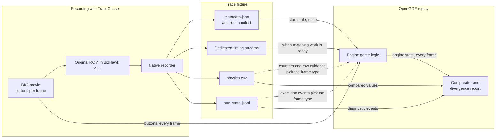
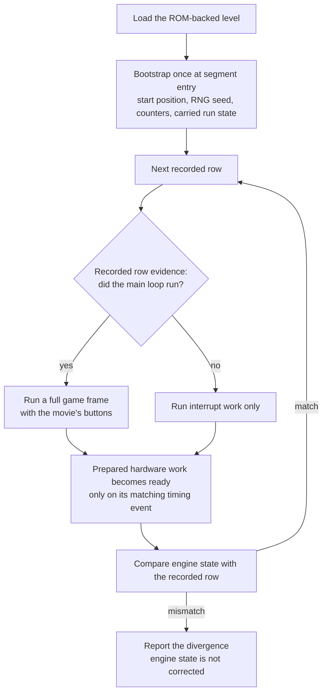

# Trace replay testing

A trace replay test plays a recorded route through OpenGGF and checks, frame by
frame, that the engine reaches the same state the original game reached. It is
the strictest check in the repository for physics, collision, object timing and
spawn timing. By default a one-unit difference in a compared field fails the test
on the frame where it first appears.

> **Workflow skill.** When investigating or fixing a `*TraceReplay` test failure, invoke the
> `trace-replay-bug-fixing` skill
> (`.agents/skills/trace-replay-bug-fixing/SKILL.md`). It codifies the comparison-only
> invariant, the four mission rules, the diagnose-fix-regen-loop workflow, recorder extension
> recipe, and pointers to disassembly and process skills.

| You want to | Go to |
|---|---|
| Run an existing trace test | [Running existing trace tests](#running-existing-trace-tests) |
| Understand a failure report | [Reading divergences](#reading-divergences) |
| Record your first trace | [Making your own traces](making-traces.md) |
| Refresh or publish a fixture | [Recording or refreshing a trace](#recording-or-refreshing-a-trace), then [Trace v5 capture and publication](trace-v5-publication.md) |
| Add a replay test class | [Adding a new trace test](#adding-a-new-trace-test) |
| Know what a pass proves | [Questions and answers](#questions-and-answers) |

## Questions and answers

### What is a trace?

A trace is a recording of the original game running in an emulator. The recorder
plays a BizHawk movie (`.bk2`), which lists the controller buttons for every
frame. On each frame it writes down what the game did: player position and speed,
angle, camera, rings, frame counters, and events such as objects appearing or
being removed. One recorded route is a trace fixture, stored under
`src/test/resources/traces/<game>/`.

### What is TraceChaser?

TraceChaser is the separate repository that records traces. OpenGGF pins it as
the optional submodule `tools/tracechaser`. It holds the native BizHawk 2.11
recorder, the older Lua recorders kept for diagnostics, and the tools that
validate, compare, compress and publish trace files. Builds and ordinary tests
do not need it. To record a trace, see [development setup](dev-setup.md),
[making your own traces](making-traces.md) and the [native headless harness](../../../tools/tracechaser/bizhawk-headless/README.md).

### Why does replay use emulator data beyond button presses?

Buttons alone do not say when the game ran. On a Mega Drive the 68000 CPU
sometimes needs more than one frame for a job such as decompressing art or
building a level. On those frames the game's main loop does not run and only the
vertical-blank interrupt does. These are lag frames. Whether a frame lags depends
on CPU cycles, DMA transfers and other hardware costs.

OpenGGF reimplements the games' logic. It does not simulate the CPU, the video
chip (VDP), beam timing or the system bus, so it cannot compute those costs; see
the [reimplementation boundary](../../architecture/engine-map.md#reimplementation-boundary).
If replay ignored them, the same buttons would land on different game frames and
the run would drift apart even with every game rule correct.

A trace therefore gives the engine three kinds of data beyond buttons:

- **Start state, applied once.** The values the ROM had when the recording
  began, such as position, RNG seed and counters that depend on power-on history.
- **Scheduling.** Which frames lagged, and when hardware-paced work such as a
  decompression queue or a level-load phase finished.
- **Comparison data.** Everything else. The test reads it to judge the engine and
  never writes it into the engine.

[Input versus comparison data](#input-versus-comparison-data) lists each source
and its limits.

### Does depending on that data undermine accuracy?

It limits what a pass proves. It does not hand the engine the answers. Timing
data says *when* something happens: this frame lagged, this queued job is ready
now, this load phase is still running. It never says *what* happens. The engine
still decodes every art and level byte from the ROM, runs every object, resolves
every collision, draws every random number and updates every ring count itself.

Each timing event must also match work the engine already prepared on its own,
by kind, ordinal and a fingerprint of the ROM operation. A missing, extra or
mismatched event fails the replay. The trace cannot create work, pick which work
runs or supply its result.

A passing trace shows that, given the original game's timing on that route, the
engine's game logic produced the same compared values on every compared frame. It
does not show:

- that OpenGGF's own timing in normal play matches the hardware. Normal play has
  no trace and releases hardware-paced work from ROM-derived work budgets. The
  [timing contract](../../architecture/designs/2026-07-27-cross-game-hardware-timing-trace-contract.md#ordinary-play)
  states that a green trace alone is not evidence of live accuracy;
- exact loading time in live play;
- anything about routes, characters, fields or frames the fixture does not cover.

OpenGGF is alpha software. Trace coverage is a set of recorded routes, and many
of them still fail at a known frame. The [trace frontier log](../../status/trace-frontier-log.md)
records dated results.

### What would count as cheating?

Cheating would mean copying recorded values into the engine while the run is in
progress. If the harness reset the player's speed or an object's state to the
recorded value on each frame, every later frame would match and the engine would
be untested. This
is continuous correction, and committed test code never does it. Setting the
start state once at segment entry is allowed, because it plays the role of
loading a save state at the movie's starting point.

## How a replay uses each file



Solid arrows into the engine carry input, start state or timing. The dotted
arrows are the only engine-side use of `physics.csv` and `aux_state.jsonl`. Replay
classifies each row's frame type, such as a full game frame or an interrupt-only
lag frame, and then runs the matching existing engine loop. The classification
mainly reads the frame counters. Some cases also read the recorded game mode, a
recorder execution event such as the Tails CPU hook, or, for S3K rows without a
usable VBlank counter, whether the recorded player state changed. The result is a
choice of loop. No recorded value is written into the engine.

## Input versus comparison data

| Data | Stored in | Role | What it may do | What it may not do |
| --- | --- | --- | --- | --- |
| Controller buttons | `.bk2` movie | Input, every frame | Supply Player 1 buttons, and Player 2 buttons when the log labels them | Not applicable |
| ROM demo input | The ROM's `DemoEndData` table | Input, every frame (Sonic 1 credits demos) | Play the ROM's own demo stream, so no movie is needed | Not applicable |
| Start state | `metadata.json`, run manifest, the segment's entry row | Bootstrap, once at segment entry | Set start position, RNG seed, oscillator pre-advance, frame counters and the `V_int_run_count` base. Import carried rings, emerald progress, used giant rings, shield and path bits | Apply again during the run. Run-chain continuations import nothing |
| Frame-type evidence: `gameplay_frame_counter`, `vblank_counter`, `lag_counter`, game mode and some recorder execution events | `physics.csv`, `aux_state.jsonl.gz` | Scheduling, every row | Choose which existing engine loop runs for the row, such as a full level frame or a VBlank-only lag frame | Write a value into engine state |
| `terminal_admission_runs` (Sonic 1) | Run manifest | Scheduling for the unrecorded movie tail | Select the existing lag loop from alternating lag and non-lag run lengths | Carry gameplay state |
| Hardware completion edges | `hardware_timing.jsonl.gz` | Scheduling | Release a prepared, production-submitted job after its kind, ordinal, fingerprint and service boundary match. Implemented for the Sonic 1 Nemesis PLC arm and the S3K Kosinski queues | Create or choose work, advance a decoder, or perform the consumer's response |
| Initialization phases | Run-root `initialization_timing.jsonl.gz` | Scheduling during level loads | Hold or resume a prepared production load phase, and select an observed zero-routine interrupt service (`VInt_0`), after load ordinal, phase ordinal, phase kind and fingerprint match | Supply clock values, decoder progress or gameplay state, create or select work, or move an interrupt across a clock or RNG read |
| Load queue completions | `initialization_hardware_timing.jsonl.gz` | Scheduling inside one matched load | Release queue work that lies within that load's recorded phase interval, under the same identity checks | The same limits as hardware completion edges |
| Player and camera fields | `physics.csv` | Comparison | Fail the test when the engine differs: position, subpixel, speeds, angle, air and rolling flags, routine, status, rings, camera | Change engine state |
| `input` column | `physics.csv` | Validation | Fail the test when the movie and the recording disagree | Change engine input |
| Aux events | `aux_state.jsonl.gz` | Comparison and diagnostics | Check checkpoint order and fill the divergence context | Change engine state |

The timing rows come from one dedicated input port. It cannot read physics or aux
data, and it never calls a title-card, level-load, ring, object or event API. The
[timing contract](../../architecture/designs/2026-07-27-cross-game-hardware-timing-trace-contract.md)
is the authority for which kinds and fixtures are implemented. Its scope allows
Sonic 2 DPLC readiness, but no Sonic 2 code or fixture uses it, so Sonic 2
replays rely on lag and phase scheduling only.

## The comparison-only invariant

The engine must be able to play a movie and produce ROM-correct behaviour on its
own. Trace replay tests check that. They do not keep the engine in step with the
recording.

- **Movie buttons are the only gameplay input.** The Sonic 1 credits demos use
  the ROM's own demo stream instead. Sidekick AI, oscillator phase,
  object state, audio, RNG and subpixel position evolve inside the engine from the
  starting conditions the ROM had at the first row.
- **Scheduling input is narrow and checked.** Recorded frame counters and related
  row evidence choose the frame type for each row. The dedicated timing streams may release or hold
  only work the engine already prepared, as the table above describes. No
  scheduling input carries a gameplay value.
- **Physics and aux values are read-only.** `physics.csv` and `aux_state.jsonl`
  (or their `.gz` forms) feed the comparator and the divergence report. Their permitted engine-side uses are the one-time bootstrap and frame-type
  classification described above. They never correct engine state during the
  comparison loop.
- **Bootstrap happens once.** Setting start position, RNG seed, oscillator
  pre-advance and frame counters at the first row is equivalent to loading a save
  state at the movie's starting point. The rule forbids writing recorded values
  during the comparison loop.
- **Carried run state enters once, through one mechanism.** A standalone run
  segment starts with the run state the ROM carried in from the previous segment:
  rings, emerald progress, used giant rings, and Player 1's shield and path bits.
  `TraceSegmentCarriedStateImport` resolves these from the run manifest and the
  segment's own recorded entry row and imports them at segment entry.
  Special-stage segments pick their stage from the same state through the ROM's
  `sub_85B0` search. A variable that no recording establishes is reported as
  unresolved instead of guessed. State is never invented mid-run, and run-chain
  continuations never import. See
  [segment carried run state](../../architecture/designs/2026-11-03-segment-carried-run-state.md).



The chart is simplified. The engine has more frame types than full and lag, and
some rows carry no timing event. The point it shows is that recorded values go
into the comparator, and scheduling selects existing engine work without copying its results.

If a trace replay test passes only because engine state is snapped back to
ROM-correct values each frame, the engine has not been verified. The mismatch has
been hidden. An honest test forces an engine fix.

### Diagnostic ghosts

Trace Test and offline capture ghosts are unregistered diagnostic copies. Their
animation advances with admitted rows, even when no picture is drawn. Seeking
restores private presentation checkpoints without rerunning historical animation
against the current tunnel or gravity context. Each seek restores at most two
presentation snapshots containing only local pose/input scalars and animation
trackers; checkpoint storage grows with observed rows and is retired at session,
fixture or level-load replacement. Full player rewind capture/restore is never
used: even an unregistered copy can otherwise remove a live speed-shoes timer
by character code or invoke shared controller callbacks. Row inputs also bypass
gameplay setters, so a diagnostic landing cannot reset the live item-bonus chain.
Failed row preparation rolls back both private poses before publishing history.
No gameplay sprite is restored from these checkpoints.

If a late observer bind, skipped prefix, reload or invalidated forward branch
leaves a requested row without observed history, the ghost stays hidden and a
warning explains the missing context. Replay from the start to establish it.
Layer selection, opacity and repeated pictures do not advance animation.

## Representative trace fixtures

| Game | Test class | Trace directory |
| --- | --- | --- |
| Sonic 1 | `TestS1Ghz1TraceReplay` | `src/test/resources/traces/s1/ghz1_fullrun/` |
| Sonic 1 | `TestS1Mz1TraceReplay` | `src/test/resources/traces/s1/mz1_fullrun/` |
| Sonic 1 | `TestS1Credits00..07*TraceReplay` (×8) | `src/test/resources/traces/s1/credits_*/` |
| Sonic 2 | `TestS2Ehz1TraceReplay` | `src/test/resources/traces/s2/ehz1_fullrun/` |
| Sonic 3&K | `TestS3kAizTraceReplay` | `src/test/resources/traces/s3k/aiz1_to_hcz_fullrun/` |
| Sonic 3&K | `TestS3kCnzTraceReplay` | `src/test/resources/traces/s3k/cnz/` |

This table is a starting set, not an inventory or a passing-status claim. Complete
runs and later-zone fixtures also live under `src/test/resources/traces`; consult the
[trace frontier log](../../status/trace-frontier-log.md) for dated replay evidence.

The Sonic 1 credits demos use the ROM's built-in ending replays as the input source and do not
require BK2 movies (the ROM owns the input stream).

Each trace directory contains:

- `metadata.json` — trace metadata and start state
- `physics.csv` (or `physics.csv.gz`) — per-frame core state
- `aux_state.jsonl` (or `aux_state.jsonl.gz`) — richer diagnostic events
- a `.bk2` movie used to drive the engine replay (except credits-demo traces)

Committed trace payloads are gzip-compressed (`.gz`). The Java parser and the test harness
also read plain files in scratch candidates. See [Compressing trace payloads](#compressing-trace-payloads) below
for the workflow.

Replay phase is derived from recorded ROM counters:

- `gameplay_frame_counter` changes only when the level main loop completed
- `vblank_counter` changes on every VBlank
- `lag_counter` is diagnostic where the ROM exposes it

## When to use it

Use trace replay when:

- a bug is about ROM parity rather than just local correctness
- a fix affects movement, terrain collision, object timing, or hurt/bounce flow
- you need to prove that a change fixed the first real divergence instead of only masking symptoms

Prefer ordinary headless tests for small isolated behaviours. Use trace replay when the interaction
between multiple systems is the thing under test.

## Replay status and details

Recorded BK2 playback and ROM-reference Trace Test replays show a compact status
plate with `Tab: Details`. Press **Tab** to open or close the detailed report;
desyncs, missing sidecars and other verification failures never open it automatically.
The report uses the native 6x8 menu font at 320x224, wraps complete identifiers and
values, and uses **Page Up / Page Down** for longer reports. Each mismatch separates
its frame (`F:44`), field, recorded or ROM value, engine value and delta.

Opening details does not pause, advance or change comparison or playback state.
The existing pause-on-desync option still controls pausing. During fast-forward,
scene rendering resumes only while details are explicitly open, and ordinary
fast-forward rendering suppression returns when they close. Details close when
the recorded replay ends. Missing, unsupported or truncated sidecars report their
availability reason without inventing a gameplay mismatch.

## Running existing trace tests

Trace replay tests require:

- the matching ROM for the game(s) you want to replay, in the repo root or main checkout
  (the queue discovers it by SHA-1) or via system property:
  - Sonic 1: `s1.gen`, World REV01, CRC32 `AFE05EEE` (or `-Dsonic1.rom.path=...`)
  - Sonic 2: `s2.gen`, World REV01, CRC32 `7B905383` (or `-Dsonic2.rom.path=...`)
  - Sonic 3 & Knuckles: `s3k.gen`, World lock-on combined ROM, CRC32 `63522553` (or `-Ds3k.rom.path=...`)
- the fixture's referenced movie to resolve through the
  [diagnosis guide's lookup](testing.md#diagnose-one-trace-replay); ROM-driven
  credits demos do not use a `.bk2`

Select the affected fixtures for the change. A complete trace sweep is a separate,
explicit validation task, not the routine development default. A small cross-game
selection, when shared physics/timing changes require it, is:

```bash
python3 tools/testing/maven_queue.py -Dmse=off \
  -Ptrace-replay \
  '-Dtest=TestS1Ghz1TraceReplay,TestS1Mz1TraceReplay,TestS2Ehz1TraceReplay,TestS3kAizTraceReplay,TestS3kCnzTraceReplay' \
  test
```

Run one trace:

```bash
python3 tools/testing/maven_queue.py -Dmse=off -Ptrace-replay test -Dtest=TestS1Mz1TraceReplay
```

Check the selected test identities, skips and actual replay reports. A successful
Maven invocation with missing ROMs does not establish parity. Use absolute paths
in worktrees and inspect `target/surefire-reports/TEST-*.xml` when attribution is unclear.

**It worked if** the selected classes ran, none were skipped, and Maven passed.
A failure writes the JSON and context reports described below; start from the
first divergent frame in the context file.

Useful optional override while tuning S1 oscillation alignment:

```bash
python3 tools/testing/maven_queue.py -Dmse=off -Ptrace-replay test -Dtest=TestS1Mz1TraceReplay -Dosc.override=0
```

Reports use the owner-keyed physical layout
`target/trace-reports/<profile>/<logical-key>-<lane>-<owner-hash>.json`. A normal
single-level replay, for example, writes
`target/trace-reports/trace/s3k_aiz1-single-<owner-hash>.json`; a divergent run also
writes the same stem with `_context.txt`, and every report has a `.json.owner.json`
ownership sidecar.

The JSON groups divergences by field and frame range. The context file is the fastest way to find
the first non-cascading failure — open it, scroll to the first error, look at the side-by-side
ROM-vs-engine columns.

<details>
<summary>Diagnosing tip: "phantom landing" patterns</summary>

When a sidekick lands on a
surface ROM keeps falling through (engine `tails_y_speed=0x0000` and
`tails_g_speed=<prior_x_speed>` while ROM `tails_y_speed` keeps advancing
by gravity), the fingerprint maps to one of two ROM paths: terrain
`Sonic_HitFloor` or solid-object `SolidObjectTopSloped2` /
`SolidObject_Landed`. Add a `setGSpeed` velocity-probe in
`AbstractPlayableSprite` that prints the call site and check the stack;
if it points into `ObjectSolidContactController`'s contact-resolution path,
the offender is a solid object whose state machine has drifted from ROM
(e.g. AIZ F7127 was the AIZ collapsing platform stuck in
`state==2`/solid-stay forever; ROM's `loc_205DE` at sonic3k.asm:44895-44899
unconditionally promotes to the falling state when its post-fragment
timer underflows, but the engine had been gating that promotion on a
still-standing player). The correct fix touches the object's state
machine, not the collision sensor.

</details>

### Campaign endpoints and segment entry kind

Full S3K campaign certification uses `assertCompleteCampaignReplay`: the manifest
must contain a native recorder-observed `expected_movie_end_mode`, and its final
segment must fit within the actual source BK2. The drive then compares the
remaining movie tail and terminal mode/art; passing preflight alone does not
certify a campaign. The field check cannot authenticate provenance: reviewers
must verify that the value came from the native recorder and matching inputs.
Missing endpoint evidence fails before engine boot. Partial
runs, round trips and prefix/frontier checks retain optional endpoints through
their existing replay helpers. A `complete_run` segment profile or a full-run
filename does not supply an endpoint observation. The three S3K
campaign manifests (Knuckles Super Emerald, Tails full chain, Sonic+Tails complete
emeralds) carry the native observation `title_screen`, captured by TraceChaser
from the final input frame; see the
[five-manifest audit](../../architecture/audits/2026-10-29-s3k-campaign-terminal-certification.md)
for the history. Do not fill missing observations by hand.

Segment entry kind comes only from the recorder's `level_entry_placement_source`
(`start_table`, `starpost_restore`, `special_stage_restore`): the placement branch
the ROM took when that segment's load began (S3K `loc_1BE46` /
`Load_Starpost_Settings`, S2 `LevelSizeLoad`). `TraceReplayBootstrap` maps it in
`recordedEntryPlacementProvenance`: an S3K start-table segment boots as a fresh
post-spawn body (ROM camera derivation including the Tails-alone +4), an S3K
restore as a post-spawn return (zone intros skipped, as `SpawnLevelMainSprites`
does), and an S2/KiS2 start-table segment with a native title-card prelude as a
native load. S2 restores and fixtures without the field keep the unclassified
setup. Coordinates, manifest topology and run names never select the entry kind.
The same observation records `last_star_post_hit`, the raw star-post byte the load
read (bit 7 retained on special-stage returns). Replay does not read it yet; it is
the ROM-observed index for importing carried segment state.

## Rendering An Existing Trace Segment

`TraceCaptureTool` renders a supported existing fixture through its maintained
replay bootstrap; it does not record native evidence or certify parity.

```bash
python3 tools/testing/maven_queue.py -Dmse=off exec:java \
  "-Dexec.mainClass=com.openggf.tools.TraceCaptureTool" \
  "-Dexec.args=--trace <segment-dir> --clip frames:0:40 --out-dir <outside-repo-dir>"
```

An individual segment under a validated `run_manifest.json` may resolve that
run's declared movie. Game/run/source identity, segment membership, offset,
count and profile must match; unsafe source paths are rejected. Shared movie
placement retains priority over the local run movie. This is single-segment
capture with the existing bootstrap, not continuous joined-run capture.
See the [trace-capture skill](../../../.agents/skills/trace-capture/SKILL.md)
for graphics prerequisites, clipping, output and observation limits.

## Recording Or Refreshing A Trace

The native BizHawk headless harness is the canonical recorder for all three
games and all production profiles. Every output uses one strict contract:
`trace_schema: 5`. Ordinary level rows have 42 columns, or 43 when the recording
carries the trailing `life_count` column; game/profile selects
the dedicated S1/S2/S3K special-stage width. A v5 timing file has one grammar,
and every run manifest includes `dynamic_art_gap_transitions`, even when empty.

Metadata uses `recorder` to identify the producer and `recorder_version` to
identify that implementation. They are opaque provenance and never select
parsing or replay. `lua_script_version`, `csv_version`, `ss_csv_version`,
`hardware_timing_schema`, and `run_schema` are removed rather than renamed.

See [Trace v5 capture and publication](trace-v5-publication.md) for the capture
matrix, validator, comparator, candidate-root replay, raw-host evidence, and
exact-byte approval workflow.

Prerequisites:

- BizHawk 2.11 installed at `tools/tracechaser/.dependencies/BizHawk-2.11-linux-x64`, or set `BIZHAWK_HOME`
- the matching game ROM for the recorder you are using
- a BK2 movie for BK2-owned profiles; credits demos use ROM-owned input
- initialize the pinned submodule with `git submodule update --init --recursive tools/tracechaser`
  and check it with `tools/tracechaser-bootstrap.sh --check`

Example, run from the OpenGGF checkout root. Set the three paths first; `OUT`
must not exist yet and must be outside both repositories:

```bash
S3K_ROM=/absolute/path/to/s3k.gen
MOVIE=/absolute/path/to/movie.bk2
OUT=/absolute/scratch/candidate

tools/tracechaser/bizhawk-headless/run.sh \
  --tracechaser-root "$PWD/tools/tracechaser" \
  --input-repository-root "$PWD" \
  --fixture-root "$PWD/src/test/resources/traces" --mode trace \
  --rom "$S3K_ROM" --movie "$MOVIE" \
  --output "$OUT" --trace-profile aiz_end_to_end
```

Capture only to a new scratch root. Never copy candidate bytes into
`src/test/resources/traces` until the complete candidate is validated,
compared, frozen, and explicitly approved.

Sanity-check `metadata.json` before trusting the trace:

- `game` should be `s1`, `s2`, or `s3k` to match the recorder
- `zone` and `act` should match the intended recording
- `trace_frame_count` should be in the expected range for that route
- `start_x` and `start_y` should look plausible for the level start
- `trace_schema` must be integer `5`
- `recorder` must be `native-bizhawk-headless` for publication and
  `recorder_version` must be `3.0`; neither controls replay
- `bizhawk_version` should be `2.11`
- `genesis_core` should be `Genplus-gx`

Sonic 2 level-select traces use the `level_gated_reset_aware` profile. The profile discards the
shared setup section when debug mode exits EHZ back to the menu, then starts the persisted trace at
the selected gameplay route. For these traces, `zone_id` is the engine progression id used by the
Java replay/catalog code, `rom_zone_id` is the raw Sonic 2 ROM zone id, and `act` remains 1-based in
metadata. Frame `0` must include either `zone_act_state` or a `gameplay_start` checkpoint with
`game_mode: 12` so the fixture cannot accidentally begin in the menu. The generator script
normalizes the fixture input column from the BK2 log, then validates that metadata, BK2 input
alignment, frame-zero marker, and gzip-only payload storage before copying fixtures into
`src/test/resources/traces/s2/<route>/`.

The Sonic 2 DEZ ending movie is catalog/parser-only until replay support for the ending sequence is
proven; keep it out of replay test discovery unless that support is added deliberately.

Any absent or non-5 schema and every removed version key is rejected. There is
no legacy reader or compatibility warning path.

S3K traces additionally include `aux_schema_extras` listing opt-in per-frame event types — see
[Aux event types](#aux-event-types) below.

Interpret the execution counters the same way across games:

- `gameplay_frame_counter` advances only when the level main loop completed
- `vblank_counter` advances on every VBlank
- `lag_counter` is meaningful only for Sonic 3&K; Sonic 1 and Sonic 2 record `0`

## Aux event types

`aux_state.jsonl` contains a stream of one-JSON-object-per-line events. Standard events are
present in every game's trace:

- `zone_act_state` — emitted on zone/act/apparent-act/game-mode change
- `checkpoint` — semantic milestones (e.g. `gameplay_start`, `aiz2_reload_resume`)
- `state_snapshot` — periodic pose/state captures
- `mode_change` — Sonic/Tails routine transitions
- `slot_dump` — periodic OST dumps
- `object_appeared` / `object_near` / `object_removed` — object-window tracking

S3K traces opt in to additional per-frame diagnostic events declared in `aux_schema_extras`.
Current capabilities are semantic names advertised in `aux_schema_extras`:

| Aux key | Event type | Purpose |
| --- | --- | --- |
| `cpu_state_per_frame` | `cpu_state` | Sidekick CPU routine + flight timer + cached `Tails_CPU_interact` per frame |
| `oscillation_state_per_frame` | `oscillation_state` | ROM oscillator counters per frame |
| `object_state_per_frame` | `object_state` | Per-slot OST first 32 bytes for nearby objects |
| `interact_state_per_frame` | `interact_state` | Per-player `status` / `status_secondary` / `object_control` bytes |
| `cage_state_per_frame` | `cage_state` | CNZ wire-cage status + per-player phase/state bytes |
| `cage_execution_per_frame` | `cage_execution` | M68K execution-hook hits inside CNZ cage routines (BizHawk Lua `event.onmemoryexecute`) |
| `velocity_write_per_frame` | `velocity_write` | Per-frame writer-PC trace for Tails `x_vel` / `y_vel` (BizHawk Lua `event.onmemorywrite`, frame-window-gated) |
| `position_write_per_frame` | `position_write` | Per-frame writer-PC trace for Tails `x_pos` / `y_pos` with the captured `(a1)`/`(a0)` registers (v6.11-s3k recorder; BizHawk Lua `event.onmemorywrite`, frame-window-gated). Used to disambiguate Player_1 vs Player_2 targeting in routines like `SolidObjectFull2_1P` that loop both players |
| `solid_object_cont_entry_per_frame` | `solid_object_cont_entry` | Per-frame snapshot of `(a0)`/`(a1)`/d1/d2 plus `y_radius`/`default_y_radius` and pixel x/y on entry to `SolidObject_cont` (sonic3k.asm:41439 / ROM 0x1DF90; v6.11-s3k recorder; BizHawk Lua `event.onmemoryexecute`, frame-window-gated). Used to reconstruct the `loc_1DFD6+`/`loc_1E154` push-up branch d3/d4 conditional after the fact |

All event types are **diagnostic only** — they feed the divergence comparator and the
divergence report's context window. They are never written into engine state by the test
harness in committed code (see [Comparison-Only Invariant](#the-comparison-only-invariant)).

Adding a new event type:

1. Native recorder: emit a JSONL line with a new `event` field, add the semantic
   opt-in key to `aux_schema_extras`, and add behavioral/unit coverage. Lua may
   mirror it for scratch diagnostics but is not publication authority.
2. Java parser: add a new sealed-record subtype to
   [`TraceEvent.java`](../../../src/main/java/com/openggf/trace/TraceEvent.java); parse it
   in `parseJsonLine`; add `TraceMetadata.hasPerFrame<Feature>()` + a typed accessor on
   `TraceData`. Keep v5 strict: absent optional capability means absent events,
   not a legacy compatibility branch.
3. Wire the data into `DivergenceReport.getContextWindow` rendering or a probe class.
4. Regenerate the affected trace(s). Commit the regen as a separate logical change from the
   recorder schema bump.

## Compressing trace payloads

Dedicated `hardware_timing.jsonl` streams also load transparently from `.gz`.
S3K complete runs may additionally carry run-root `initialization_timing.jsonl`
(or `.gz`). Its `raw_frame` uses absolute zero-based BK2 rows, including loading
gaps, rather than segment-local physics rows. It may hold/resume only a matching
prepared production load phase and select zero-routine interrupt service; it
accepts no clock values, gameplay state or decoder progress. Missing, reordered
or mismatched observations fail once a represented phase starts. Exact live-play
load duration remains outside this replay input's scope. See the
[dedicated timing contract](../../architecture/designs/2026-07-27-cross-game-hardware-timing-trace-contract.md#2026-11-03-approved-extension-synchronous-initialization-phases).
Loads outside structural segments can additionally carry
`initialization_hardware_timing.jsonl.gz`, containing actual matching queue
completion observations for that load. The producer publishes both initialization
companions compressed; do not reconstruct timing input from interstitial
`bk2_frame` provenance or recompress candidate payloads by hand.
Use `gzip -9 -n hardware_timing.jsonl` when publishing new timing payloads;
the native compression threshold and the helper below apply to physics and
auxiliary payloads. Do not leave a plain timing sibling beside its gzip: the
loader follows the existing trace-file policy and prefers the plain file.
Compression changes storage only; strict v5 event and timing authority checks
still apply to the decoded stream.

Commit `aux_state.jsonl` and `physics.csv` payloads only in gzip-compressed form. The Java parser
([`TraceData.load`](../../../src/main/java/com/openggf/trace/TraceData.java)) loads either form
transparently. If a scratch producer emitted plain payloads, compress them before
freezing the publication candidate:

```powershell
powershell -File tools/tracechaser/traces/compress-traces.ps1 -Path /absolute/scratch/candidate -Recurse -ThresholdBytes 0
```

The script:

- Walks `aux_state*.jsonl` and `physics*.csv` files.
- Skips files below 1 MB (override with `-ThresholdBytes <bytes>`).
- Compresses to `<file>.gz`, verifies the round-trip via SHA-256, and removes the uncompressed
  source unless `-KeepOriginal` is set.

Complete [candidate validation and exact-byte publication](trace-v5-publication.md)
before installing the frozen compressed files. Compression is part of that candidate;
do not recompress approved bytes while installing them.

## Recording The S3K End-To-End Fixture

Use the native `aiz_end_to_end` profile to refresh the AIZ intro through HCZ handoff.
The profile records semantic `checkpoint` and `zone_act_state` events; metadata owns
the actual `bk2_frame_offset`, so do not assume recording begins at movie frame zero.

From the OpenGGF root, with `S3K_ROM_PATH` pointing to the verified locked-on ROM:

```bash
tools/tracechaser/bizhawk-headless/run.sh \
  --tracechaser-root "$PWD/tools/tracechaser" \
  --input-repository-root "$PWD" \
  --fixture-root "$PWD/src/test/resources/traces" \
  --mode trace --rom "$S3K_ROM_PATH" \
  --movie "$PWD/src/test/resources/traces/s3k/aiz1_to_hcz_fullrun/s3k-aiz1-aiz2-sonictails.bk2" \
  --trace-profile aiz_end_to_end --output /absolute/scratch/aiz-v5-candidate
```

The output directory must not exist. Apply the native gates and validator/comparator
from [Trace v5 capture and publication](trace-v5-publication.md), including required
checkpoint order and candidate-root replay, before approving and installing a fixture.

## Recording Sonic 1 Credits Demo Traces

The native harness captures all eight ROM-owned ending demos without a BK2. It
enters the ROM's credits flow, then clears external input; the ROM chooses the demos
and controls the replay input. From the OpenGGF root:

```bash
tools/tracechaser/bizhawk-headless/run.sh \
  --tracechaser-root "$PWD/tools/tracechaser" \
  --input-repository-root "$PWD" \
  --fixture-root "$PWD/src/test/resources/traces" \
  --mode trace --rom "$S1_ROM_PATH" \
  --trace-profile credits_demo --credits-target all \
  --output /absolute/scratch/credits-v5-candidate
```

`--credits-target` also accepts `0` through `7` for diagnostics. Publication uses all
eight fixtures atomically in a new external candidate root. This profile rejects
`--movie`, run/segment selectors and compression overrides, and forces compression.
Follow [Trace v5 capture and publication](trace-v5-publication.md) for raw-host
evidence and exact-byte publication. The removed `record_s1_credits_traces.bat`
launcher is not a supported capture path.

The demo indices are `0` GHZ1, `1` MZ2, `2` SYZ3, `3` LZ3, `4` SLZ3, `5` SBZ1,
`6` SBZ2, and `7` GHZ1 again. Credits metadata includes `trace_type: credits_demo`,
`input_source: rom_ending_demo`, `credits_demo_index`, `credits_demo_slug`, and
`emu_frame_start`, alongside the current v5 contract.

## Adding a new trace test

1. Create a new directory under `src/test/resources/traces/<game>/<name>/` (e.g.
   `src/test/resources/traces/s3k/mgz/`).
2. Record to a new external candidate (see [Recording Or Refreshing A Trace](#recording-or-refreshing-a-trace)).
   Validate, compare and approve the exact candidate using [the publication workflow](trace-v5-publication.md)
   before installing `metadata.json`, compressed payloads, required timing data and
   the `.bk2` movie into the target directory.
3. Add a test class under `src/test/java/com/openggf/tests/trace/<game>/` extending
   `AbstractTraceReplayTest`.
4. Return the correct engine zone index, act index, and trace directory path.
5. Run the new test once and inspect `target/trace-reports/trace/` before treating the
   baseline as valid.

Minimal example (S3K):

```java
@RequiresRom(SonicGame.SONIC_3K)
public class TestS3kMgzTraceReplay extends AbstractTraceReplayTest {
    @Override
    protected SonicGame game() { return SonicGame.SONIC_3K; }

    @Override
    protected int zone() { return 2; }   // engine zone index, not raw ROM v_zone

    @Override
    protected int act() { return 0; }

    @Override
    protected Path traceDirectory() {
        return Path.of("src/test/resources/traces/s3k/mgz");
    }
}
```

Important: the test's `zone()` is the engine's zone index, not necessarily the raw ROM `v_zone`
value. [`TestS1Mz1TraceReplay.java`](../../../src/test/java/com/openggf/tests/trace/s1/TestS1Mz1TraceReplay.java)
shows the Marble Zone mapping nuance.

## Reading divergences

Focus on the first non-cascading error. Everything after that may be fallout.

The main sources are:

- `physics.csv` (or `.csv.gz`)
  Core compared fields: position (x/y), velocities (x_speed/y_speed/g_speed), angle, air/rolling
  flags, ground mode, status byte. For S2 / S3K, also Tails columns.
- `aux_state.jsonl` (or `.jsonl.gz`)
  Event stream — see [Aux event types](#aux-event-types) for the full taxonomy.
- `target/trace-reports/<profile>/<logical-key>-<lane>-<owner-hash>_context.txt`
  Side-by-side ROM and engine diagnostic context generated by `AbstractTraceReplayTest`.

The current recorder/test pipeline also carries diagnostic-only fields that do not fail the test by
themselves, but greatly narrow investigation:

- subpixel position
- routine (Sonic / Tails CPU)
- camera position
- ring count
- status byte (and per-game `status_secondary` / `object_control`)
- gameplay frame counter
- VBlank counter
- lag counter
- ridden object slot / latched solid object
- ObjPosLoad cursor state
- (S3K only) Tails CPU flight timer, oscillation phase, spring/cage execution path

Typical debugging pattern:

1. Open the first error in the context file.
2. Check whether the first mismatch is terrain, object contact, hurt/bounce, or spawn timing.
3. Cross-reference the same frame in the aux event stream (use `TraceData.getEventsForFrame(K)` or
   open the JSONL/JSONL.gz directly with `gzip -d -c | grep '"frame":K'`).
4. Trace the divergence **backward** to the earliest divergent frame — that's the real bug, not
   necessarily the first-error frame.
5. If the divergence involves object control, participant selection, or object lifetime, map it
   to `ObjectControlState`, `ObjectPlayerQuery` / `ObjectPlayerParticipationPolicy`, or
   `ObjectLifetimeOps` before adding local trace-specific logic.
6. Only after the first error is understood should you trust later divergences.

The `trace-replay-bug-fixing` skill contains a full diagnose-fix-regen-loop workflow with
ROM-citation requirements and per-game parity rules.

## Common pitfalls

- Missing `.bk2` file: the test will skip even if `metadata.json` and `physics.csv` exist.
- Wrong zone index in the test class: the metadata may be correct while the engine loads the
  wrong level.
- Regenerating only `physics.csv` but not `aux_state.jsonl` or `metadata.json`: diagnostics
  become misleading.
- Treating warning-only 1px drift as the root cause when a later object timing error is the
  real break.
- Updating the trace baseline before understanding whether a behaviour change is a real fix or
  a regression.
- **Committing uncompressed large traces.** GitHub will reject any push containing files
  >100 MB. Always run `tools/tracechaser/traces/compress-traces.ps1` after regenerating a large trace.
- **Adding per-frame trace-driven hydration to the test harness.** Setting engine state from
  recorded values mid-replay violates the comparison-only invariant and masks engine bugs. If
  you find yourself wanting to "preserve" or "set" engine fields each frame from the trace,
  the engine probably has a real bug — fix it instead.
- **Fixing object trace failures with one-off local control/lifetime logic.** Prefer
  `ObjectControlState` for native object-control bits, `ObjectPlayerQuery` plus
  `ObjectPlayerParticipationPolicy` for player/sidekick participation, and
  `ObjectLifetimeOps` for destruction, respawn-latch, offscreen-expiry, and slot-transfer
  semantics. If the current engine path still needs a `level.objects` compatibility wrapper,
  use that wrapper and keep the trace fix behavior-neutral outside the diagnosed divergence.
- **Growing guard baselines to land a trace fix.** Baselines are for known legacy violations
  and should ratchet downward as object/boss/badnik code migrates. A new trace fix should not
  add raw focused-player access, first-sidekick access, object-control setters, or direct
  lifecycle mutation unless the native-only reason is documented and covered by the guard.
- **Branching on game id in shared physics/AI code.** Per-game divergences must be gated via
  the narrowest typed `GameRules` rule or an existing provider/profile/registry/object owner,
  never `if (gameId == GameId.S3K)`. When ROM uses a different semantic on a value that
  exists across games (e.g. `cmp.w y_pos(a0),d0` in `Player_LevelBound` reads centre-Y while
  the engine's `getY()` returns top-left), prefer adding a focused rule with explicit
  cross-game values over flipping an unrelated global default in the same change. See
  `PlayerMovementRules.levelBoundaryUsesCentreY` for the canonical example. Another example
  is `ObjectInteractionRules.solidObjectTopBranchAlwaysLiftsOnUpwardVelocity`, which enables
  ROM `loc_1E154` (sonic3k.asm:41646-41672) writing the top-branch position lift before the
  `tst.w y_vel(a1) / bmi.s loc_1E198` test only on S3K; S1 `Solid_Landed`
  (s1disasm/_incObj/sub SolidObject.asm:278) and S2 `SolidObject_Landed` (s2.asm:35589-35590)
  bail on upward y_vel BEFORE any lift, so the rule stays false there.
- **Verify edits against actual file bytes.** Do not assume a file has a BOM or
  CRLF from historical notes. Check its present encoding/line endings when an
  edit fails, then inspect the resulting diff; tool success alone is not proof
  that the intended source changed.
- **Misreading aux trace `cpu_state` event field semantics.** S3K's `cpu_state` event
  reports `cpu_routine` as the raw `Tails_CPU_routine` byte — `0x06` is the NORMAL
  ground-following AI (`loc_13D4A`, sonic3k.asm:26696), NOT a "FLY" routine. Similarly,
  `flight_timer` is `sub_13EFC`'s `Status_OnObj` watchdog used by NORMAL routine
  (sonic3k.asm:26856-26887), not an active-flight indicator; it ticks any time Tails is
  riding the same `Tails_CPU_interact` slot, regardless of whether Tails is flying. And
  `target_x` / `target_y` are leader-history positions (the CPU's follow target), not
  Tails's own position — for Tails's actual coordinates, use the
  `object_state` event for slot 1 in the same frame. Always cross-reference
  `Tails_CPU_Control_Index` (sonic3k.asm:26408-26426) when interpreting `cpu_routine`
  values, and do not infer "Tails is flying" from a non-zero `flight_timer` alone.

## Related files

Test harness:

- [`AbstractTraceReplayTest.java`](../../../src/test/java/com/openggf/tests/trace/AbstractTraceReplayTest.java)

Parser (production code, used by tests + diagnostics):

- [`TraceData.java`](../../../src/main/java/com/openggf/trace/TraceData.java)
- [`TraceMetadata.java`](../../../src/main/java/com/openggf/trace/TraceMetadata.java)
- [`TraceFrame.java`](../../../src/main/java/com/openggf/trace/TraceFrame.java)
- [`TraceEvent.java`](../../../src/main/java/com/openggf/trace/TraceEvent.java)
- [`TraceBinder.java`](../../../src/main/java/com/openggf/trace/TraceBinder.java)
- [`DivergenceReport.java`](../../../src/main/java/com/openggf/trace/DivergenceReport.java)

Current recorder:

- [`Native headless harness`](../../../tools/tracechaser/bizhawk-headless/README.md)
- [Trace v5 capture and publication](trace-v5-publication.md)

Historical Lua and stable-retro implementations are described in the
[framework reference](trace-framework-reference.md); they are not publication paths.

Trace payload tooling:

- [`compress-traces.ps1`](../../../tools/tracechaser/traces/compress-traces.ps1)

Skills:

- [`trace-replay-bug-fixing`](../../../.agents/skills/trace-replay-bug-fixing/SKILL.md) — the
  canonical workflow for any `*TraceReplay` test failure.
- [`s1-trace-replay`](../../../.agents/skills/s1-trace-replay/) — Sonic 1 replay
  specifics.
- **`bizhawk-headless-trace`** — canonical native capture and publication,
  including S1 credits demos; the maintained protocol is
  [`tools/tracechaser/bizhawk-headless/README.md`](../../../tools/tracechaser/bizhawk-headless/README.md).

## Next steps

- [Testing](testing.md)
- [Tutorial: Implement an Object](tutorial-implement-object.md)
- [Tooling](../cross-referencing/tooling.md)

## Diagnostic note: validating hypotheses against the recorded JSONL

When a trace replay test fails and the failure has been attributed to a
specific in-game object (e.g. "napalm projectile ride-bridge release"
in S3K AIZ F7552), always verify the hypothesis by inspecting the
recorded JSONL aux state directly before writing engine code. The
trace files live at
`src/test/resources/traces/<game>/<run>/aux_state.jsonl.gz`. Search
for the relevant per-frame events (`sidekick_interact_object`,
`object_state` with the suspect object code, `aiz_transition_floor_solid`,
etc.) across the suspect frame window and confirm the prerequisite
state matches the hypothesis.

For the AIZ F7552 case (round 2) this check disproved the prior-round
ride-bridge hypothesis: the suspected `interact` slot was
`destroyed=true` for ~50 frames before the divergent frame, ruling out
any `Solid_Object_Detach`-style release as the cause. Skipping this
check would have produced an engine fix targeted at the wrong root
cause — a hack by the repo policy in `AGENTS.md`. Documented in
`docs/status/s3k-known-bugs.md` under the AIZ F7552 entry.

For the AIZ F8927 case (round 1, diagnosis-only) the same check
disproved a "swing/vine peak handling" guess that fell out of the
prior round's F7660 fix: at F8927 Sonic's `status=0x06` (Air|Roll)
with `obj_control=0x00` and `interact_slot=9` pointing to a static
sprite (`object_code=0x0002BF5A`) that has not moved since F7252, so
no swing or carry object is active. The actual signature in the
recorded data is a 5-frame `0/0x18/0x30/0x48/0x60/0` cycle on
`x_speed` with a sub-x snap pushback once per cycle — the canonical
ROM "rolling-air sliding into a flush right-side wall" pattern from
`SonicKnux_DoLevelCollision`'s `CheckRightWallDist` arm
(`sonic3k.asm:24101-24105`). This narrowed the next-round
investigation to the engine's airborne right-wall probe vs the
player path's fixed `addi.w #$A,d3` (sonic3k.asm:20231) before any
engine code was changed.
