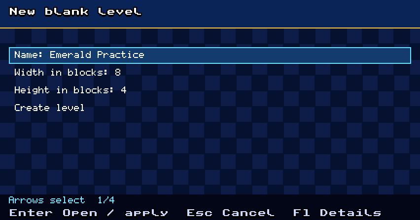
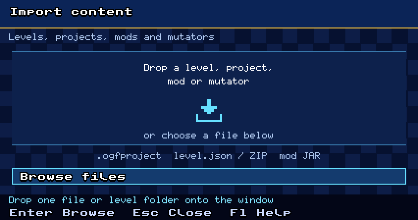
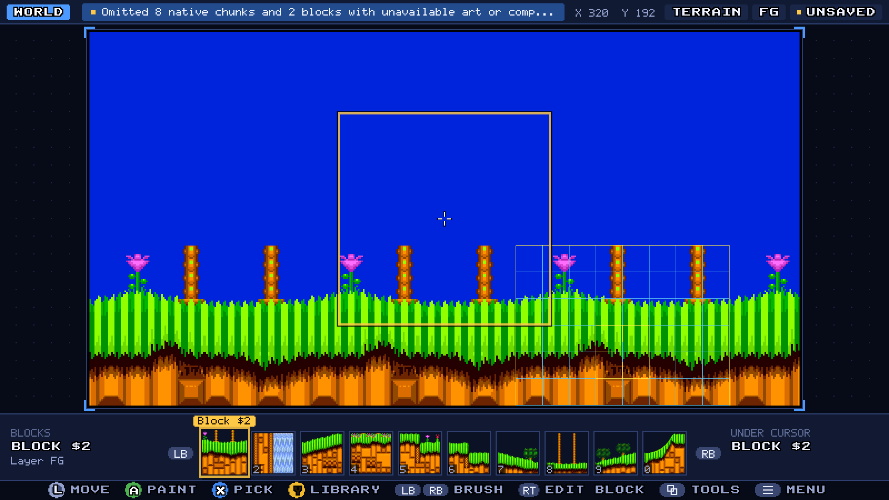
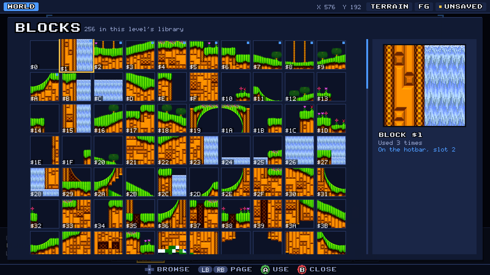
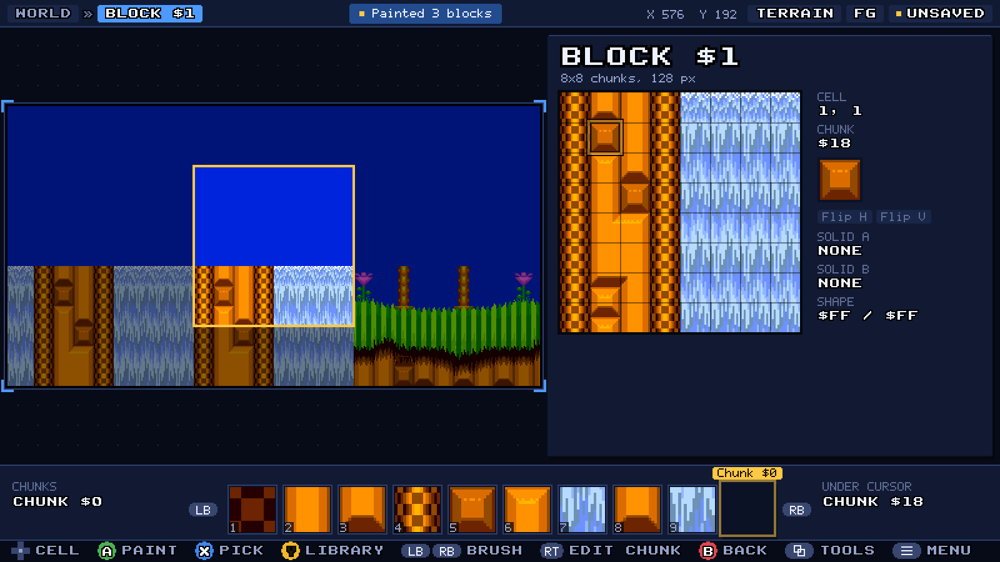
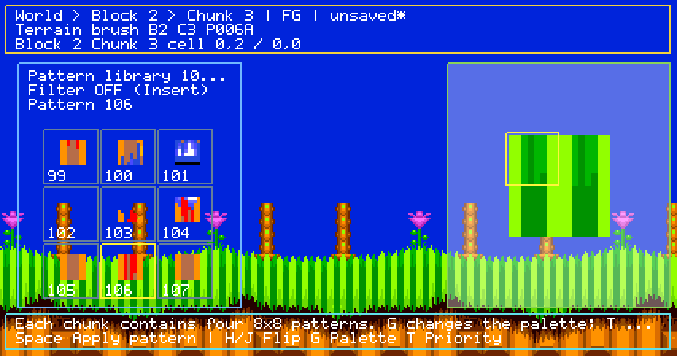
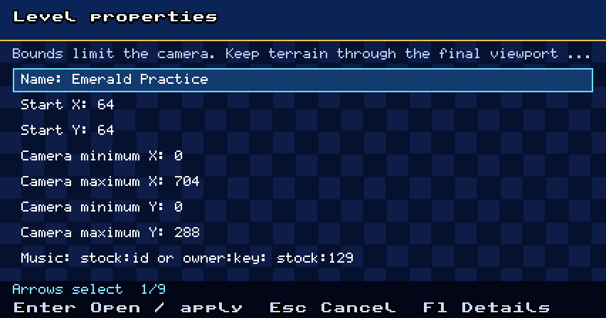

# Create levels with the editor

The editor creates playable levels for Sonic 1, Sonic 2, and Sonic 3 & Knuckles
using assets from your supplied ROMs or an imported level. It supports foreground
and background layouts, block/chunk composition, collision assignments,
object/ring placement, launch properties, project saves, and playtesting.

Start at **Advanced → Editor projects** on the master title. The same project
commands are available from the editor menu. The editor remains
experimental; pixel-art painting, collision-profile shape drawing, native stock
cutscenes/boss scripts, and campaign packaging are separate workflows.

For authored sprite films and mod cutscenes, press **F4** to open
[OpenGGF Stageplay](stageplay.md). It shares the loaded set with a separate
directing document and preserves the level workspace when you switch back.

## Start a project

1. Choose **New blank level**, then choose the game and source zone/act for its
   ROM asset library. The game must have a configured, accessible ROM.
2. Enter a name, width, and height, then choose **Create level**.
3. Open **Level properties** to set the name, start position, bounds, and music.
   S3K also needs an object family: `S3KL` for Sonic 3 objects or `SKL` for Sonic &
   Knuckles objects. The family selects the meaning of stock object IDs.
4. Use **Save project as** to choose an `.ogfproject` file before your first save.

*New blank level after choosing Sonic 2 and an Emerald Hill asset library.
Dimensions count map cells; an 8×4 Sonic 2 canvas is 1024×512 pixels.*

To begin from a supported stock layout, enable `debug.flags.editor`, load the
zone/act in gameplay, and press `Shift+Tab`. The editor adopts it as a project.
With a project open, **Clone this layout** makes a named copy of the current
layout and placements.

Cloning copies level data into an authored level with a fresh, flat runtime.
Native zone events, terrain swaps, animations, water programs, and PLC scripts do
not become an authored campaign. Layouts with native collision remaps, including
Sonic 1 loop flags, fail with an explanation; use **New blank level** with that asset
library instead. An incompatible stock object can also prevent playtesting or
export until it is removed or replaced.

**Open project** reopens a complete `.ogfproject`. **Import exported level** reads a canonical level
export directory containing `level.json` and its binary assets; choose its host
game so native geometry and object semantics can be checked. Import creates an
editable project rather than overwriting the export.

**Advanced → Import content** also accepts `.ogfproject` files, level folders,
`level.json`, and level ZIPs. A level ZIP can hold the exported files at its root
or inside one enclosing folder. Drop one item onto the idle master title or
editor window, or use **Browse files**, then review the detected name, game and
action. **Import level into editor** creates a new editable project;
**Open project in editor** reopens the project file. Both preserve the current document until any required
save/discard/cancel choice is resolved. Invalid content reports an error without
changing the source.

The shared screen also installs mod and mutator packages at the master title.
They remain disabled, and **MODS** opens for enablement, code trust and Apply.
See [installing mods](../../modding/installing-mods.md) for packages and updates.
Finish the current dialog or return from gameplay before dropping content.

*Open **Advanced → Import content** at the master title, or **Import content** in the
editor menu. Drop one project, level folder/ZIP, or mod/mutator package
onto the window, or use **Browse files**. Review the detected content before
applying it.*

## Edit the level

The hierarchy is **World → Block → Chunk**. World cells select blocks, block
cells select 16×16 chunks, and chunk cells select 8×8 patterns. Select a library
entry as the brush, focus the destination canvas, and place it. `Enter` descends
into the selected content and `Escape` returns to its parent. The active layer
is shown as FG or BG.

### Controller HUD

The editor draws its interface at window resolution around the level, sized for a
gamepad on a couch as well as a keyboard: a top bar with the view and layer, a
ten-slot brush hotbar along the bottom and button prompts that follow the pad you
are holding (Xbox, PlayStation or keyboard keycaps). The level is never covered by
a panel.

*Steer with the left stick (the right stick moves faster; the D-pad steps whole
blocks), hold South (A / Cross) and steer to paint a stroke that undoes as one
edit, and pick with West (X / Square). LB/RB change brush along the hotbar.*

*North (Y / Triangle) or `Tab` opens the library for the current brush kind;
choosing an entry puts it on the hotbar. RT edits the block under the cursor and
then its chunk; LT or East goes back up. Hold View (or press `Q`) for a wheel of
tools for the current view, and press Menu (or `F1`) for save, playtest, export,
project commands and every editor command.*

The full pad table is in the [configuration guide](../../../CONFIGURATION.md#level-editor-experimental). The
keyboard shortcuts below apply to the HUD and world editing canvas.

*World view of a Sonic 2 project with a sample floor assembled from decoded
Emerald Hill art. Choose a block from the hotbar or open the library with North
or Tab, then paint on the world canvas. These pictures show the full 1600×900
window with the game scaled by an integer factor.*

Erase chooses actual transparent terrain with no collision; it does not assume
library entry zero is empty. If the library lacks an appropriate empty definition,
the action reports the problem and leaves the level intact.

For a first route, place a solid floor below the start, add a few rings, and
place a supported goal along the path. Check the collision overlay before
playtesting so a visually convincing floor also has the intended collision.

Local composition edits derive definitions for the selected placement instead
of changing every placement that shares a block or chunk. The editor reports
capacity exhaustion when it cannot allocate a free definition. Undo the change,
reuse an existing definition, or start from a library with spare capacity.

*Press Enter from World to edit a block. Its 8×8 chunk cells appear in the
workbench; the hotbar and library supply the 16×16 chunks used to compose it.*

*Press Enter again to edit a chunk's four 8×8 patterns. Use G for its palette,
H/J for flips, and T for priority. Escape returns to Block, then World.*

| Input | Action |
|---|---|
| Arrows / menu directions | Move the canvas cursor or selection in an open library |
| `Tab` | Open the library sheet |
| `Page Up` / `Page Down` | Move through pages in an open library |
| `Enter` / South in a library | Select the highlighted brush |
| `Space` / left click | Place or apply the brush |
| Left drag in World | Paint terrain as one undoable stroke |
| `E` / right click | Pick content near the cursor |
| `Delete` | Erase terrain at the selected cell or delete the selected spawn |
| `L` | Switch FG / BG |
| `Enter` / `Escape` | Descend / ascend the hierarchy |
| `O` | Cycle terrain, objects, and rings |
| `H` / `J` | Toggle horizontal / vertical flip on a selected block/chunk cell or object |
| `G` in Chunk view | Cycle the selected pattern descriptor's palette line |
| `T` in Chunk view | Toggle the selected pattern descriptor's priority |
| `C` / `P` | Toggle collision overlay / select primary or secondary path |
| `V` in Block view | Cycle the selected cell's collision mode |
| `[` / `]` | Decrease / increase the selected chunk's collision-profile index |
| `=` / `-` with an object selected | Increase / decrease that object's subtype |
| `R` with an object selected | Toggle its respawn tracking |
| `M` with a spawn selected | Move it to the world cursor |
| `Ctrl+Z` / `Ctrl+Y` | Undo / redo |
| `F1` | Open the editor menu |

Picking an existing object lets you edit its subtype, flips, and respawn
tracking without changing the brush for future placements. In spawn mode the HUD
places with South, picks with West and deletes from the tools wheel. The visible
prompts adapt to the controller family.

Pointer clicks on the HUD belong to its controls and do not paint through
menus or chrome. Library sheets and modal forms suppress underlying editing
shortcuts. Save, export, history, layer changes, and playtest boundaries
finish the current edit transaction.

Sonic 1 has one collision-profile path. Its primary and secondary assignments
must agree for a playable export. S2/S3K have separate paths. Assigning a profile
uses existing collision data; this tool does not draw new height/width profiles.

## Properties and resizing

Start X/Y and object/ring positions use their centers in level pixels. Bounds
limit the gameplay camera; the editor can navigate the entire canvas. New levels
reserve a native 320×224 final viewport beyond those limits. X uses the native unsigned 16-bit range; Y uses
the native signed 16-bit range for bounds and the start. The start must lie inside
ordered bounds and the bounds must fit the map.

**Resize level** uses map cells, not pixels:

| Game | One map cell | Block composition |
|---|---|---|
| Sonic 1 | 256×256 pixels | 16×16 chunks |
| Sonic 2 / Sonic 3&K | 128×128 pixels | 8×8 chunks |

Growing keeps the overlap in both layers and adds empty terrain. Shrinking
requires an explicit crop choice. Cropping removes outside placements; an
object-backed ring group is removed together if any part is cropped. Resizing
keeps the start inside the resulting bounds by clamping it when necessary. It
establishes a new editing checkpoint, so save a copy first if you need the older
map dimensions and history. Resizing preserves camera margins while they fit.
If a map is reduced below the native viewport, growing it again restores the
standard 320×224 margins; review any custom camera bounds afterward. Changing
bounds in **Level properties** also starts
a new undo checkpoint; name, start, and music changes remain undoable.

The music field accepts `stock:<decimal id>` (for example, `stock:129`) or an
owned track such as `owner:localName`. S3K projects must deliberately choose the object family that
matches their stock objects. Changing the family can make existing object IDs
mean different things; validate the result with a fresh playtest.

*Level properties keeps the authored start, camera bounds, and music together.
Choose a row to edit it, then scroll to **Apply properties**. S3K projects also
show the object-family field.*

## Save and reopen safely

`Ctrl+S` saves the current project; **Save project as** chooses a new path.
A project includes the full art library, layouts, collision profiles, palettes,
objects, rings and backing groups, plus its game/source identity and launch
properties. The project file is separate from ROMs, stock gameplay saves, and
legacy editor sidecars.

Saves validate a complete staged file before atomically replacing the previous
project. A failed save leaves the previous file intact and the document open for
retry. Opening malformed, oversized, unsupported-version, or checksum-damaged
projects reports an error without rewriting or quarantining the file.

The unsaved marker compares the complete document with its savepoint. Undoing
back to saved content clears it. An unavailable keyed object or music dependency
stays recorded in the project; reopening or saving never silently removes it.
Install/enable the matching dependency or explicitly edit the placement. Playtest
refuses unavailable object keys and leaves the document intact.

A stock asset library can contain shared definitions whose art belongs to another
zone or a later native art upload. New blank projects include the available
definitions and report any omitted chunks/blocks; they never invent replacement
art. Choose another source library for unavailable definitions. A full layout
clone remains strict and reports missing assets rather than changing its layout.

**Close project** asks about unsaved changes. **Save and continue** saves before
closing; **Discard changes and continue** closes without saving; **Continue
editing** keeps the document open. Replacing a project uses the same choices.
Application quit and the window close button also offer **Save and quit**,
**Quit without saving**, and **Cancel quit**. A failed save keeps the application
open; cancelling restores the editor or active playtest.

## Playtest and return

Choose **Playtest from level start** for the authored start or **Playtest from
cursor** for a validated cursor position. Cursor launches use the same camera
bounds and body-clearance checks as the authored start, so the final runway beyond
Camera maximum X cannot be a launch point. `F5` starts a fresh playtest of the
current project from its authored start. `Shift+Tab` switches between the editor and its playtest;
when entering from ordinary gameplay, enable `debug.flags.editor` first.

Each playtest builds a fresh runtime snapshot. Rings collected, objects destroyed,
terrain changed by gameplay, score/timer/checkpoint state, and other runtime
changes do not alter the authored document. Returning restores the document,
selection, and undo history. Starting a playtest does not save the project or
write stock gameplay saves. Missing dependencies or unsupported host features
produce a visible error and keep the project in the editor.

For an S3K finish, choose the engine-provided `openggf:authored-goal` from the
object library. It triggers the native signpost/results flow in an
authored level without assigning a new meaning to a stock numeric object ID. It
does not require a separate mod installation. S1/S2 use their supported stock
signpost objects.

Place a native finish in the final camera view and keep its floor through the
right edge of the map. S1/S2 signposts lock the camera at **Camera maximum X**
and finish when the player's center reaches that maximum plus 296 pixels. For
example, a 1024-pixel wide course can use camera maximum X=704, a goal around X=920,
a finish threshold at X=1000, and floor through X=1023. Keep that runway when changing bounds; moving only the signpost earlier
does not move the native camera limit.

## Export a playable level

Choose **Export level** or press `Ctrl+Shift+E`, then choose a new destination directory.
Export never overwrites an existing directory. Use another destination for a
later revision; keep `.ogfproject` as the editable source.

| Host game | Export format | Additional checks |
|---|---|---|
| Sonic 1 | `ModLevelDefinition` v1, 16×16 blocks | Native object/ring encoding, supported flat-host objects, one collision path |
| Sonic 2 | `ModLevelDefinition` v1, 8×8 blocks | Native object encoding and host-level validation |
| Sonic 3&K | `ModLevelDefinition` v2, 8×8 blocks | Explicit `S3KL`/`SKL`, sparse palette ownership and supported custom-zone objects |

Export uses the project's name, start, bounds, and music. Ring backing objects
are converted into individual ring entries. The exporter checks references,
reads back the staged directory through the strict parser, and validates the
selected game host before publishing it.

Projects retain exact RGB data and can store a larger native asset library than
a portable export permits. Playtest and export require exact Genesis-representable
colors and the format's asset limits. For S3K, reachable terrain art must use creator
palette cells: character line 0 and HUD-reserved cells belong to the host. An
export error identifies the incompatible data; it does not change the project
or leave a partially published destination.

To package the exported directory into a mod, continue with the
[creator handbook](../../modding/index.md),
[level formats](../../modding/formats/level-definition.md), and
[`ggfmod` conversion/validation](../../modding/ggfmod.md). Exported ROM-derived
assets remain subject to their original rights; exporting them does not grant
permission to redistribute them.
