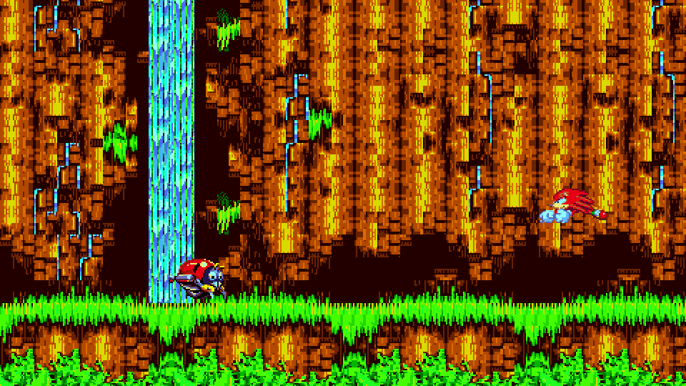
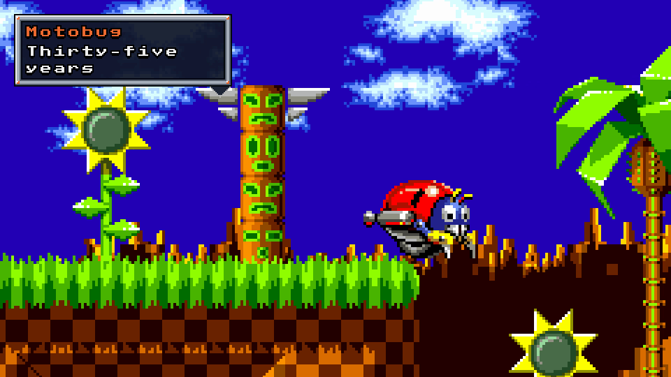
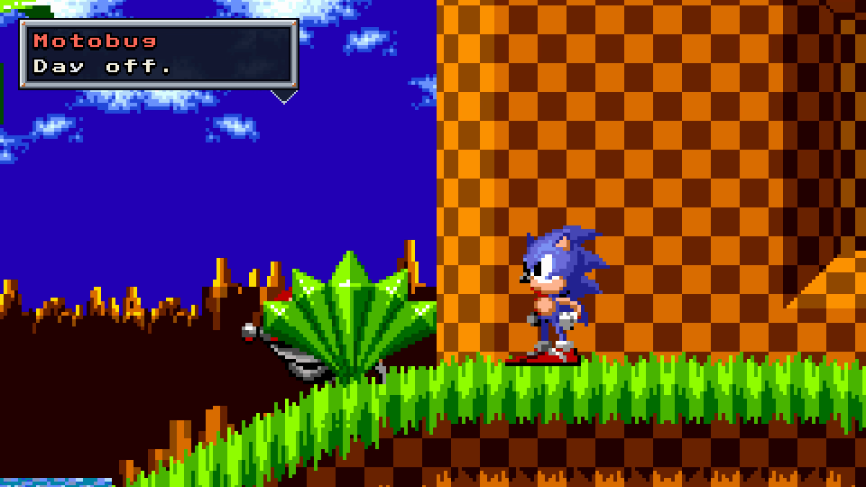
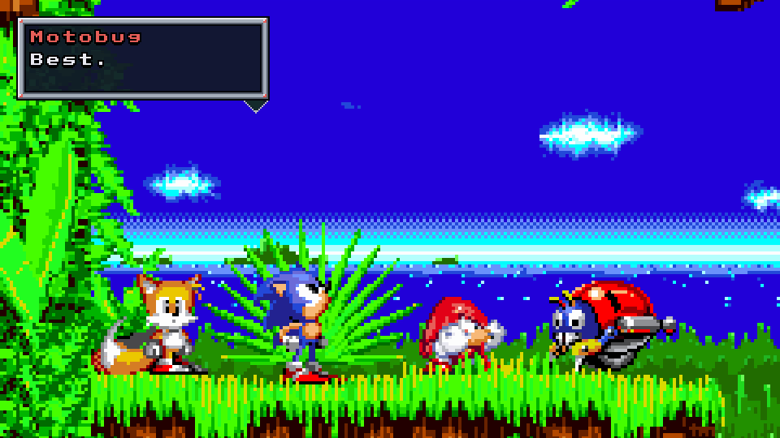

# How Day Off was made

*Day Off* is a 75-second Stageplay film. The first badnik Sonic ever met, a
Sonic 1 Motobug, is tired of patrolling the same ledge after thirty-five years,
so it takes a day off in two other games. It was made entirely in Stageplay,
with both editors and the terminal tools, and its screenplay is in the
repository: [`examples/stageplay-demo/day-off/`](../../../examples/stageplay-demo/day-off/).

This page walks through the film shot by shot and points out the technique
behind each moment. Frame numbers are local to each shot, at 60 frames per
second.



## The scene at a glance

| | |
| --- | --- |
| Film size | 480×270 (16:9), exported at `--scale 4` for 1920×1080 |
| Length | 4498 frames, six shots |
| Sets | Sonic 1 Green Hill 1, Sonic 2 Emerald Hill 1, Sonic 3 & Knuckles Angel Island 1 |
| Cast | Sonic (Sonic 1), Tails (Sonic 2), Knuckles (Sonic 3 & Knuckles), all Puppets; the Motobug (Sonic 1 object 64) |
| Dialogue | 16 lines, four typers, four styles with original 24×24 nine-slice frames, default voices |
| Assets | Four small PNG frames; no recordings |

## Shot 1: the patrol (Green Hill, 840 frames)

The Motobug is cast as a new object (`layoutIndex: -1`) and starts the shot
**Free** at the ledge. Its own Sonic 1 behaviour drives it back and forth, so
the patrol is genuinely the game's.

The story turns on one key. At frame 327, while the Motobug pauses at the edge
of its patrol, a **Puppet** key freezes it. From then on it never turns back:
the film's rebellion is also Stageplay's central idea. The frame was chosen
during that pause on purpose; freezing it mid-drive would also freeze its
exhaust puff in the air.

- `CLEAR_BADNIKS` at frame 0 removes the level's other enemies, and a
  `REMOVE_OBJECT` aimed at one placed object keeps the patrol area clean.
- The camera holds, then eases (`SMOOTH`) into a 2× push-in that lands at
  frame 439, just before "...".
- "Patrol... turn. Patrol..." uses `revealFrames` to time each letter by hand,
  so the words fall in a patrol rhythm. The Motobug's typer is slow (3 frames a
  letter, 14 after punctuation), which suits a tired badnik.
- `MUSIC_STOP` at frame 359 silences Green Hill's music as the Motobug stops:
  the quiet makes its first real line land.
- At frame 790 the Motobug switches to **Pose** and drives off the ledge, with
  a key every two frames that traces its drop.



## Shot 2: the loop (Green Hill, 800 frames)

Sonic runs the loop and skids to a stop in front of the Motobug.

- Sonic's run is a **planned route**. In the editor, the destination was picked
  with the position picker past the loop, and its floor snapped to `y` 620. A
  walk failed with *needs Run*; the route was planned again with **Speed: Run**,
  **Stop: Hard** and **Face: Left**. The result is three ordinary actions: a
  `MOVE_TO`, a `STOP` and a `FACE_LEFT`. The skid and turn are Sonic 1's own.
- Later actions are hand-written: a 40-frame `LOOK_UP` as Sonic thinks about
  it, then a `MOVE_TO` off-screen to the right.
- The Motobug drives through the loop in **Pose**: one key every 8 frames, each
  8 pixels further on, cycling its sprite frames 0, 1, 0, 2. Stageplay has no
  separate driving animation to play for a directed Motobug, so the keys are
  the animation.
  It passes behind the loop's front pillar, because directed objects keep the
  level's own drawing order.
- The Motobug answers Sonic as a speaker in its own right, with its own panel,
  pointer and **Patrol Buzz** voice, while Sonic speaks in **Soft Cool**.



## Shot 3: Emerald Hill (Sonic 2, 700 frames)

A 24-frame `WIPE_RIGHT` carries the Motobug into Sonic 2.

- Tails starts facing left toward the arriving Motobug. After his line he
  jumps, waits until he lands (`WAIT` until `GROUNDED`, 90-frame timeout), then
  taps right (`FACE_RIGHT`) to watch it leave. The wait means the turn happens
  on landing however long the jump takes.
- The Motobug's Pose keys follow Emerald Hill's gentle slope: their heights
  come from the `ground` command.
- Emerald Hill's music is cued at frame 8, not frame 0, so the level's
  entry does not fade it.
- "Wait... aren't you from Sonic 1?" uses Tails' typer and **Workshop** voice;
  the Motobug answers "Long drive."

## Shot 4: Angel Island (Sonic 3 & Knuckles, 918 frames)

Another wipe, and the Motobug reaches its third game.

- Knuckles arrives with his real glide: a 16-frame `JUMP` at frame 300, then
  `GLIDE_TO` a point beside the Motobug. A glide keeps going after it arrives,
  so `RELEASE`, `WAIT` until grounded and `STOP` end it cleanly.
- The music changes as he appears: Angel Island's theme at frame 0, Knuckles'
  theme at frame 280.
- The exchange alternates panels left and right: the Motobug's on the left,
  Knuckles' on the right near where he stands.

## Shot 5: the ledge (Sonic 3 & Knuckles, 760 frames)

A 40-frame `FADE_BLACK` and a "LATER" caption bring all four together.

- Everyone is still, but not frozen: Knuckles crouches (`CROUCH` for 420
  frames) and Sonic looks up (`LOOK_UP` for 180) while the Motobug, in Pose,
  faces its friends.
- "Best. Day. Ever." uses `revealFrames` to give each word its own beat.
- The music moves from the Data Select theme to the act-clear jingle at frame
  400, and the camera tilts slowly up to the sky at the end.



## Shot 6: next morning (Green Hill, 480 frames)

The epilogue reuses the first shot's camera and the Motobug's first key, back
in **Free**: it is patrolling again. "Patrol... turn." "...Only 364 days to go."

## Techniques worth reusing

- **Let the game perform.** Every player move is a Puppet action or a planned
  route. Nothing is keyed by hand except the Motobug's directed driving.
- **Turn on a key.** Free to Puppet is a story beat as well as a tool: the
  moment an object stops doing its job.
- **Find floors with the tools.** All floor heights came from the `ground`
  command, three batched queries in total, and the picker's floor snap.
- **Time text for performance.** Each character has a typer that suits them,
  and the key lines use hand timing.
- **Keep panels off the action.** Panels sit at the top of the picture, on the
  speaker's side, sized to their text.
- **Check it three ways.** The film exported from the editor matched the
  terminal's render frame for frame, the screenplay round trip was
  byte-identical, and both editors produced the identical scene from the same
  route request.

## Render it yourself

You need all three ROMs, FFmpeg and a build of the engine:

```bash
python3 tools/stageplay/stageplay.py --build help
python3 tools/stageplay/stageplay.py render \
  --scene examples/stageplay-demo/day-off/day-off.stageplay \
  --out /your/films/day-off.mkv --scale 4 \
  --s1-rom /path/to/sonic1.gen --s2-rom /path/to/sonic2.gen --s3k-rom /path/to/s3k.gen
```

Or open `day-off.stageplay` in either editor and play it. To change it as text,
copy the folder (the screenplay uses the PNGs in `decor/`), edit the copy and
compile it beside its assets:

```bash
cp -R examples/stageplay-demo/day-off /your/films/day-off
python3 tools/stageplay/stageplay.py compile \
  --script /your/films/day-off/day-off.screenplay.json \
  --out /your/films/day-off/my-take.stageplay
```
