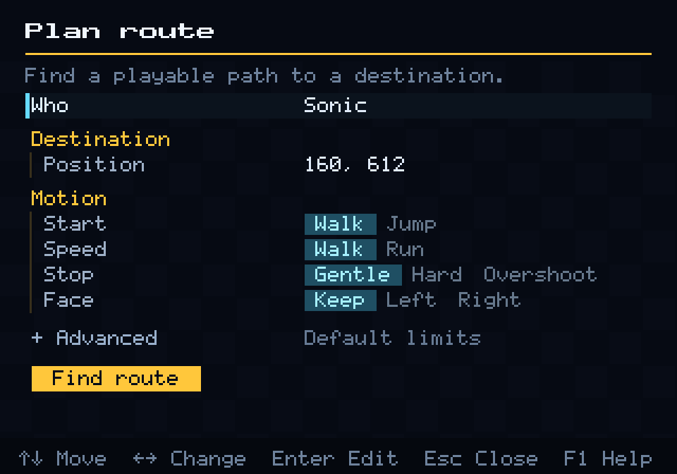
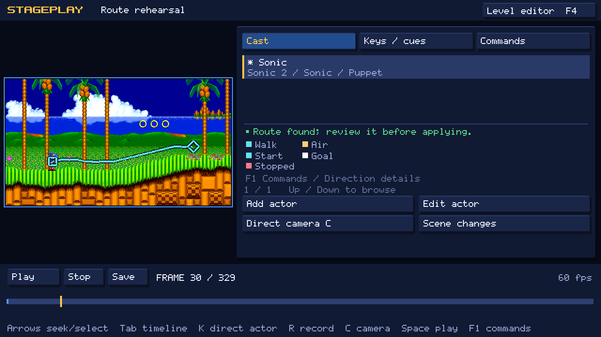
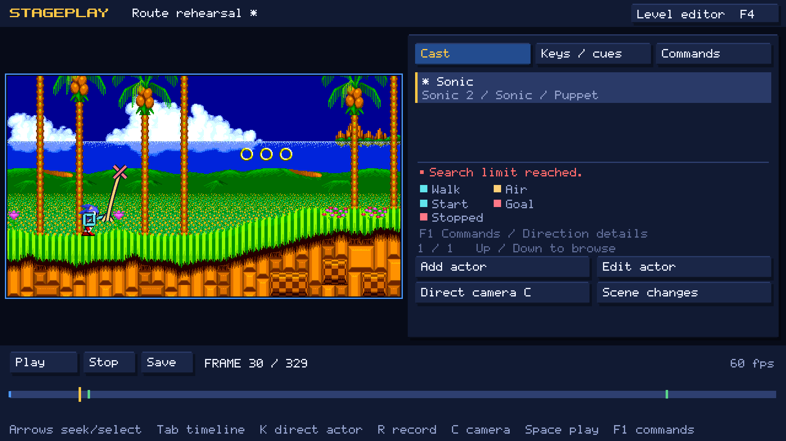
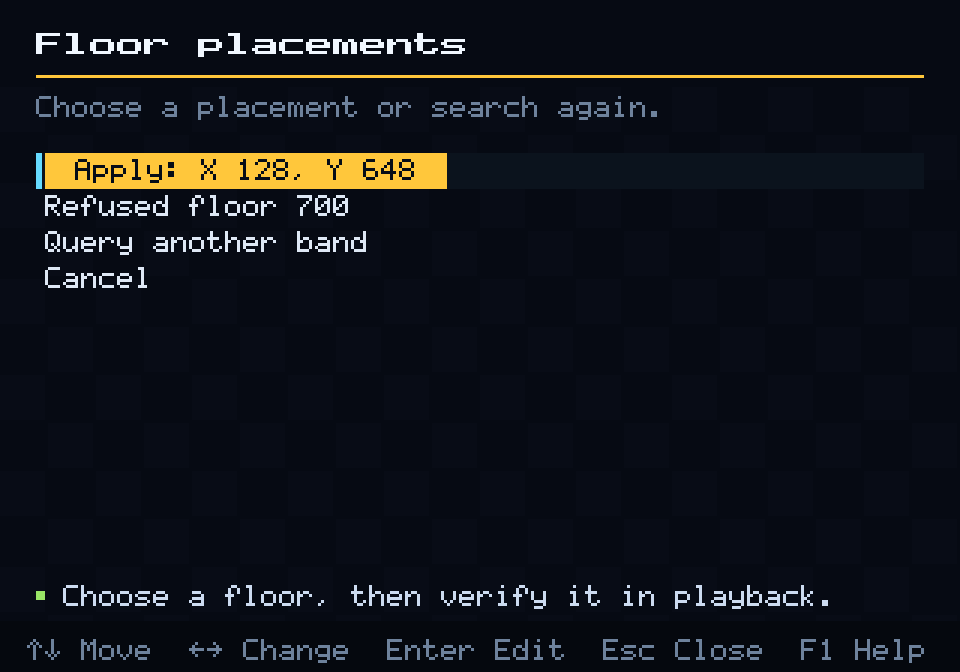
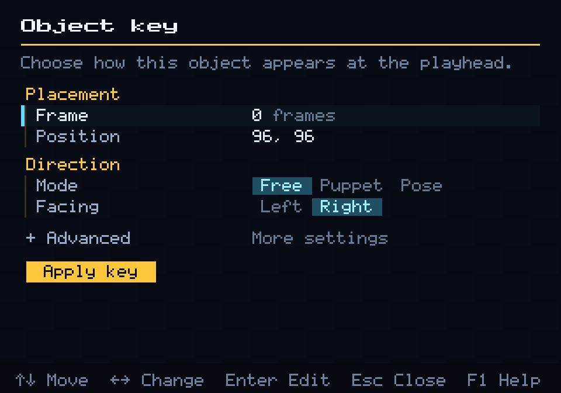
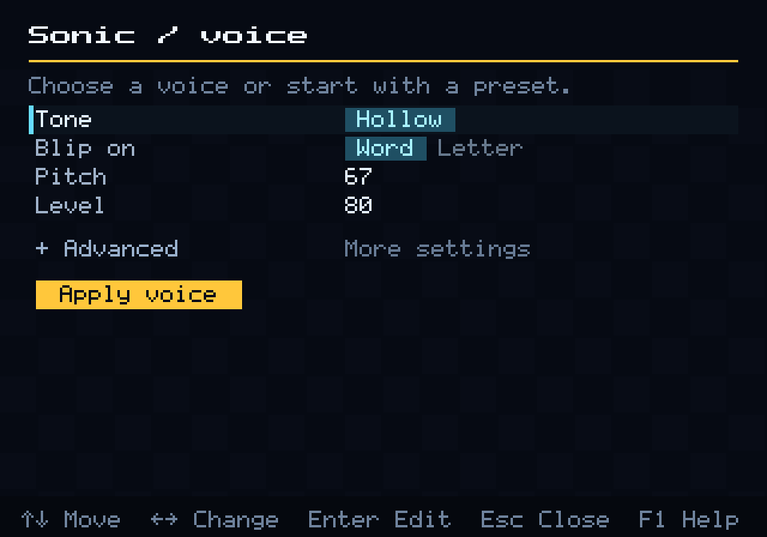

# Directing guide

Each section of this guide covers one task. It assumes you have made
[your first film](stageplay-first-film.md) or know the basics. Command names
are as they appear in the in-engine editor; OpenGGF Editor has the same
commands in its **Direct**, **Edit** and **File** menus. Exact fields and
limits are in the [reference](stageplay-reference.md).

- [Set up a scene](#set-up-a-scene)
- [Cast and modes](#cast-and-modes)
- [Direct players](#direct-players)
- [Plan a route](#plan-a-route)
- [Place on floor](#place-on-floor)
- [Direct objects](#direct-objects)
- [Facing](#facing)
- [Camera](#camera)
- [Dialogue and voices](#dialogue-and-voices)
- [Music and sound](#music-and-sound)
- [Scene changes and multiple sets](#scene-changes-and-multiple-sets)
- [Export a film](#export-a-film)
- [Use a scene in a mod](#use-a-scene-in-a-mod)

## Set up a scene

Open Stageplay with **F4** from the level editor. A new scene is ten seconds
long, the size of the game screen, and starts where the camera was. Its set is
the level you were editing.

**Scene / set** changes the scene's name, length, game, zone and act. Under
**Advanced** you can set the film's exact width and height, pin an exact ROM,
or use a saved editor level (`.ogfproject`) instead of the stock one. **Film
format presets** offers Widescreen 16:9 (384×216), Native (320×224) and HD
16:9 (1280×720).

If you open Stageplay from an editor project with unsaved changes, Stageplay
copies the level into a new project folder (`projects/stageplay-…`) and the
scene uses that copy. Your project and its save state are left alone.

To make a scene shorter, first delete any keys and cues beyond the new end.

While Stageplay is open, the engine window grows to at least 1280×720 if the
screen has room; leaving Stageplay restores it. The film keeps its own size
and is letterboxed in the preview.

## Cast and modes

**Add actor** adds a player: Sonic (from any of the three games), Tails (Sonic
2 or Sonic 3 & Knuckles) or Knuckles (Sonic 3 & Knuckles). Choose the game
under **Advanced**. A character can appear in any game's level: Sonic 3 &
Knuckles' Knuckles can glide through Sonic 1's Green Hill. You need the ROM
for every game in the scene.

Each player has a mode:

- **Puppet** (the default) uses the game's physics. You give it actions and it
  accelerates, slopes, jumps, lands, skids and animates exactly as the game
  would. You choose where it starts each shot; after that, only its actions
  move it.
- **Poser** is placed by hand. Each key sets its position, facing, animation or
  a single sprite frame, and the easing to the next key.

Switching mode in **Actor properties** asks before replacing the other mode's
keys or actions, and can be undone.

A Puppet starts each shot attached to the floor beneath its feet, if there is
one within 14 pixels. For a deliberate fall, turn off **Start on floor** under
**Advanced**. For a wider search, use [Place on floor](#place-on-floor).
**Collision path** chooses which of the level's two terrain layers the
character uses, as in levels with loops.

Use **Place actor** (in the actor's **Direct** menu) to change where a Puppet
starts the current shot and which way it faces, and **Actor visibility** to hide
or show it at the playhead.

## Direct players

Select a Puppet and press **K** to open its **Direct** menu. Each action starts
at a frame (the **Earliest frame**) and is a button press, not a teleport.

| Action | What the character does |
| --- | --- |
| Move to destination | Walks or runs toward a point. **Effort** is the share of top speed (0.4 is a jog, 1 is flat out). |
| Jump | Presses jump and holds it for **Hold** frames. A longer hold jumps higher. |
| Stop / brake | Brakes to a halt. |
| Wait | Holds back the following actions until a condition, such as landing, or until the timeout. |
| Crouch, Look Up | Holds down or up for a number of frames. |
| Roll | Rolls from a run. |
| Release | Lets go of the controls; ends a glide or flight. |
| Fly toward target, Hover | Sonic 3 & Knuckles Tails only: native flight. |
| Glide toward target | Sonic 3 & Knuckles Knuckles only: native glide. |

Things to know:

- A destination is checked on arrival, but it never lifts a character up a
  cliff. If something is in the way, add a **Jump**, or use **Plan route**.
- A **Wait** never moves the character. It lets the scene react to what really
  happened, for example *wait until on the platform, then stop*. Give it a
  timeout so the scene continues if the condition never comes.
- Movement can aim at a placed object, such as a moving platform, instead of a
  fixed point. Set its placement under **Advanced**; the `level` command lists
  placements (see [the terminal guide](stageplay-authoring.md#level-placements)).
- A glide or flight keeps going after it arrives. Follow it with **Release**,
  **Wait** (until grounded) or **Stop**.
- Each shot starts the cast afresh from their starting positions.

**Record actor take** (**R**) records a take from the keyboard. For a Puppet, A
and D move, S brakes and W jumps; the take is saved as actions. For a Poser,
WASD moves it 2 pixels per frame and the take is saved as keys. Space or Esc
ends the take, and the whole take undoes in one step.

## Plan a route

**Plan route** finds button presses that take a player to a destination,
trying them under the game's real physics, and then checks the result by
playing it back from the start of the shot.



1. Select the player and go to the first frame of the shot. Routes start where
   a shot starts.
2. Choose **Plan route**. Pick the **Position** with the picker; floor snap is
   on, so the point lands on the ground.
3. Choose the **Motion**:
   - **Start**: Walk, Jump (jump first) or Spindash (only for characters that
     can spin dash).
   - **Speed**: Walk is a relaxed stroll; Run uses the character's real top
     speed. Spindash always uses Run.
   - **Stop**: Gentle coasts to a stop, Hard skids to a stop, Overshoot runs
     past, turns and comes back.
   - **Face**: Keep the facing it ends with, or turn Left or Right after stopping.
4. Choose **Find route**. When it finishes, close the menu to look at the
   proposed path in the preview.



The line shows where the character actually went in the check: cyan on the
ground, gold in the air, small chevrons at take-off, a square at the start and
a diamond at the destination. If you like it, choose **Apply route**. The
route becomes ordinary actions (a move, a stop and perhaps a jump or turn), and
it undoes in one step. While you play that shot, the line stays visible and a
white cross follows the character so you can compare.

When planning fails, the line stops at a red cross where the attempt ended,
and the panel says why.



The side panel gives a one-line result. **F1** (or **Direction details**) gives
the full diagnosis: what happened, what to try, the settings used and how much
searching was done.

| Message | What to do |
| --- | --- |
| Search limit reached. | The search ran out of time before it found a way. It does not mean the place cannot be reached. Read the advice in **F1**; otherwise try a nearer destination, choose Run, or give it more time under **Advanced** (**Frames**, **Search nodes**). |
| No route found in this search. | Try a different start or speed, or a destination on the other side of the obstacle. |
| *terrain near x=…: needs Run* (in **F1**) | A walk failed, so the planner rehearsed the same terrain at a run, and running got there. Change **Speed** to Run. |
| *…needs more Attempt frames* or *needs Run and more Attempt frames* (in **F1**) | The rehearsal got there, but took longer than the route was allowed. Raise **Frames** under **Advanced**, and choose Run if it says so. |
| This route is unsupported; open Details. | The request can't be planned this way, for example a Spindash start for a character that cannot spin dash. **Direction details** explains. |
| Playback could not confirm the route. | The check failed (a fall, a hit or a missed stop). Try another stop style or destination. |
| Scene or assets changed; plan again. | You edited the scene while it planned. Plan again. |

Routes are planning aids only. The line is not saved in the scene and never
appears in films or mods. Reopening a scene does not bring old lines back.

Walking objects (see below) can also be routed. Their route only follows the
floor and small steps up to 8 pixels; it does not jump or detour around walls.

## Place on floor

**Place on floor** finds the floors in one column of the level for the
selected actor or object and puts it on the one you choose.

1. Select the actor and go to the first frame of the shot (players can only be
   placed at the start of a shot).
2. Choose **Place on floor**, pick the **Column** with the picker, and choose
   **Find floors**.
3. Choose an **Apply** row. Floors that cannot be used are listed as
   **Refused floor**; **F1** says why.



The search covers 128 pixels above and below the current position; widen it
under **Advanced**. Floors are terrain only: platforms and other objects are
not included. Always play the scene afterwards to see the character land.

The position picker's floor snap uses the same search for a single point, so
for one placement you can simply pick with snap on.

## Direct objects

Objects are badniks, animals, bosses, platforms, monitors and every other
object the games place in their levels. Open **ROM object cast / clear** (shown
as **Object cast**).

| Row | Use it to |
| --- | --- |
| Add object | Add an object of any type from any of the three games. |
| Object library | Browse every object type for the current set, with notes on what each supports. |
| Loaded objects | Take over an object that is already placed in the level. |
| Clear badniks | Remove the level's enemies, from the playhead onward in this shot. |
| Clear objects | Remove all placed objects, from the playhead onward in this shot. |
| World commands | Edit or delete clears and removals. |

Clears never remove rings, players or the players' own effects. A cleared object
stays gone for the rest of the shot; the next shot starts with the full level
again. To show only the terrain, add **Clear objects** at the first frame of the
shot.

Every object has a mode, set in its **Position and pose** keys:

- **Free** runs the object's own game behaviour: a Motobug patrols, a platform
  moves, a boss fights. It can hurt players and affect the level.
- **Puppet** freezes the object, including its behaviour and contact damage, so
  you can slide it with **Move or stop**.
- **Pose** places the object exactly at each key, with a chosen sprite frame,
  and eases between keys.



Switching an object from Free to Puppet or Pose freezes it where it is,
including any timers and the parts it has spawned. Switching back to Free
resumes it from that moment. If the object was carrying a player, the player is
let go.

Things to know:

- Some objects only build their picture after their own behaviour has started.
  Give them a short **Free** start before you switch them to Puppet or Pose. A
  missing picture is reported, never replaced with other art.
- Some bosses always appear at their own arena position. Their keys show
  **Free: native arena position, anchor ignored**; use them in their own arena,
  or use Puppet or Pose to place them elsewhere.
- Many objects have several parts. **Part overrides** sets the sprite frame of
  each part; **Parts and limits** lists the parts and anything that object
  cannot do while directed.
- Animals freed from badniks can be cast too: in **Add object**, open
  **Advanced** and set **Source kind** to `RELEASED_ANIMAL`. The level decides
  which animal appears.
- Objects can speak. Choose them as the speaker of a dialogue line.

## Facing

Facing is always **Left** or **Right**, as you see it on screen, for players and
objects alike. You never flip sprites yourself: each object's own art decides
how it looks when it turns, including skids, look-backs and objects whose
parts turn separately.

- A Poser or a Puppet or Pose object faces the way its key says.
- A Puppet player faces the way it is moving. Set its starting facing with
  **Place actor**, and choose **Face** when you plan a route to turn it after it
  stops.
- A Free object faces the way its behaviour makes it face.

## Camera

The camera has keys like the cast. Each key sets the view's position, zoom and
**Easing** (Hold, Linear or Smooth) toward the next key. A push-in that keeps
the same centre zooms straight in.

- **Camera mode** (**C**): pan with WASD or the arrow keys (Shift is faster),
  zoom with Q and E, and press **K** to capture a key. **C** leaves camera mode.
- **Camera keys** opens the numeric **Camera key** form, and **Capture 1x–4x
  pixel framing** snaps the zoom to a whole number.
- **Record camera take** (**R** in camera mode) records your panning and
  zooming as keys.
- **Follow** (in the Camera key form's **Advanced**) keeps one or more Puppets
  in frame. Several actors are framed together. Dead zone, look-ahead,
  smoothing and offset shape the follow.
- **Camera shake / quake** adds shake over a time range. It moves the picture
  only, never the characters.

Q and E zoom in whole steps from 1×. For a zoom below 1× or a fractional zoom,
type it in the **Camera key** form. Whole-number zooms keep pixel art crisp;
fractional zooms can shimmer while the camera moves, so watch them at full
speed. Text always stays sharp.

The camera never shows beyond the edges of the level.

## Dialogue and voices

**Dialogue lines** → **Add dialogue line** asks who is speaking: any player,
any object, or an **Offscreen speaker** with a name you type. Then write the
text and choose when it starts and ends.

- The speaker's name appears at once and the text types out. The panel's
  pointer follows the speaker as the camera moves.
- **Advanced** sets the panel's position and size, a different display name and
  a small portrait PNG. The panel must fit the film and its text, or the line
  is rejected with an explanation.
- **Dialogue typing** (reusable typers) sets the typing speed and the pauses
  after punctuation and spaces. **Custom reveal timing** times each character by
  hand, for dramatic pauses.
- **Dialogue styles** (reusable decorations) set the text, name, panel and
  border colours, and can frame the panel with your own nine-slice PNG.
- **Captions** are plain on-screen text, for titles and time cards.

### Voices

Every speaker has a voice made of short game-chip blips that follow the text as
it types. Defaults: Sonic **Soft Cool**, Tails **Workshop**, Knuckles **Red
Rattle**, Motobug **Patrol Buzz** and Buzz Bomber **Wing Chime**. Other speakers
get a voice of their own.



Choose **Speaker voice** for the selected cast member, or from a dialogue
line's menu.

- **Tone**: Square, Chime, Hollow or Buzz. **Off** silences the speaker.
  **Presets** lists all fifteen named voices; pick one and adjust it.
  **Default** returns to the character's own voice.
- **Blip on**: one blip per word or per letter.
- **Pitch** and **Level**; under **Advanced**, **Variation** (how much the pitch
  wanders) and **Length** (of each blip).

Voices need no audio files and play in the editors, in films and in mods.
Punctuation and spaces are silent. Scrubbing is silent too: you hear voices
when you play.

To use a recorded performance instead, add it as an audio cue (below) and set
that speaker's tone to **Off**.

## Music and sound

**Audio cues** → **Add audio cue** adds a cue at the playhead. Set **Action**:

- **Music** plays a song. Pick it by name in the **Music** list, for example
  **Emerald Hill ($82)**. The list holds every song in the cue's game; change
  **Game** under **Advanced** to use another game's music.
- **Sound effect** plays one of the game's sound effects, picked by name in the
  **Sound** list.
- **Audio file** plays your own WAV or Ogg recording. Put the file in the
  scene's folder (or a folder below it) and enter its path. **Volume** applies
  to recordings only.
- **Stop music** silences the music.

How playback treats sound:

- Cues play when playback passes them. Scrubbing and seeking are silent, and
  starting in the middle does not resume a song from its middle. Play from frame
  0 to hear the whole soundtrack.
- Once a scene has any music or music-stop cue, the level's own music stays off
  for the whole scene, including after scene changes. Give each shot that needs
  music its own music cue.
- Sound effects made by the game itself, such as jumps, rings and springs, play
  as they happen.
- A music cue on a shot's first frame plays as written, in every game; the
  level's own start-up does not fade it out.

The number after each name (such as `$82`) is the one the game itself uses for
that sound, as listed in the game's disassembly. Screenplays use the same
numbers, written in decimal (`$82` is 130), or a music name; **F2** in the form
also accepts the exact number. See [audio cues](stageplay-reference.md#audio-cues).

## Scene changes and multiple sets

A scene change starts a new shot. The new shot can be in the same level, a
different act or a different game.

1. Make room: in **Scene / set**, lengthen the scene.
2. Choose **Scene changes / transitions** → **Add scene change**.
3. Set the **Frame** where the new shot starts, the **Transition** and its
   **Length**, and the new set's **Game**, **Zone** and **Act**. Choose **Apply
   scene change**.
4. Stageplay adds a starting key for every actor, object and the camera at that
   frame. Go to the frame and place them for the new set: **Place actor** for
   Puppets, keys for Posers and objects, and a camera key.

Transitions are **Cut**, **Fade Black**, **Fade White**, **Wipe Left** and
**Wipe Right**. A fade or wipe is centred on the change: the screen is fully
covered at the change frame, so avoid starting a line of dialogue under it, and
leave room for the transition on both sides. Transitions cannot overlap.

Each shot starts a fresh copy of its level, so the cast can appear anywhere
without walking there. Nothing carries over from the previous shot: positions,
actions, cleared objects and rings all start again.

A shot can use a saved editor level instead of a stock one: set **Level
project** under **Advanced** to an `.ogfproject` file in the scene's folder.

## Export a film

Choose **Export film** (or **File → Export film** in OpenGGF Editor). Stageplay
saves the scene first, then asks for a new `.mkv` file and renders it in a
separate process while you keep working.

- Films are lossless: FFV1 video and FLAC audio at 60 frames per second, at the
  scene's exact size. Convert them with any video tool for sharing.
- FFmpeg must be installed. Every game used by the scene needs its ROM.
- Export never overwrites a file and never leaves a half-written film.
- Route lines, editor panels and gameplay overlays never appear in films.

The terminal's `render` command does the same, and can scale the film up by a
whole number (`--scale 4` turns 480×270 into 1920×1080). See
[render](stageplay-authoring.md#render).

## Use a scene in a mod

A mod can play a scene as a cutscene. Package the `.stageplay` file and its
assets in the mod's resources and register it while the mod registers:

```java
StageplayPlayback.register(context, "opening", "scenes/opening.stageplay");
```

`register` throws `IOException` if the scene cannot be read; handle it in your
entry point. To trigger the scene from one of your objects:

```java
var director = services().gameService(StageplayControl.class);
director.play();
```

`skip()`, `cancel()`, `status()` and `frame()` report and control progress.
`registerOnEntry` plays the scene automatically when the level is ready. The
[demo mod](../../../examples/stageplay-demo/README.md) does this.

While the scene plays, the game is paused behind it; when it ends, play
resumes exactly where it left off. The scene runs in its own copy of the level,
so nothing in it affects the game.

A scene can also take over the player and hand it back. Pass the cast member's
ID and a finish mode to `register`: `RESTORE_ENTRY` returns the player to where
it started, and `KEEP_FINAL_POSITION` leaves it where the scene ended, in the
air and standing still, so choose a safe spot. The cast member must be the
same character from the same game as the player, in the same level, and the
player must be free to move (not hurt, dead, super or riding something).

The Mod API is an unpublished candidate that follows the engine version. Build
mods against the same engine commit you run. The
[mod creator handbook](../../modding/index.md) covers packaging.
