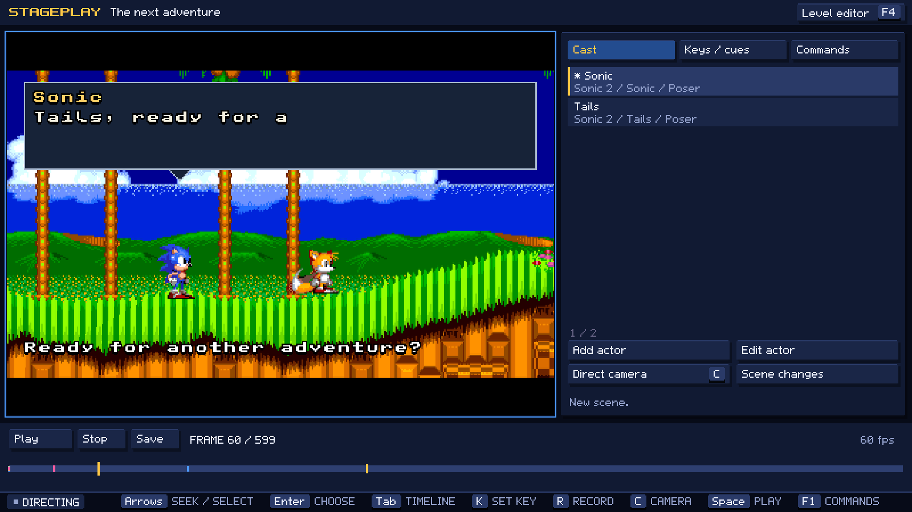
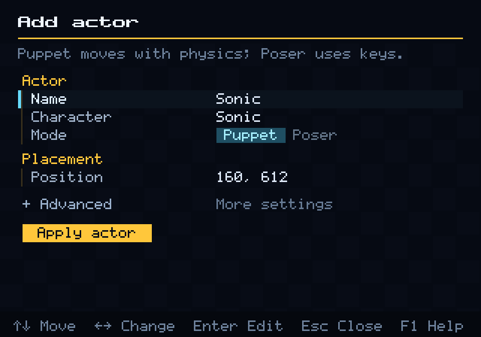
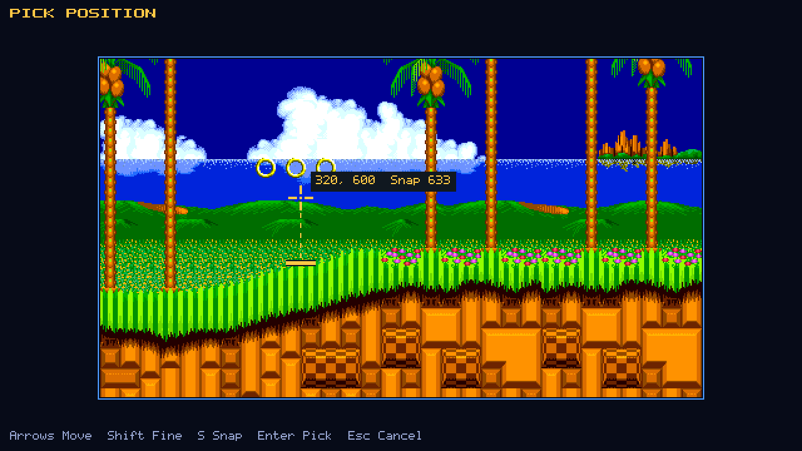
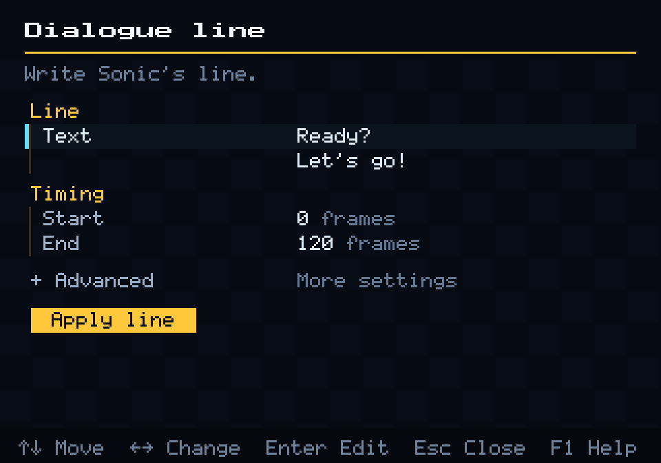

# Your first Stageplay film

In this tutorial you make a ten-second film in Sonic 1's Green Hill Zone. Tails
(visiting from Sonic 2) calls out to Sonic, Sonic runs over, they agree to a
race and Tails hops with excitement. Along the way you meet every basic tool:
cast, actions, the camera, dialogue, music and export.

Part 1 makes the film in the in-engine editor. Part 2 makes the same film as a
screenplay, for people who prefer text or want to script their films. Each
part takes about half an hour.

## Before you start

- Set up OpenGGF with your Sonic 1 and Sonic 2 ROMs, as in
  [Getting started](../playing/getting-started.md).
- Install FFmpeg if you want to export the film.
- To edit a stock level, the level editor must be allowed from gameplay. Add
  this to `config.yaml`, or set `editor: true` under the `debug:` → `flags:`
  section that is already there:

  ```yaml
  debug:
    flags:
      editor: true
  ```

The frame numbers below assume 60 frames per second: frame 120 is two seconds
in.

## Part 1: in the editor

### 1. Open Stageplay in Green Hill

1. Start Sonic 1 and play Green Hill Zone Act 1.
2. Press **Shift+Tab** to open the level editor.
3. Press **F4**. The Stageplay workspace opens with a new, empty ten-second
   scene. Its camera starts where the game's camera was.



The preview on the left is your film. The panel on the right has three pages:
**Cast**, **Keys / cues** and **Commands**. **Tab** switches between the first
two and **F1** opens **Commands**. The bar along the bottom is the timeline:
**Left** and **Right** step one frame, **Shift** with them steps one second,
and **Space** plays.

Every change you make can be undone with **Ctrl+Z**.

### 2. Name the scene

1. Press **F1**, choose **Scene / set** and press **Enter**.
2. Change **Name** to `First take`. Leave the length at 600 frames.
3. Choose **Apply scene**.

In a form, **Up** and **Down** move between rows, **Left** and **Right** change
a choice, **Enter** edits a value and **Esc** closes. **F1** inside a form
explains every field.

### 3. Cast Sonic

1. On the **Cast** page, choose **Add actor**.
2. Leave **Name** and **Character** as Sonic and **Mode** as **Puppet**.
3. Select **Position** and press **Enter**. The form steps aside and a yellow
   crosshair appears over the level.
4. Move the crosshair with the arrow keys to the left edge of the picture,
   above the grass. The tag beside it reads `Snap` and a number: that is the
   floor Sonic will stand on. If it reads `Snap off`, press **S**.
5. Press **Enter** to use the point, then choose **Apply actor**.





A **Puppet** moves with the game's physics: you tell it what to do and the game
decides how it looks doing it. A **Poser** is placed by hand at every key. Most
of the time you want Puppets.

### 4. Cast Tails

1. Choose **Add actor** again.
2. Set **Name** to `Tails` and **Character** to `tails`.
3. Open **Advanced** and set **Game** to **Sonic 2**. Tails is not in Sonic 1,
   but Stageplay can bring him in from Sonic 2.
4. Pick a **Position** on the grass about two-thirds of the way across the
   picture, and choose **Apply actor**.
5. With Tails selected, press **K**. In the **Direct** menu choose **Place
   actor**, set **Facing** to **Left** and choose **Apply placement**.

Tails now starts the shot looking toward Sonic.

### 5. Frame the camera

The scene starts with one camera key at frame 0. You will add a second so the
camera drifts right as Sonic runs.

1. Make sure you are on frame 0 (press **Home**).
2. Press **F1**, choose **Camera keys**, then **Set camera key**. Set
   **Easing** to **Smooth** and choose **Set camera**. Easing describes how
   the camera moves from this key to the next one.
3. Step to frame 240 (press **Shift+Right** four times).
4. Press **C** for camera mode. Pan right with the arrow keys until Tails is
   comfortably inside the picture, then press **K** to capture a key.
5. Press **C** again to leave camera mode.

Scrub back and forth: the camera now eases from the first framing to the
second over four seconds.

### 6. Make Sonic run over

1. Select Sonic on the **Cast** page and go to frame 120.
2. Press **K** and choose **Move to destination**.
3. Pick the **Position** on the grass a little to the left of Tails.
4. Set **Effort** to `0.4`. Effort is the share of top speed Sonic aims for.
5. Choose **Apply action**.

Press **Home**, then **Space**. Sonic waits two seconds, sets off, speeds up
and brakes to a stop near Tails. The game's physics does all of it. To check
on him, pause and press **K**: the top of the **Direct** menu shows his status,
`MOVING` on the way and `ARRIVED` once he stops. **Esc** closes the menu.

A destination is a request, not a promise: if a wall or a gap is in the way,
Sonic stops or falls just as he would in the game. To have Stageplay find a
path for you, use **Plan route** (see [Plan a route](stageplay-directing.md#plan-a-route)).

### 7. Give Tails a hop

1. Select Tails and go to frame 432.
2. Press **K**, choose **Jump**, leave **Hold** at 12 frames and choose
   **Apply action**.

A longer hold makes a higher jump, as on a controller.

### 8. Write the dialogue

Add three lines. For each one:

1. Go to the start frame in the table.
2. Press **F1**, choose **Dialogue lines**, then **Add dialogue line**, then
   the speaker.
3. Type the **Text**, set **End**, and in **Advanced** set **Y** to `12` so the
   panel sits at the top of the picture, clear of the characters.
4. Choose **Apply line**.

| Start | End | Speaker | Text |
| --- | --- | --- | --- |
| 20 | 140 | Tails | Sonic! Over here! |
| 300 | 430 | Sonic | Race you to the loop? |
| 500 | 590 | Tails | You're on! |



Play the scene. Each line types out with the speaker's name, a pointer toward
the speaker and a voice: Sonic's is **Soft Cool** and Tails' is **Workshop**.
Tails' first line plays while he is still off screen; the pan brings him in.
The second line starts after Sonic has arrived, and the hop happens in the gap
before Tails answers, so his own panel never hides him.

### 9. Add a title and music

1. Go to frame 10. Press **F1**, choose **Captions**, then **Add caption**.
   Type `GREEN HILL ZONE`, set **End** to 130 and choose **Apply caption**.
2. Go to frame 0. Press **F1**, choose **Audio cues**, then **Add audio cue**.
   Set **Action** to **Music** and choose Green Hill's music, then choose
   **Apply audio**.
   <!-- Reconcile with the music naming fix on bugfix/ai-stageplay-dayoff-bugs. -->

Music and sounds play only when playback passes their cue, never while you
scrub. To hear the whole soundtrack, play from frame 0.

### 10. Save and export

1. Press **Ctrl+S**. The **Save scene** form suggests a file name; keep it or
   type your own, such as `first-take.stageplay`, and choose **Save**.
2. Press **F1** and choose **Export film**. Enter a new file name ending in
   `.mkv` and choose **Export**.

The film renders in a separate process, so you can keep working. The status
line reports when it has finished. Export never overwrites an existing file;
choose a new name for each take.

You have made a film. The same `.stageplay` file opens in OpenGGF Editor, and a
mod can play it as a cutscene.

## Part 2: as a screenplay

A screenplay describes the same scene as JSON, one shot at a time. This is the
whole film from Part 1. It is also in the repository as
`first-take.screenplay.json` in the
[Stageplay examples folder](../../../examples/stageplay-demo/).

```json
{
  "version": 7,
  "name": "First take",
  "width": 400,
  "height": 224,
  "cast": [
    {"id": "sonic", "name": "Sonic", "gameId": "s1", "character": "sonic"},
    {"id": "tails", "name": "Tails", "gameId": "s2", "character": "tails"}
  ],
  "shots": [
    {
      "id": "hello",
      "durationFrames": 600,
      "set": {"gameId": "s1", "zone": 0, "act": 0},
      "camera": [
        {"frame": 0, "x": 0, "y": 768, "interpolation": "SMOOTH"},
        {"frame": 240, "x": 140, "y": 768, "interpolation": "HOLD"}
      ],
      "actors": {
        "sonic": [{"frame": 0, "x": 100, "y": 942}],
        "tails": [{"frame": 0, "x": 460, "y": 944, "facing": "LEFT"}]
      },
      "actions": {
        "sonic": [{"frame": 120, "kind": "MOVE_TO", "x": 380, "y": 940, "urgency": 0.4}],
        "tails": [{"frame": 432, "kind": "JUMP", "holdFrames": 12}]
      },
      "captions": [
        {"startFrame": 10, "endFrame": 130, "text": "GREEN HILL ZONE", "x": 12, "y": 196}
      ],
      "dialogue": [
        {"startFrame": 20, "endFrame": 140, "speakerActor": "tails", "text": "Sonic! Over here!"},
        {"startFrame": 300, "endFrame": 430, "speakerActor": "sonic", "text": "Race you to the loop?"},
        {"startFrame": 500, "endFrame": 590, "speakerActor": "tails", "text": "You're on!"}
      ],
      "audio": [
        {"frame": 0, "kind": "ROM_MUSIC", "gameId": "s1", "soundId": 129}
      ]
    }
  ]
}
```

Reading it from the top:

- **`cast`** lists the players. `gameId` is the game each one comes from, so
  Tails is Sonic 2's Tails even though the set is Sonic 1. Cast members are
  Puppets unless you add `"puppet": false`.
- **`shots`** holds one shot of 600 frames in Sonic 1 (`s1`), zone 0, act 0:
  Green Hill Act 1. Zone and act numbers start at zero.
- **`camera`** keys give the top-left corner of the view in level pixels.
  `SMOOTH` eases toward the next key.
- **`actors`** places each player at frame 0, by the centre of the sprite. The
  `y` values are the floor heights the picker showed in Part 1.
- **`actions`** are the button presses: Sonic's `MOVE_TO` at frame 120 and
  Tails' 12-frame `JUMP` at frame 432. `urgency` is the editor's **Effort**.
- **`dialogue`** lines name their speaker by cast ID. Panels default to the top
  of the picture in a screenplay.
- **`audio`** starts Green Hill's music at frame 0. The `catalog` command
  (below) lists each zone's music number as `musicId`.

Every field and its default is in the [reference](stageplay-reference.md#screenplay-format).

### Compile, check and render

The terminal tools need Java 25 and a build of the engine. From the
repository:

```bash
python3 tools/stageplay/stageplay.py --build help
python3 tools/stageplay/stageplay.py compile \
  --script examples/stageplay-demo/first-take.screenplay.json \
  --out /your/films/first-take.stageplay
python3 tools/stageplay/stageplay.py simulate \
  --scene /your/films/first-take.stageplay --out /your/films/first-take.jsonl \
  --s1-rom /path/to/sonic1.gen --s2-rom /path/to/sonic2.gen
python3 tools/stageplay/stageplay.py render \
  --scene /your/films/first-take.stageplay --out /your/films/first-take.mkv \
  --s1-rom /path/to/sonic1.gen --s2-rom /path/to/sonic2.gen --scale 3
```

- `--build` packages the engine once; leave it out afterwards until the engine
  sources change.
- `compile` turns the screenplay into a scene. Nothing is ever overwritten, so
  use a new output name for each take.
- `simulate` plays the scene under the game's physics and writes one JSON line
  per frame. Check that Sonic's status reaches `ARRIVED` (in this scene, around
  frame 268) and that Tails lands before frame 500.
- `render` exports the film. `--scale 3` makes it 1200×672.

Open `first-take.stageplay` in either editor to keep refining it. To return to
text, use **Export screenplay** in the editor, or:

```bash
python3 tools/stageplay/stageplay.py decompile \
  --scene /your/films/first-take.stageplay --out /your/films/first-take-v2.screenplay.json
```

### Find positions and floors without an editor

```bash
python3 tools/stageplay/stageplay.py catalog --game s1 --rom /path/to/sonic1.gen --zone 0 --act 0
python3 tools/stageplay/stageplay.py ground --set s1/0/0 --queries floors.json --s1-rom /path/to/sonic1.gen
```

`catalog` lists the zones, their start positions and music, and the size of the
chosen act. `ground` finds floors for many columns at once; see
[Find floors](stageplay-authoring.md#find-floors).

## Where to go next

- Add a second shot with a wipe into another game:
  [Scene changes](stageplay-directing.md#scene-changes-and-multiple-sets).
- Let Stageplay plan a path over hills and gaps:
  [Plan a route](stageplay-directing.md#plan-a-route).
- Bring in a talking badnik:
  [Objects](stageplay-directing.md#direct-objects).
- See a finished film's techniques: [How Day Off was made](stageplay-day-off.md).
