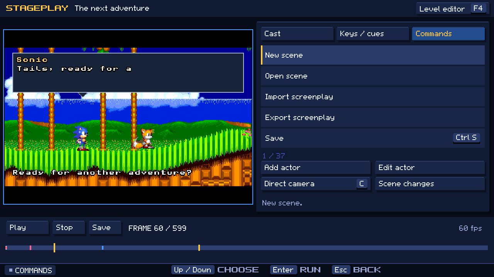
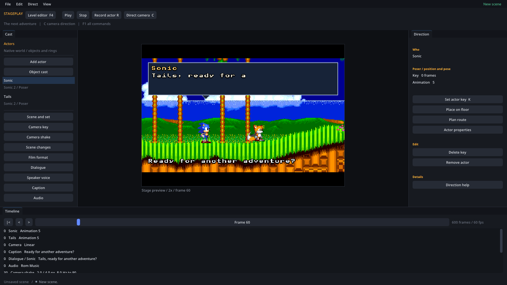
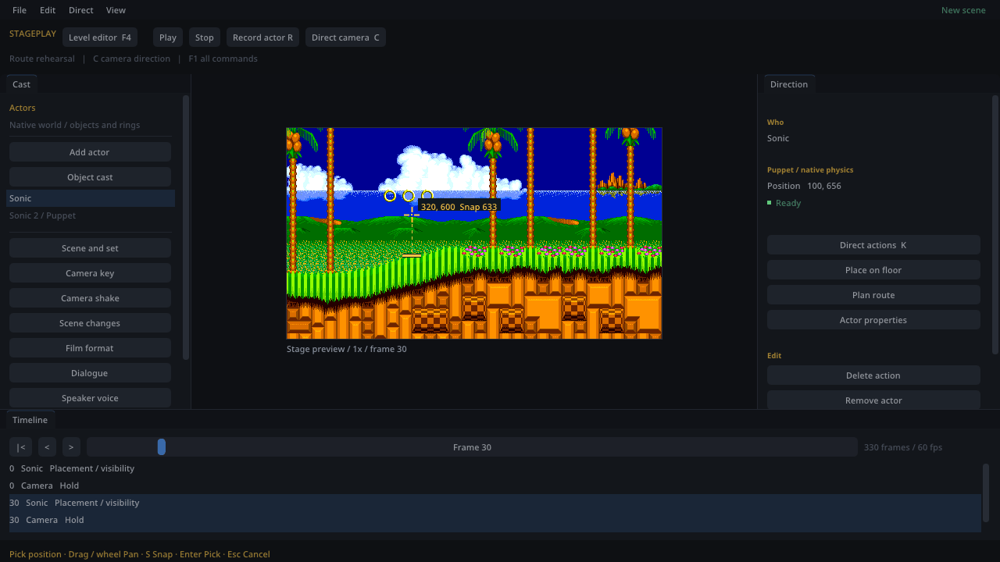

# Stageplay reference

This page lists every screenplay field, editor command, key and limit. It is
for looking things up. To learn Stageplay, start with
[your first film](stageplay-first-film.md); for the terminal tools, see
[Stageplay from the terminal](stageplay-authoring.md).

It describes the **0.7.prerelease development line**. The screenplay is
version 7 and the saved scene (`.stageplay`) is version 8. Both formats are
unpublished: only the current version is accepted, and older files are not
migrated.

- [Files](#files)
- [Screenplay format](#screenplay-format)
- [Actions for players](#actions-for-players)
- [Objects](#objects)
- [Camera](#camera)
- [Dialogue, typing and styles](#dialogue-typing-and-styles)
- [Speaker voices](#speaker-voices)
- [Audio cues](#audio-cues)
- [Route motion](#route-motion)
- [In-engine editor commands and keys](#in-engine-editor-commands-and-keys)
- [OpenGGF Editor commands and keys](#openggf-editor-commands-and-keys)
- [Limits](#limits)

## Files

| File | What it is |
| --- | --- |
| `NAME.stageplay` | The saved scene. Both editors open and save it, the film exporter renders it and mods play it. JSON, at most 8 MiB. |
| `NAME.screenplay.json` | A screenplay: the same scene written shot by shot for people and scripts. It compiles to a `.stageplay` and a `.stageplay` decompiles back to it without loss. At most 32 MiB. |
| `*.png`, `*.wav`, `*.ogg`, `*.ogfproject` | Optional assets: dialogue decorations and portraits, voice recordings and saved editor levels. Paths are relative to the scene's folder. |

Neither file contains ROM data. Every picture and sound comes from the ROMs you
supply when the scene plays. Move a scene together with its folder so relative
asset paths keep working.

## Screenplay format

A screenplay is a JSON object. Unknown fields, duplicate fields, numbers
written as strings and anything after the closing brace are errors. All frames
are at 60 frames per second and start at zero.

### Top level

| Field | Required | Default | Meaning |
| --- | --- | --- | --- |
| `version` | yes | | Must be `7`. |
| `name` | yes | | Scene name, 1–256 printable characters. |
| `width`, `height` | no | `400`, `224` | Film size in pixels: width 160–1920, height 112–1080. |
| `cast` | yes | | Player characters ([cast](#cast)). Up to 32; may be empty. |
| `objectCast` | no | `[]` | Game objects ([objects](#objects)). |
| `shots` | yes | | 1–129 shots, played in order. |
| `dialogueTypers` | no | `[]` | Reusable typing speeds ([typers](#typers)). |
| `dialogueSkins` | no | `[]` | Reusable panel styles ([styles](#styles)). |
| `voices` | no | `[]` | Speaker voice overrides ([voices](#speaker-voices)). |
| `order` | no | | Restores list order after a round trip ([order](#order)). |

The whole scene can be up to 36,000 frames (ten minutes).

### Cast

| Field | Required | Default | Meaning |
| --- | --- | --- | --- |
| `id` | yes | | Unique name used everywhere else in the screenplay. 1–64 letters, digits, `.`, `_` or `-`, starting with a letter or digit. |
| `name` | yes | | Name shown on dialogue panels. |
| `gameId` | yes | | `s1`, `s2` or `s3k`: the game the character comes from. |
| `character` | yes | | `sonic` (all games), `tails` (`s2`, `s3k`) or `knuckles` (`s3k`). |
| `puppet` | no | `true` | `true` for a **Puppet** (moves with the game's physics), `false` for a **Poser** (you key every position). |
| `snapToFloor` | no | `true` | Puppets only. At the start of each shot, attach the feet to a floor within 14 pixels. Turn it off for a deliberate fall. |
| `collisionPath` | no | `0` | Puppets only. Terrain layer `0` or `1`. |

A character from one game can appear in a set from another, for example Sonic
1's Sonic in Sonic 3 & Knuckles' Angel Island. Each character's game must have a
ROM available.

### Shots

| Field | Required | Default | Meaning |
| --- | --- | --- | --- |
| `id` | yes | | Unique shot name, 1–64 characters (`[a-zA-Z0-9][a-zA-Z0-9_.-]*`). Keep it short: it prefixes generated IDs. |
| `durationFrames` | yes | | Length of the shot, at least 1. |
| `set` | yes | | Where the shot takes place ([set](#set)). |
| `transition` | no | cut | How this shot begins. Not allowed on the first shot. |
| `camera` | yes | | Camera keys; the first must be at frame 0. |
| `actors` | no | | Keys for each player in this shot. |
| `actions` | no | | Actions for each Puppet player ([actions](#actions-for-players)). |
| `objects` | no | | Keys for each object role ([objects](#objects)). |
| `objectActions` | no | | Moves for each object Puppet. |
| `worldCommands` | no | `[]` | Clear or remove objects. |
| `captions` | no | `[]` | On-screen text. |
| `dialogue` | no | `[]` | Spoken lines. |
| `audio` | no | `[]` | Music, sound effects and recordings. |
| `cameraEffects` | no | `[]` | Camera shake. |

Frames inside a shot are local: frame 0 is the shot's first frame. Every shot
starts a fresh copy of its level, with its own objects and rings, so each shot
is a new take of the world.

A cast member with no track in a shot is hidden for that shot. A track must
start at frame 0, and its keys must rise strictly and stay inside the shot.

#### Set

| Field | Required | Default | Meaning |
| --- | --- | --- | --- |
| `gameId` | yes | | `s1`, `s2` or `s3k`. |
| `zone`, `act` | yes | | Zero-based zone and act numbers (0–255). The `catalog` command lists them with their names. |
| `romSha1` | no | `""` | Optional lowercase SHA-1 of the exact ROM. |
| `levelProject` | no | `""` | Relative path to a saved editor level (`.ogfproject`) to use instead of the stock level. |

#### Transition

| Field | Required | Default | Meaning |
| --- | --- | --- | --- |
| `kind` | no | `CUT` | `CUT`, `FADE_BLACK`, `FADE_WHITE`, `WIPE_LEFT` or `WIPE_RIGHT`. |
| `durationFrames` | no | `0` | `0` for a cut; 2–600 for the others. |
| `id` | no | `SHOT.change` | Literal ID, kept through round trips. |

A fade or wipe is centred on the cut: half of it plays at the end of the
previous shot, the screen is fully covered at the cut, and the rest plays at the
start of the new shot. Transitions cannot overlap, and every transition must
finish before the scene ends.

### Player keys

| Field | Default | Meaning |
| --- | --- | --- |
| `frame` | (required) | Local frame. |
| `x`, `y` | `0`, `0` | Position of the character's centre in level pixels. |
| `facing` | `RIGHT` | `LEFT` or `RIGHT`, as seen on screen. |
| `visible` | `true` | Show or hide the character. |
| `animation` | `0` | Posers only: animation number. |
| `pose` | `-1` | Posers only: `-1` plays the animation; a number holds that sprite frame. |
| `scale` | `1` | Posers only: 0.01–64. |
| `interpolation` | `HOLD` (Puppet), `LINEAR` (Poser) | Posers only: `HOLD`, `LINEAR` or `SMOOTH`, from this key to the next. |

A Puppet's frame-0 key places it at the start of the shot. Later keys in the
same shot may only change `visible`; the game's physics owns position, facing
and animation. Write `facing`, never `flipX` (a screenplay with `flipX` is
rejected).

### Captions

| Field | Default | Meaning |
| --- | --- | --- |
| `startFrame`, `endFrame` | (required) | Shown from `startFrame` up to, but not including, `endFrame`. |
| `text` | (required) | Up to 4096 characters. |
| `x`, `y` | `12`, `12` | Screen position in film pixels. |
| `argb` | `-1` (white) | Colour as a signed 32-bit ARGB integer. |
| `id` | generated | Optional literal ID. |

A caption, dialogue line or shake starts inside its shot but may end in a later
shot; it is kept whole.

### Camera shake

| Field | Default | Meaning |
| --- | --- | --- |
| `startFrame`, `endFrame` | (required) | Shake from start up to, but not including, end. |
| `amplitudeX`, `amplitudeY` | (required) | Size in level pixels, 0–4096. |
| `frequency` | (required) | Shakes per second, above 0 and at most 30. |
| `seed` | `0` | Changes the pattern; the same seed always shakes the same way. |
| `id` | generated | Optional literal ID. |

Shake moves the picture only. It never moves the characters or the level's own
camera.

### World commands

| Field | Default | Meaning |
| --- | --- | --- |
| `frame` | (required) | Local frame; commands are kept in frame order. |
| `kind` | (required) | `CLEAR_BADNIKS`, `CLEAR_OBJECTS` or `REMOVE_OBJECT`. |
| `actorId` | `""` | `REMOVE_OBJECT` only: an object role to remove. |
| `target` | none | `REMOVE_OBJECT` only: a placed object, `{"layoutIndex":N,"objectId":N,"subtype":N}`. |
| `id` | generated | Optional literal ID. |

`CLEAR_BADNIKS` removes enemies; `CLEAR_OBJECTS` removes every placed object.
Neither removes rings, players or the players' own effects. `REMOVE_OBJECT`
needs exactly one of `actorId` or `target`. A cleared object does not come back
later in the shot; the next shot starts with the full level again.

### Order

`order` may contain `puppets` (actor IDs), `captions`, `audio`, `cameraEffects`
and `dialogue` (event IDs). Each list must name every ID of that kind exactly
once. Decompiling writes it when the saved order differs from the shot-by-shot
order; you rarely need to write it yourself.

### IDs

Every action, cue and command may carry a literal `id`. Without one, the
compiler generates an ID from the shot and position, such as `hello.dialogue0`.
IDs must be unique across the scene.

## Actions for players

The shot's `actions` maps each Puppet's ID to a list of actions in frame
order. Actions are button presses for the character. They never move a
character directly, so a destination is an attempt, not a promise.

| `kind` | Extra fields | Effect |
| --- | --- | --- |
| `MOVE_TO` | `x`, `y`; `urgency` (default 0.5); optional `target`, `motion` | Walk or run toward a point. `urgency` (shown as **Effort**) is the share of top speed, above 0 and at most 1. `y` is checked on arrival; it does not make the character climb. |
| `STOP` | | Brake to a stop. |
| `JUMP` | `holdFrames` (default 12, 1–60) | Press jump and hold it; a longer hold jumps higher. |
| `WAIT` | `condition`, `timeoutFrames` (1–36,000); optional `target` | Hold back the following actions until the condition is met or the time runs out. |
| `RELEASE` | | Let go of the ability button and brake. |
| `CROUCH` | `holdFrames` (1–3600) | Hold down. |
| `LOOK_UP` | `holdFrames` (1–3600) | Hold up. |
| `ROLL` | | Roll from a run. |
| `FLY_TO` | like `MOVE_TO` | Sonic 3 & Knuckles Tails only: fly toward a point. |
| `HOVER` | `holdFrames` (1–3600) | Sonic 3 & Knuckles Tails only: keep flying in place. |
| `GLIDE_TO` | like `MOVE_TO` | Sonic 3 & Knuckles Knuckles only: glide toward a point. |
| `SPINDASH` | like `MOVE_TO`; `holdFrames` must be 24 | Charge and release a spin dash. Written by the route planner. |
| `FACE_LEFT`, `FACE_RIGHT` | | Tap left or right once to turn. Written by the route planner; you may also write them. |

Rules:

- Two movement actions cannot share a frame; a movement and a jump can.
- Two jumps need at least one released frame between them.
- A jump, hover, crouch or look-up hold cannot cross into the next shot.
- Every shot resets the cast to their frame-0 keys and forgets earlier actions.

`WAIT` conditions: `ARRIVED`, `ON_OBJECT`, `GROUNDED`, `AIRBORNE`, `HURT`,
`RECOVERED`, `RING_COLLECTED` and `TARGET_AVAILABLE`. A timed-out wait lets the
following actions run; it never moves the character to make the condition
true.

### Object targets

`MOVE_TO`, `FLY_TO`, `GLIDE_TO` and `WAIT` can aim at a placed object, such as a
moving platform, instead of a fixed point:

```json
"target": {"layoutIndex": 179, "objectId": 74, "subtype": 1, "offsetX": 0, "offsetY": -33}
```

`layoutIndex`, `objectId` and `subtype` identify the placement in the level's
object list; the `level` command prints them. The offset is added to the
object's position every frame, so the target follows a moving platform.
`TARGET_AVAILABLE` requires a target. A target that has not loaded yet reports
`NOT_ACTIVE`; one that has been destroyed reports `DESPAWNED`.

## Objects

`objectCast` declares objects from any of the three games:

| Field | Required | Default | Meaning |
| --- | --- | --- | --- |
| `id`, `name` | yes | | As for players. |
| `gameId` | yes | | `s1`, `s2` or `s3k`. |
| `zone`, `act` | no | `0`, `0` | The level the object comes from. |
| `objectId` | yes | | The game's object number, 0–255. |
| `subtype` | no | `0` | The object's subtype, 0–255. |
| `layoutIndex` | no | `-1` | `-1` adds a new object; a number takes over the object already placed at that index in the level. |
| `sourceKind` | no | `LAYOUT_OBJECT` | `RELEASED_ANIMAL` casts the animal freed from a destroyed badnik (`objectId` and `subtype` 0, `layoutIndex` -1). |

Each shot's `objects` maps role IDs to keys:

| Field | Default | Meaning |
| --- | --- | --- |
| `frame` | (required) | Local frame. |
| `x`, `y` | `0`, `0` | Position in level pixels. |
| `mode` | `FREE` | `FREE` runs the object's own behaviour; `PUPPET` freezes it so you can move it with `objectActions`; `POSE` places it and its frame exactly at each key. |
| `facing` | `RIGHT` | `LEFT` or `RIGHT`, as seen on screen. |
| `visible` | `true` | Show or hide it. |
| `animation`, `pose` | `0`, `-1` | Animation, or a held sprite frame (`pose` ≥ 0). Free keys must keep the defaults. |
| `interpolation` | `HOLD` (Free), `LINEAR` (others) | Free keys must use `HOLD`. |
| `parts` | `[]` | Frames for individual parts of a multi-part object: `{"partId":"root/0","animation":0,"pose":0}`. |

Free keys inside a shot must keep the shot's first position and facing: a Free
object goes where its own behaviour takes it. Some bosses always appear at
their arena position; their keys show **Free: native arena position, anchor
ignored**. An object placed from a level (`layoutIndex` ≥ 0) can only appear in
its own level.

`objectActions` move object Puppets:

| `kind` | Fields | Effect |
| --- | --- | --- |
| `MOVE_TO` | `x`, `y` (required), `speed` (default 1, pixels per frame) | Slide the object's picture toward a point. |
| `STOP` | | Stop sliding. |

An object action needs a visible Puppet key at or before its frame. Object
actions rise strictly by frame. Sliding is visual: the object's own behaviour,
contact damage and effects stay off while it is a Puppet or Pose.

## Camera

| Field | Default | Meaning |
| --- | --- | --- |
| `frame` | (required) | Local frame. |
| `x`, `y` | (required) | Top-left corner of the view in level pixels. |
| `zoom` | `1` | 0.05–64; 2 shows the level twice as large. |
| `interpolation` | `LINEAR` | `HOLD`, `LINEAR` or `SMOOTH`, from this key to the next. |
| `follow` | none | Follow one or more Puppets (below). |

The camera moves the centre of the view between keys, so two keys with the same
centre and different zoom make a straight push-in. The picture is clamped to the
level's edges.

`follow`:

| Field | Default | Meaning |
| --- | --- | --- |
| `actors` | `[]` | Puppet IDs to keep in frame. Several actors are framed together. |
| `deadZoneX`, `deadZoneY` | `0`, `0` | How far the subject can move before the camera follows (0–960, 0–540). |
| `lookAhead` | `0` | Lead in the direction of travel, 0–60. |
| `smoothing` | `1` | 0.001–1; smaller is softer. |
| `offsetX`, `offsetY` | `0`, `0` | Shift of the framing. |

A followed actor must be a Puppet that is visible somewhere in the same shot.

## Dialogue, typing and styles

### Dialogue lines

| Field | Default | Meaning |
| --- | --- | --- |
| `startFrame`, `endFrame` | (required) | The line's panel is shown from start up to, but not including, end. |
| `text` | (required) | 1–4096 characters. Line breaks are allowed. |
| `speakerActor` | `""` | A player or object role ID. The panel shows its name and points at it. |
| `speakerName` | `""` | A name to show instead, or the name of an offscreen speaker. One of the two speaker fields is required. |
| `typerId`, `skinId` | `""` | A typer and style from the top level; empty uses the built-in ones. |
| `x`, `y` | `12`, `12` | Panel position in film pixels. |
| `width`, `height` | film width − 24, min(70, film height − 24) | Panel size: width 80–1920, height 36–1080. |
| `portraitAsset` | `""` | Optional PNG drawn in a 32×32 area beside the text. |
| `revealFrames` | `[]` | Hand timing: one frame offset per character, never decreasing, all before the line ends. |
| `id` | generated | Optional literal ID. |

The panel must fit inside the film and hold all of the wrapped text, or the
scene is rejected. Text is wrapped once before it types, so words never jump.
The whole line must finish typing before `endFrame`.

### Typers

| Field | Default | Meaning |
| --- | --- | --- |
| `id` | (required) | Name used by `typerId`. |
| `framesPerGrapheme` | `2` | Frames per character, 0–30; 0 shows the whole line at once. |
| `punctuationPauseFrames` | `6` | Extra pause after punctuation, 0–120. |
| `spacePauseFrames` | `0` | Extra pause after a space, 0–120. |

### Styles

| Field | Default | Meaning |
| --- | --- | --- |
| `id` | (required) | Name used by `skinId`. |
| `textArgb` | `-593700` | Text colour. |
| `nameArgb` | `-11172` | Speaker name colour. |
| `panelArgb` | `-15722457` | Panel fill. |
| `borderArgb` | `-7826009` | Panel border. |
| `padding` | `6` | Inner margin, 4–32. |
| `decorationAsset` | `""` | Optional PNG drawn as a nine-slice frame around the panel. |
| `decorationBorder` | `0` | Width of the PNG's corners and edges in its own pixels, 0–64. |
| `pointer` | `true` | Draw the tail that points at the speaker. |

Colours are signed 32-bit ARGB integers, so opaque white is `-1`. A scene may
have up to 64 typers and 64 styles. PNGs may be at most 1024×1024 each and
four million pixels in total per scene.

## Speaker voices

Every speaker makes short game-chip sounds as their text appears, unless you
turn them off. Defaults:

| Speaker | Default voice | Tone, blip on | Pitch | Variation | Length | Level |
| --- | --- | --- | --- | --- | --- | --- |
| Sonic | Soft Cool | Hollow, word | 67 | 2 | 7 | 80 |
| Tails | Workshop | Buzz, letter | 79 | 2 | 2 | 70 |
| Knuckles | Red Rattle | Buzz, letter | 62 | 2 | 3 | 78 |
| Motobug | Patrol Buzz | Buzz, word | 69 | 4 | 8 | 80 |
| Buzz Bomber | Wing Chime | Chime, letter | 75 | 4 | 3 | 80 |
| Bosses | | Hollow, word | 48 | 3 | 11 | 90 |
| Offscreen names | | Square | 64 | 2 | 7 | 75 |

Other objects get a voice derived from their object number. Renaming a role
does not change its voice.

The fifteen presets, for any speaker:

| Origin | Preset | Tone, blip on | Pitch / variation / length / level |
| --- | --- | --- | --- |
| Sonic | Blue Spark | Square, word | 72 / 5 / 5 / 80 |
| Sonic | Soft Cool | Hollow, word | 67 / 2 / 7 / 80 |
| Sonic | Speed Talk | Square, letter | 76 / 4 / 2 / 74 |
| Tails | Twin Chime | Chime, letter | 84 / 3 / 2 / 72 |
| Tails | Warm Pips | Square, word | 77 / 3 / 6 / 80 |
| Tails | Workshop | Buzz, letter | 79 / 2 / 2 / 70 |
| Knuckles | Stone Hollow | Hollow, word | 55 / 2 / 8 / 88 |
| Knuckles | Blunt Square | Square, word | 57 / 1 / 9 / 88 |
| Knuckles | Red Rattle | Buzz, letter | 62 / 2 / 3 / 78 |
| Motobug | Patrol Buzz | Buzz, word | 69 / 4 / 8 / 80 |
| Motobug | Little Square | Square, word | 69 / 4 / 8 / 80 |
| Motobug | Rusty Low | Hollow, word | 57 / 3 / 10 / 84 |
| Buzz Bomber | Wing Chime | Chime, letter | 75 / 4 / 3 / 80 |
| Buzz Bomber | Radio Buzz | Buzz, word | 78 / 5 / 5 / 80 |
| Buzz Bomber | Deadpan | Hollow, word | 62 / 1 / 8 / 84 |

A preset copies its values into the scene; the screenplay stores the values,
not the preset's name.

A `voices` entry overrides one speaker for the whole scene:

| Field | Default | Meaning |
| --- | --- | --- |
| `speakerActor` or `speakerName` | | Exactly one: a cast ID, or an offscreen name (matched exactly). |
| `tone` | `SQUARE` | `OFF`, `SQUARE`, `CHIME` (octave), `HOLLOW` (open fifth) or `BUZZ` (chip noise). |
| `rhythm` | `WORD` | `WORD` makes one blip per word, `LETTER` one per letter. |
| `pitch` | `72` | MIDI note 48–96 (C3–C7). |
| `variation` | `4` | Random-but-repeatable pitch spread in semitones, 0–12. |
| `lengthFrames` | `6` | Longest blip, 1–18 frames. |
| `level` | `80` | Volume, 0–100. |

An override uses these defaults for any field you leave out; it does not mix
with the character's default voice. Remove the override to return to the
default. Punctuation and spaces are silent.

## Audio cues

| Field | Default | Meaning |
| --- | --- | --- |
| `frame` | (required) | Local frame. |
| `kind` | (required) | `ROM_MUSIC`, `ROM_SFX`, `VOICE` or `MUSIC_STOP`. |
| `gameId` | the shot's game | Game whose music or sound to play. |
| `soundId` | `0` | `ROM_MUSIC` and `ROM_SFX`: the game's own request number, in decimal. |
| `music` | | `ROM_MUSIC` only, instead of `soundId`: a song name such as `"EMERALD_HILL"` or its title, `"Emerald Hill Zone"` (any letter case). |
| `asset` | `""` | `VOICE` only: relative path to a WAV or Ogg file. |
| `gain` | `1` | `VOICE` only: 0–1. Music and sound effects must use 1. |
| `id` | generated | Optional literal ID. |

Sound numbers are the shipped game's own request numbers, as in its
disassembly: Sonic 2's Emerald Hill is `$82`, written `130`. Sonic 1's music runs
from `$81` (Green Hill, `129`). Sonic 3 & Knuckles uses the combined game's
soundtrack, from `$01` (Angel Island Act 1); its S&K credits are `$DC` (`220`).
A `music` name compiles to the same number, and saved scenes and exported
screenplays always store the number. A cue cannot have both `music` and
`soundId`.

The `catalog` command lists every song's name, title and number for its game,
and every zone with the number of its own music (`musicId`). In the editors, the
**Music** and **Sound** lists show each name with its number in hexadecimal,
such as **Emerald Hill ($82)**; **F2** accepts an exact decimal number. A scene that contains any music or music-stop cue switches off the
level's automatic music while it plays. Cues play only when playback passes
them, never when you seek. Voice recordings are limited per clip, and a scene's
decoded recordings may total at most 64 MiB.

## Route motion

A route planned in either editor, or with the `route` command, stores its
settings on the `MOVE_TO` it writes:

```json
"motion": {"startingAction": "WALK", "travelSpeed": "WALK",
           "endingAction": "GENTLE_STOP", "endingFacing": "INHERIT"}
```

| Field | Values (editor label) | Planner default |
| --- | --- | --- |
| `startingAction` | `WALK` (Walk), `JUMP` (Jump), `SPINDASH` (Spindash) | `WALK` |
| `travelSpeed` | `WALK` (Walk), `RUN` (Run) | `WALK` |
| `endingAction` | `GENTLE_STOP` (Gentle), `HARD_STOP` (Hard), `OVERSHOOT` (Overshoot) | `GENTLE_STOP` |
| `endingFacing` | `INHERIT` (Keep), `LEFT` (Left), `RIGHT` (Right) | `INHERIT` |

A hand-written `MOVE_TO` without `motion` behaves like `WALK`, `RUN`,
`HARD_STOP`, `INHERIT`. `SPINDASH` requires `RUN`. Walk caps the character at a
stroll of 1.5 pixels per frame; Run uses the character's real top speed.

## In-engine editor commands and keys

Open the in-engine editor with **F4** from the level editor. Its panel has
three pages: **Cast**, **Keys / cues** and **Commands**.


### Keys

| Key | Controller | Action |
| --- | --- | --- |
| F4 | | Return to the level editor. |
| Left / Right | D-pad left / right | Step one frame; with Shift, 60 frames. |
| Home / End | | First / last frame. |
| Up / Down | D-pad up / down | Choose a row. |
| Enter | A | Open the chosen row. |
| Space | | Play / pause. |
| Tab | View | Switch between **Cast** and **Keys / cues**. |
| F1 | Start | Open **Commands**. |
| K | X | Direct the selected actor: the action menu for a Puppet, a key for a Poser. In camera mode: capture a camera key. |
| R | | Record an actor take; in camera mode, a camera take. |
| C | | Camera mode on / off. |
| | Y | Add actor. |
| | LB / RB | Previous / next cast member. |
| Ctrl+S, Ctrl+Z, Ctrl+Y | | Save, undo, redo. |
| Esc | B | Leave camera mode, close **Commands**, or leave Stageplay. |

The **Stop** button stops playback and returns to frame 0.

The prompt bar along the bottom names the current mode in a chip (**CAMERA**,
**REC CAMERA TAKE**, **REC POSER TAKE**, **REC PUPPET TAKE**, **FRACTIONAL ZOOM**,
**COMMANDS**; plain directing leaves the bar to its keys at the smallest window) and
shows the keys that act in that mode, or the pad buttons after a controller press.
Panel buttons and **Commands** rows show their keyboard shortcut as a key cap.

Camera mode: WASD or arrow keys pan (Shift pans faster), Q and E step the zoom
through whole numbers from 1 to 64, K captures a key and R records a camera
take. To zoom below 1, type the zoom in the **Camera key** form.

Recording a take: in a Puppet take, A and D move, S brakes and W jumps. In a
Poser take, WASD moves the actor 2 pixels per frame. Space or Esc ends the take,
which undoes as one step.

### Forms

| Key | Action |
| --- | --- |
| Up / Down | Move between rows. |
| Left / Right | Change a choice. |
| Enter | Edit a value. On a **Position** or **Column** row, open the position picker. On **Advanced**, open or close the section. |
| F2 | Type a value instead of picking it. A position accepts `X, Y`. |
| F1 | Full help, ranges and error details. |
| Esc | Close. |

### Position picker


| Key | Controller | Action |
| --- | --- | --- |
| Arrow keys | D-pad or left stick | Move the crosshair; it speeds up while held. The view follows. |
| Shift | RB | Move one pixel at a time. |
| S | X | Floor snap on / off. |
| Enter | Start or A | Use this point. |
| Esc | Back | Cancel. |

Placement pickers start with floor snap on; the camera framing picker starts
with it off. The tag shows the position and `Snap Y` (the floor it will snap to), `Snap
off` or `No floor`. Picking only fills in the form; the change happens when you
apply the form.

### Commands



| Command | What it does |
| --- | --- |
| New scene, Open scene, Save, Save as | Scene files. Unsaved changes ask **Save and continue**, **Discard scene changes** or **Keep editing**. |
| Import screenplay, Export screenplay | Open a screenplay as a new unsaved scene, or write the scene as a screenplay. Export does not change the save state or undo history. |
| Scene / set | **Scene and set** form: name, length, game, zone, act. Advanced: width, height, ROM identity, level project. |
| Film format presets | Widescreen 16:9 (384×216), Native (320×224), HD 16:9 (1280×720) or Custom. |
| Add actor, Actor properties, Remove actor | Name, character, Puppet or Poser and starting position. Advanced: game, **Start on floor**, collision path. |
| Direct actor / set key | Puppet: the **Direct** menu (below). Poser: the **Actor key** form. |
| Remove actor key / action | Delete the key or action at the playhead. |
| Puppet actions | The **Direct** menu for the selected Puppet. |
| Plan route | Find a route under the game's physics ([route motion](#route-motion)). |
| Place on floor | Find floors in a column for the selected actor or object. |
| ROM object cast / clear | The **Object cast** menu: add, take over or direct objects; Clear badniks; Clear objects; world commands. |
| Direct camera (`C`), Capture camera key (`K`), Camera keys, Record camera take (`R`) | Camera direction. **Camera keys** also captures 1×–4× pixel framing. |
| Camera shake / quake | Shake intervals. |
| Scene changes / transitions | Shot changes with their transition and set. |
| Captions, Dialogue lines, Dialogue typers, Dialogue decorations, Speaker voice | Text, speech and voices. |
| Audio cues | Music, sound effects, recordings and music stops. |
| Record actor take (`R`) | Record a take from the keyboard. |
| Play / pause, Stop, Undo, Redo | Playback and history. |
| Export film | Save, then render a lossless MKV in a separate process. |
| Direction details | Full status, preview problems and route diagnostics. |
| Level editor | Return to the level editor. |

The **Direct** menu for a Puppet offers **Move to destination**, **Jump**,
**Stop / brake**, **Wait**, **Release**, **Crouch**, **Look Up** and **Roll**,
plus **Fly toward target** and **Hover (bounded)** for Sonic 3 & Knuckles
Tails and **Glide toward target** for Sonic 3 & Knuckles Knuckles. **Place
actor** sets where the actor starts the shot and which way it faces;
**Actor visibility** hides or shows it at the playhead. Each existing action is
listed below these, with **Edit** and **Delete**.

## OpenGGF Editor commands and keys

The [OpenGGF Editor](https://github.com/OpenGGF/OpenGGF-Editor) desktop app
shows the same scene in docked panels: **Cast** on the left, the preview in the
middle, **Direction** on the right and **Timeline** at the bottom. Its menus
are **File**, **Edit**, **Direct** and **View**, and every form is the same as
in the in-engine editor.



| Key | Action |
| --- | --- |
| F4 | Switch between the level editor and Stageplay. |
| Space | Play / pause. |
| Left / Right | Step one frame; with Shift, 60 frames. |
| Home / End | First / last frame. |
| C | Camera mode on / off. Esc also leaves it. |
| K | Set an actor key, or capture a camera key in camera mode. |
| R | Record an actor take, or a camera take in camera mode. Space or Esc ends it. |
| Delete | Delete the key or action. |
| Ctrl+S / Ctrl+Shift+S | Save / Save as. |
| Ctrl+Z / Ctrl+Y (or Ctrl+Shift+Z) | Undo / redo. |
| F1 | **Stageplay commands**: a searchable list of every command. Inside a form, F1 shows help. |

Cmd works in place of Ctrl on macOS. **View → Reset panel layout** restores the
panels.

In a form, Tab moves between fields, Enter applies and Esc closes. Position
fields have a **Pick** button: hover over the preview to aim, click to choose,
drag or scroll to pan, and press S to toggle floor snap. File fields have
**Browse**. If you last used a controller, forms use the in-engine layout so you
can keep using the controller.



## Limits

| Item | Limit |
| --- | --- |
| Scene length | 36,000 frames (10 minutes) at 60 fps |
| Shots | 129 per screenplay; 128 scene changes |
| Film size | 160–1920 wide, 112–1080 high |
| Player cast | 32 |
| Object roles | 1024 |
| Keys | 100,000 in total, including object part frames |
| Actions and commands | 4096 in total |
| Captions, dialogue lines | 1024 each |
| Audio cues, world commands | 4096 each |
| Camera shakes | 256 |
| Typers, styles | 64 each |
| Text | 4096 characters per caption or line |
| Coordinates | ±1,048,576 |
| Camera zoom | 0.05–64 |
| Preview and export view | The visible part of the level (film size ÷ zoom) may be at most 4096 pixels on a side and 8 million pixels in total. |
| Export scale | 1–8 |
| Dialogue images | 1024×1024 each; 4 million pixels per scene |
| Voice recordings | 64 MiB decoded per scene |
| Screenplay / scene file | 32 MiB / 8 MiB |

Shots activate the level around each performer. All of them share the game's
object slots; if a shot runs out, the error names the placement. Clear objects
you don't need or split the shot.
