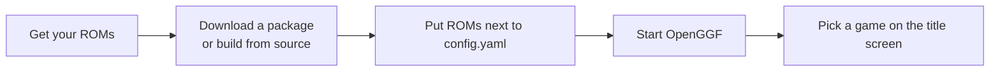

# Getting Started

This guide follows the `develop` branch (`0.8.prerelease`). The latest release,
0.7.20261105, may have different menus; use the documentation included with your
download for that release.



## What You Need

- **A graphics driver that supports an OpenGL 4.1 core context.** Support depends
  on both the GPU and its operating-system driver.
- **ROM files** for the games you want to play. The engine does not include any game data.
  You must supply your own legally obtained copies.
- **Java only for JAR builds.** Native release packages include their own runtime.
  The universal JAR and source builds need Java 25 or later; source builds need
  JDK 25. Download one from [Adoptium](https://adoptium.net/) or your preferred
  distribution, and run `java -version` to check.

Native packages load code and data mods and include Time Attack, with the same
trust prompts as the JVM. Keep the bundled folders and native libraries together.

### Expected ROM Files

The development engine recognizes these original ROM revisions. Supported revision
differences use the supplied image's own data; other editions remain unverified.

| Game | Expected revision and hash |
|------|----------------------------|
| Sonic 1 REV00 | World; CRC32 `F9394E97`; SHA-1 `6DDB7DE1E17E7F6CDB88927BD906352030DAA194` |
| Sonic 1 REV01 | World; CRC32 `AFE05EEE`; SHA-1 `69E102855D4389C3FD1A8F3DC7D193F8EEE5FE5B` |
| Sonic 2 REV00 | World; CRC32 `24AB4C3A`; SHA-1 `14DD06FC3AA19A59A818EA1F6DE150C9061B14D4` |
| Sonic 2 REV01 | World; CRC32 `7B905383`; SHA-1 `8BCA5DCEF1AF3E00098666FD892DC1C2A76333F9` |
| Sonic 3&K | World lock-on combined ROM; CRC32 `63522553`; SHA-1 `CFBF98C36C776677290A872547AC47C53D2761D6` |

Filenames do not matter. Put your images next to `config.yaml` (or in the folder named by
`roms.directory`) and the engine recognises each one by its size and cartridge header.

<details>
<summary>Accepted image layouts, revision choice and per-game overrides</summary>

The engine accepts:

- a standalone Sonic 1, Sonic 2, Sonic 3 or Sonic & Knuckles image;
- a Sonic 3 & Knuckles lock-on dump (4 MiB), which also serves as Sonic 3 and Sonic & Knuckles;
- a Sonic & Knuckles + Sonic 1 or + Sonic 2 lock-on dump, which also serves the game it carries;
- a separate Sonic 3 image plus a separate Sonic & Knuckles image, which together boot
  Sonic 3 & Knuckles with no joining on disk.

The per-game keys (`roms.sonic1`, `roms.sonic2`, `roms.sonic3k`) remain as explicit
overrides through master-title **Settings** or `config.yaml`. Leave them at their
defaults or blank to let the engine find your images, or set one to a file that must
exist. See the [image identity table](../../../CONFIGURATION.md#image-identity)
for all recognised layouts.

REV00/REV01 selection is automatic from the original bytes. If both are available,
set the per-game file to the revision you want to play. A revision name in a
filename or header alone does not verify a modified image. Console-region
differences and later rerelease patches are separate from this revision choice.

</details>

## Install and Run

Choose one option. Native release packages need no Java install.

### Option A: Download a Release

1. Download a package for your platform from [GitHub Releases](https://github.com/OpenGGF/OpenGGF/releases):

   | Platform | Package | Start it with |
   |---|---|---|
   | Windows | `OpenGGF-windows.zip` | Double-click `OpenGGF.exe`, or run `.\OpenGGF.exe` in a terminal |
   | Linux | `OpenGGF-linux.tar.gz` | `cd OpenGGF` then `./OpenGGF` |
   | macOS | `OpenGGF-macos.zip` when the release has one | Open `OpenGGF.app` |
   | Any, including macOS for 0.7 | `OpenGGF-universal.jar` (needs Java 25) | `java -jar OpenGGF-universal.jar`; on macOS `java -XstartOnFirstThread -jar OpenGGF-universal.jar` |

   The 0.7.20261105 release has no macOS native package, so use the universal JAR there.
2. Extract the package to a folder.
3. Place your ROM files next to the editable `config.yaml` included in the package.
4. Start OpenGGF with the command in the table.
5. If a game card says its ROM is missing, set the path in Settings or `config.yaml`.
   In development builds, **Locate ROM** and **Add your games** also locate images
   or scan a folder; filenames need not match the defaults.

### Option B: Build from Source

Source builds also need Git, Python 3 and Maven; see
[Developer Setup](../contributing/dev-setup.md#prerequisites). Run these from a
terminal. On Windows, use `tools/testing/install-hooks.ps1` and your Python 3 launcher.

```bash
git clone --branch develop https://github.com/OpenGGF/OpenGGF.git
cd OpenGGF
tools/testing/install-hooks.sh
python3 tools/testing/maven_queue.py -Dmse=off -DskipTests package
```

The last command packages without running tests. For development validation,
follow the [testing guide](../contributing/testing.md).

Place your ROM files in the project root directory (next to `pom.xml`); any filename
works. Then run:

```bash
java -jar target/OpenGGF-0.8.prerelease-jar-with-dependencies.jar
```

On macOS, add `-XstartOnFirstThread` before `-jar`. The filename follows the
version in `pom.xml`; use the artifact produced by your checkout.

**It worked if** the legal disclaimer appears, followed by the master title screen.
If the window does not open, see [Troubleshooting](troubleshooting.md).

## First Launch

The legal disclaimer appears first by default. After accepting it:

1. **Master title screen.** A shelf of game cards. Left/right changes game and
   Enter (A) starts it.
2. **Game title screen.** The selected game's original title screen (e.g., the Sonic 2
   "PRESS START BUTTON" screen).
3. **Gameplay.** The first zone of the selected game.

If no ROMs are found, **Add your games** lets you locate a game or scan a folder
for all three supported games. A missing game's card also opens its ROM browser.
The browser has Home, Downloads and Last folder shortcuts and lists likely ROM
files first. Your files stay in their original locations.

<details>
<summary>Master title screen tour</summary>

Each game card shows the game's original animated title logo. Under the card,
**setup chips** show what Start will launch, such as `SONIC & TAILS`, `4:3` or
`REWIND ON`; amber chips are set for that game only. The chips are status only;
change them in **Game Setup**. If they do not all fit, a `+N MORE` chip counts the
rest and the line under the buttons names them ("Also debug on, 12 mods") on the card
and on Start, with set-for-this-game values in amber.

| From the game card | Reaches |
|---|---|
| Down | **Start**, **Game Setup** and **Recordings** |
| Up | Engine-wide tabs: **Mods**, **Settings**, **Extras** (**Blue Spheres** and mod-added modes such as the bundled **Time Attack** mod), **Advanced** and **Quit** |
| Back | Asks whether to quit (from any other row, Back returns to the game card) |

The footer shows only the keys that work on the focused row, as key caps or your
controller's buttons. Games without a ROM stay on the shelf and name the file to add.

Opening Mods from Game Setup shows mods for that game, including shared mods. The
header Mods tab shows the full catalog. The Mods list labels each installed mod
with its target game: S1, S2, S3K, S1/S2/S3K for all three, or Standalone. When
audio is enabled, navigation, confirmation and errors use short host-owned cues
that do not depend on the selected game's ROM.

The hub remembers the game you last focused. **Start** opens the selected game's
title screen; use the paused card to resume a live session at its exact position.
After a short idle, a ROM terrain preview pans inside the card. Optional **Hub
music** and its volume are under Settings → Sound.

</details>

## Quick Configuration

| Menu | Scope | What you set there |
|---|---|---|
| **Game Setup** (on the hub, or `Tab`) | One game | Players, aspect ratio, rewind, **Borrow from** (another game's sprites, spindash and sounds) and debug tools |
| **Settings** | Every game | Tabs for Display, Sound, Controls, Gameplay, Files and Capture |
| **Advanced** | Every game | Expert ROM loading and rewind tuning |

In Game Setup, rewind, debug tools and aspect ratio show **Default** and follow
Settings until you choose a value for that game.

Settings, Game Setup and Mods all keep a draft: the footer counts unsaved changes,
and Back lists the old and new values before asking **Save**, **Discard** or
**Keep editing**. Applied mod changes reload the mods at the title.

<details>
<summary>Navigating Settings and its editors</summary>

Press Up from the first row to switch Settings tabs. Controls groups player
bindings and warns about duplicate keys. Gameplay keeps the Rewind scope, budget
and stage/life-loss options together. Values that differ from the default have an
amber dot. Each tab offers a confirmed reset, which remains a draft until saved.

In text editors, Down enters the keypad and Up from its top row returns to the
text field. Enter/A chooses a key or accepts the focused field; you can also type
normally. Number fields use a numeric keypad, and Up in path fields opens a
controller file browser. **Details** (`F1` or controller north button) shows
complete help, values and errors with manual scrolling, including when a setting
takes effect. Hold directions for repeated navigation.

Controller prompts follow Xbox/PlayStation labels or physical button positions.
See [configuration](../../../CONFIGURATION.md#engine-settings-from-the-title)
for details.

</details>

The engine reads settings from `config.yaml` in the working directory. It stores only your overrides;
`config.yaml.example` lists the bundled reference settings. Missing keys use built-in
defaults. A few settings you might want to change immediately:

| Setting | What it does | Default |
|---------|-------------|---------|
| `roms.default` | Which game boots when the master title is bypassed (`"s1"`, `"s2"`, or `"s3k"`) | `"s2"` |
| `roms.directory` | Folder scanned for ROM images, identified by size and header rather than name | `"."` |
| `startup.masterTitleScreen` | Show game picker on launch | `true` |
| `display.windowAutosize` | Derive the window size from the aspect preset | `true` |
| `audio.enabled` | Enable or disable sound | `true` |
| `characters.sidekick` | CPU sidekicks for direct launches, comma-separated in follow order (edit as a list in Settings > Advanced); hub launches use each game’s Game Setup | `"tails"` |
| `debug.flags.editor` | Allow `Shift+Tab` to open the experimental editor overlay | `false` |

Key bindings can be written as names like `"SPACE"` and `"F9"` instead of raw numeric key codes.

For the full list, see [Configuration](configuration.md) or the
[Configuration Reference](../../../CONFIGURATION.md).

## What Next?

- [Controls](controls.md) -- Learn the keyboard layout
- [Game Status](game-status.md) -- See what works in each game
- [Troubleshooting](troubleshooting.md) -- If something went wrong
