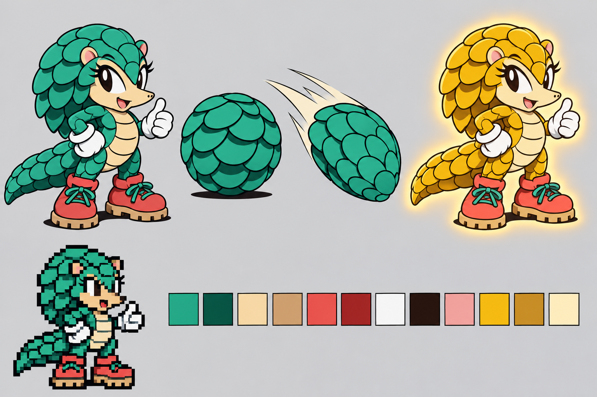

# Part 1: the design contract

*[MICA and TALON tutorial](README.md), part 1 of 9.*

| You build | You learn | Checkpoint |
| --- | --- | --- |
| A one-page design for your character | Which archetype to pick, what the engine gives you, and what you must draw | none: this part is a document |

Most of the work on a character is drawing, and most drawing mistakes start as design
mistakes. A tail that vanishes at 40 pixels tall, or a name the game's font cannot
spell, costs days later. This part fixes those decisions on one page before any art.

## Steps

1. **Draw a silhouette that reads at 40 pixels.** The player sprite is about 40 pixels
   tall. Large heads, big eyes and one or two bold shapes survive; fine detail does not.
   MICA's scales are drawn light-on-dark so they read as plates, never as quills. If
   your character is Sonic-like, it must also curl into a ball.
2. **Pick the archetype.** It decides more than anything else you choose. See
   [the archetype table](#the-archetype-decides-the-route) below.
3. **Choose one defining action.** MICA has one: an airborne homing attack. TALON's is
   the divebomb; his flight comes with his archetype. One action keeps the art and code
   small and the character easy to learn.
4. **Choose a name the fonts can spell.** HUDs and results screens draw names from each
   game's own letters. MICA and TALON were chosen partly because the fonts already
   contain their letters. Sonic 1's small HUD font has no M or A, so MICA ships two
   extra letters for it. [Part 6](06-every-screen.md#2-names-and-letters) shows how.
5. **Fix a palette of 15 colours.** Index 0 is transparent. Every other colour must sit
   on the Mega Drive's colour ladder: each channel is one of 0, 36, 73, 109, 146, 182,
   219 or 255. MICA's palette is
   [`art/mica/sheet/palette.yaml`](../../../../examples/mica-and-talon/art/mica/sheet/palette.yaml).
   Choose a powered-form colour plan now too (MICA's jade turns gold), because
   [part 7](07-powered-forms.md) cycles these indices.
6. **Get a model sheet approved.** Make a turnaround and a few key poses with your image
   model, and keep the accepted images and prompts together. MICA and TALON were chosen
   from four candidates; their
   [character reference](../../../../examples/mica-and-talon/concept/README.md) records
   the brief, the rejected designs and why. Every later drawing is made against these
   sheets.
7. **Write the contract down.** Fill in the table below for your character.

| Decision | MICA | TALON |
| --- | --- | --- |
| Stands in for | Sonic | Tails |
| Archetype | `SONIC_AND_TAILS` (solo: `SONIC_ALONE`) | `TAILS_ALONE` |
| Physics | `PhysicsProfile.SONIC_2_SONIC` | `PhysicsProfile.SONIC_2_TAILS` |
| Defining action | Homing attack; Instagib when Gilded | Divebomb; flight and carry come with the archetype |
| Powered form | Gilded: jade turns gold | Solar: slate turns white-gold |
| Default partner | TALON follows her | none |
| HUD name | `MICA` | `TALON`, or `TALO` where the cell is narrower |

**It worked if** you can say, for your character, which route it plays, what its one
action is, how its name is spelled in each game, and which 15 colours it uses.

## The archetype decides the route

A character's archetype is a routing contract, not a label. Levels and events check
it: Sonic's route, Tails' route and Knuckles' route differ in where they start, which
paths open and which cutscenes play. Pick the route your character can actually finish.

| Archetype | You inherit | Use it for |
| --- | --- | --- |
| `SONIC_AND_TAILS` | Sonic's team route; solo launches use `SONIC_ALONE` | A runner that may have a partner |
| `SONIC_ALONE` | Sonic's solo route; invalid with a sidekick | A runner that is always alone |
| `TAILS_ALONE` | Tails' route, his touch attacks, object geometry and rolling rules, his respawn fly-in, the shared flight model | A flyer, or a follower |
| `KNUCKLES` | Knuckles' routes and gates; you must declare glide | A climber |

The archetype also chooses which native animation scripts your sheet answers to. A
Sonic-like sheet is bound to Sonic's script vocabulary, and a Tails-like sheet to
Tails'. [Part 4](04-full-sheet.md) uses this.

## What the engine gives you, and what you draw

| The engine keeps | You supply |
| --- | --- |
| Physics, collision, slopes, rings, shields, damage, death and rewind | A `CharacterPhysicsSpec`: a stock profile or your own tuning |
| The native animation clocks, speeds and selectors | Drawings for each canonical animation |
| Every screen's timing, layout, priority, shadows and fades | A drawing for each frame those screens show |
| The level, objects, music and enemies | Nothing: they stay the game's own |
| Native moves that come with your archetype, such as spindash, flight and carry | Your one new action, in Java |

The engine never redraws your character. Every frame the player sees is one you drew,
or the game's own art where you left a slot empty.

Why "one action": what an ability costs

An action costs a Java hook, a set of animation frames for every direction it can
face, rewind state if it keeps any, and tests. MICA's homing attack needed five
directional dive animations (`HOMING_DIVE_FORWARD`, `_FORWARD_UP`, `_UP`,
`_FORWARD_DOWN`, `_DOWN`), plus a reticle. TALON's divebomb reuses the same
world-owned strike, so it needed only his own frames. Reusing an engine facility
rather than inventing one is what kept TALON small. See the reference's
[ability rules](../../characters.md#ability-and-super-form-rules).

Colour ladder and powered colours

The Mega Drive stores each channel in 3 bits, so only eight levels exist. A colour off
the ladder is rounded when the game draws it, and two of your colours may become one.
Choose the powered form's colours at the same time: a `SuperFormProfile` replaces whole
16-colour rows, so the form can only recolour indices your normal palette already uses
for the right body parts. MICA keeps jade on indices 2–6 so Gilded can cycle exactly
those. See [part 7](07-powered-forms.md).

**Next: [part 2, a first playable](02-first-playable.md).**
