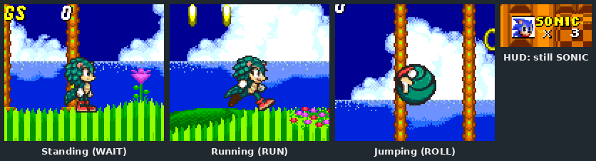

# Part 2: a first playable

*[MICA and TALON tutorial](README.md), part 2 of 9. Checkpoint:
[`tutorial/part-2-first-playable`](../../../../examples/mica-and-talon/tutorial/part-2-first-playable).*

| You build | You learn | Checkpoint |
| --- | --- | --- |
| MICA standing, walking, running and rolling in Sonic 2 | Registration, `CharacterDefinition`, physics, a minimal sheet, the build | `part-2-first-playable`: two classes, a manifest and 26 frames |

By the end of this part MICA plays Emerald Hill on her own art, with Sonic's physics.
Everything else in the game is still stock. That includes the HUD, which still says
SONIC, until [part 6](06-every-screen.md).



## Try it first

```bash
python3 examples/build_example.py mica-and-talon/tutorial/part-2-first-playable --run
```

The first build compiles the engine through the Maven queue, which takes a few minutes.
When the engine opens, choose Sonic 2, open **Game Setup**, set **Players** to MICA
alone, and press **Start**.

**It worked if** the build prints `Validation passed: 0 findings` and `Built …/part-2-first-playable.jar`,
and MICA walks, runs and rolls in Emerald Hill. If the build stops at
`OPENGGF_CLI_CLASSPATH is unset`, you ran `generate_resources.py` directly; use the
command above.

## What is in the checkpoint

```text
part-2-first-playable/
  art/sheet/
    frames.yaml            26 frames: which animation, order, file and hotspot
    palette.yaml           MICA's 15 colours plus transparent
    frames/*.png           indexed drawings (MICA's own, byte-for-byte)
  src/main/java/micaandtalon/
    MicaMod.java           registration
    MicaCharacter.java     definition, physics and drawing
  src/main/resources/META-INF/openggf-mod.yaml
  generate_resources.py    bakes art/sheet into art/mica.ggfp at build time
```

## Steps

### 1. The manifest

A character mod is a code-bearing **patch**. `baseGame: any` makes the one definition
appear in all three games:

```yaml
# src/main/resources/META-INF/openggf-mod.yaml
formatVersion: 1
id: mica-and-talon-part2
name: MICA tutorial part 2
version: 0.1.0
engineApiRange: ">=0.7.0 <0.8.0"
type: patch
baseGame: any
entrypoint: micaandtalon.MicaMod
```

The id becomes the first half of the character's key. This checkpoint's MICA is
`mica-and-talon-part2:mica`, so it can be installed next to the finished example's
`mica-and-talon:mica`.

### 2. The minimal sheet

A sheet is a folder of indexed PNG frames plus `frames.yaml`, which says what each
frame is. Four animations are enough to play:

| Animation | Frames | Used for |
| --- | --- | --- |
| `WAIT` | 9 | Standing, blinking, the fidget. Every sheet must have it. |
| `WALK` | 8 | Walking. The speed sets the timing. |
| `RUN` | 4 | Full speed. |
| `ROLL` | 4 + 1 blur | Rolling, **and jumping**: a Sonic-style jump is a roll in the air. |

Each frame entry names its animation, its order in the cycle, its file, and its
**hotspot**, the engine's centre point measured from the drawing's top-left corner:

```json
{ "id": "walk-02", "animation": "WALK", "order": 2,
  "file": "frames/walk-02.png", "hotspot": [17, 21], "angle_set": "flat" }
```

The file's top level lists `"requiredAnimations": ["WAIT", "WALK", "RUN", "ROLL"]` so the
assembler accepts a sheet this small. It also copies MICA's `WAIT` and `ROLL` scripts.
These reuse frames to reproduce Sonic's idle timing and the roll's alternating blur.
Open [`art/sheet/frames.yaml`](../../../../examples/mica-and-talon/tutorial/part-2-first-playable/art/sheet/frames.yaml)
to see both.

### 3. The build bakes the sheet

`build_example.py` compiles the Java, copies `src/main/resources`, then runs the
project's optional `generate_resources.py`, which turns the sheet into the engine's
playable format:

```python
# generate_resources.py (shortened)
assemble.assemble(PROJECT / "art/sheet", work)        # atlas PNG + sheet YAML
subprocess.run([java, "-cp", classpath, "com.openggf.tools.modsdk.GgfModCli",
                "convert", "art", "--playable", "--image", str(work / "mica.png"),
                "--sheet", str(work / "mica-sheet.yaml"), "--out", str(out)], check=True)
```

`assemble.py` packs the frames into one atlas, cuts each into hardware-sized pieces
and writes the animation table. `convert art --playable` checks it all and writes
`art/mica.ggfp`. Neither file is kept in the source tree. Finally `ggfmod package`
runs the mod validator and writes the jar.

### 4. Registration

The entry point reads the baked sheet through the mod's bounded asset root and
registers one character:

```java
// MicaMod.java
byte[] bytes = context.modAssets()
        .readBounded("art/mica.ggfp", context.modAssets().limits().maxAssetBytes());
var sheet = PlayableSheetMaterializer.read(bytes);
context.registerCharacter("mica", MicaCharacter.definition(context.ownerModId(), sheet));
```

Registration is a transaction. If anything throws, none of the mod's registrations are
published.

### 5. The definition and the sprite

`CharacterDefinition` is the whole contract in one record: key, name, how to make the
sprite, the route, the ability, the art and the palette.

```java
// MicaCharacter.java
return new CharacterDefinition(
        CharacterKey.mod(owner, "mica"),
        "MICA",
        MicaCharacter::new,
        null,                              // the standard Sonic respawn strategy
        PlayerCharacter.SONIC_AND_TAILS,   // Sonic's route; solo launches use SONIC_ALONE
        SecondaryAbility.NONE,
        false,                             // no powered form yet
        ignored -> sheet.art(),
        ignored -> sheet.palette());
```

The sprite class is short. Its constructor passes a physics spec, and `draw()` hands
the current frame to the engine:

```java
public MicaCharacter(String code, int x, int y) {
    super(code, (short) x, (short) y, physicsSpec());
}

static CharacterPhysicsSpec physicsSpec() {
    return new CharacterPhysicsSpec(PhysicsProfile.SONIC_2_SONIC);
}

@Override public void draw() { drawStandardArt(); }
```

`SONIC_2_SONIC` is the single-player Sonic profile all three games use, so MICA moves
exactly like Sonic. The engine also keeps his dust, collision and rewind.

### 6. Check it with the test

The checkpoint has its own test. It builds the jar, checks the baked sheet, checks
that every frame is byte-for-byte the finished MICA's, and plays the character in
Sonic 2:

```bash
python3 tools/testing/maven_queue.py -Dmse=off "-Dtest=TestMicaTalonTutorial" test
```

**It worked if** Maven reports `Tests run: 3, Failures: 0, Errors: 0, Skipped: 0`. A skip
means the wrapper did not find your Sonic 2 ROM; read its `ROM properties found=` line.

## Try it

- In `physicsSpec()`, change `PhysicsProfile.SONIC_2_SONIC` to `PhysicsProfile.SONIC_2_TAILS` and rebuild.
  MICA now accelerates and jumps like Tails, on her own art.
- Change one `hotspot` in `frames.yaml`, say `walk-02` from `[17, 21]` to `[17, 17]`,
  and rebuild. On that frame she sinks four pixels into the ground: the engine draws
  the frame's top-left corner at her centre minus the hotspot. (`TestMicaTalonTutorial` now fails, because it
  pins the checkpoint to the finished sheet. Put the value back.)
- Start Sonic 1 or Sonic 3 & Knuckles instead. The same jar works in all three games.

<details>
<summary>Why the slopes look stiff, and other things this checkpoint leaves out</summary>

- **Slopes.** This sheet has only flat walk and run cycles, so the converter shows them
  on every slope. Sonic leans into slopes with separate drawings at 45, 90 and 135
  degrees. [Part 4](04-full-sheet.md#2-add-slope-cycles) adds them.
- **Skid, push, balance, hurt, death and the rest.** With no drawing, the game uses its
  stand-in for that animation, and `WAIT` when the stand-in is missing too. These poses
  look wrong, but nothing breaks.
- **Spindash.** The sheet has no `SPINDASH` frames, and the definition declares no
  movement abilities. The finished MICA has the frames and declares
  `MovementAbility.SPINDASH`, which tells tools such as Stageplay that she can spindash.
- **Names, signs, results, titles.** These are presentation surfaces, added in
  [part 6](06-every-screen.md).

</details>

<details>
<summary>The converter's bank-cost warning</summary>

The build prints `WARNING generated trivial full-frame DPLC runs; bank cost=470 patterns`.
Each frame's tiles are uploaded whole when it is shown, and the engine reserves a
pattern bank for every player. The warning reports that bank's size. The converter
rejects a sheet whose frames do not fit; 470 patterns is well within budget. See
[baked playable art](../../characters.md#baked-playable-art).

</details>

<details>
<summary>How the build gives the generator a converter</summary>

`examples/build_example.py`, the portable `tools/modding/build_project.py` and the test
harness all run a project's `generate_resources.py` with the output resource directory
as its argument. They also set `OPENGGF_CLI_CLASSPATH` to the engine and SDK classpath,
so the generator can call `ggfmod` converters without knowing where the engine lives.
The finished example uses its own `build.py` instead, which bakes four sheets and copies
the presentation folders.

</details>

**Next: [part 3, drawing in the game's style](03-drawing-in-style.md).**
