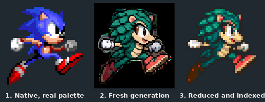
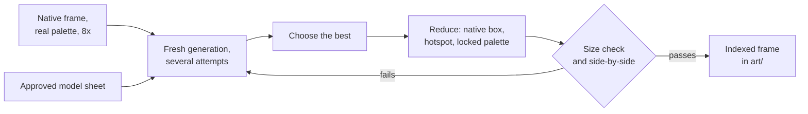
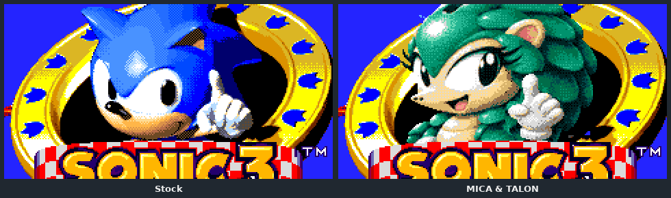

# Part 3: drawing in the game's style

*[MICA and TALON tutorial](README.md), part 3 of 9. Checkpoint: the finished example.*

| You build | You learn | Checkpoint |
| --- | --- | --- |
| One frame, taken from a native pose to a finished indexed sprite | The native-pose method, the size check and the style rules for each surface | MICA's `walk-02` in [`art/mica/sheet/frames`](../../../../examples/mica-and-talon/art/mica/sheet/frames) |

An image model can draw your character well. Left alone, though, it draws the wrong
size, from the wrong angle, in the wrong style. The native-pose method fixes all three:
show the model the game's own frame, have it redraw that exact pose as your character,
then reduce the drawing back into the frame's box, hotspot and palette.



## The method



Native references and raw generations stay outside Git, in a scratch directory. The
repository keeps only your original pixels, the prompts, the source hashes and the
measurements.

## Steps

### 1. Render the native frame at 8×, in its real palette

Use nearest-neighbour
scaling. The colours must be the ones the game shows on that surface, not the
character's usual palette. Sonic 2's ending photos are sepia; rendered blue, the model
misread them. The reference exporter writes MICA's references:

```bash
python3 -I tools/modding/playable_art/native_pose.py --core --output /tmp/my-character/native
```

It writes only under `/tmp` and needs the optional disassembly submodule. For your
own surfaces, crop the frame from an engine capture and scale it 8×.

### 2. Remove parts your character does not have

TALON's first flight frames grew a
thin mast above his head. The model had drawn Tails' rotor tails from the reference.
Mask such parts out of the reference, or name them as excluded in the prompt.

### 3. Generate fresh, several times

Give the model the 8× reference and your model
sheet. Ask for the same pose, facing and aspect, with a transparent or flat keyed
background, separate cells and no text. MICA's walk prompt began:

> Create an ORIGINAL MICA pangolin 16-bit game WALK cycle. Input1 is exact native S2
> Sonic eight-frame pose guide at 8x real palette; input2 approved MICA concept for
> identity only. … Keep native silhouette proportions and each pose aspect; NO
> horizontal stretch.

Make several attempts and keep the best. **Never feed a generation back in for
edits.** Each pass adds the model's noise, and after two or three passes the picture
turns blotchy. Revise the prompt and generate again from the original references.

### 4. Reduce into the native frame

The reducer removes the background, scales with
Lanczos, thresholds alpha, maps every pixel to the locked palette without dithering,
and adds the outline. A recipe names the source cell, the native box and the hotspot:

```bash
python3 tools/modding/playable_art/pipeline.py examples/mica-and-talon/production/mica/recipe.json --review /tmp/my-character/review
python3 tools/modding/playable_art/verify.py examples/mica-and-talon/art/mica/sheet
```

**Lock the scale to the character, not to the frame.** Measure head and torso
landmarks on your approved standing frame against its native reference. Reduce every
other frame at that same scale. Fitting each frame by its bounding box or wingspan is
what made TALON's flight frames too small.

Expect a light cleanup after reduction. Eyes, gloves and foot contact often need a
pixel or two; the recipe records each edit as a patch. Fix a bad pose by generating
again, not by repainting it.

### 5. Run the size check

For each animation, compare the opaque area of your frames
with the native frames they replace:

```python
from math import sqrt
from PIL import Image

def area(path):
    return sum(1 for a in Image.open(path).convert("RGBA").getchannel("A").getdata() if a)

ratio = sqrt(sum(map(area, mine)) / sum(map(area, native)))   # lists of 1x PNG paths
```

A good set measures about 1.0. TALON's rejected families measured 0.70 to 0.90, and
the owner saw "a lot of tiny sprites" before anyone measured them. Re-reduce the
outlier from its original generation at the locked scale rather than generating
again.

### 6. Compare side by side, then in the game

Put your frame next to the native one,
unlabelled, at 1× and at 4×. Then look at an engine capture
([part 9](09-proving-it.md)). A review page can show a palette the game never uses;
the game's own pixels are the test.

**It worked if** `verify.py` passes, the size ratio is close to 1.0, and in an unlabelled
side-by-side your frame reads as the same pose, at the same size, in the same style.

## Match the style of each surface

Each surface has its own look. Measure the native art before you prompt: outline
colour, shade steps, light direction, dithering and colour count. Then prompt for that
style and reduce into that surface's colour budget.

| Surface | What the native art does | What MICA and TALON do |
| --- | --- | --- |
| Gameplay sprites | Cel shading in two or three steps, a dark outline, light from the upper left | Material-shadow contours, compact upper-left highlights, stepped clusters |
| Sonic 3 & Knuckles title | Pre-rendered, "baked 3D" shading with soft gradients | MICA's title bank is drawn and reduced in the same baked-3D style |
| Sonic 1 title | Sonic rises and wags a finger in eight body frames (`BODY` 0–7) | MICA's eight frames line up with Sonic's, so the wag lands on the same beats |
| Blue Sphere (back view) | Half the run cycle is the other half, flipped | Dedicated drawings for the flipped phases, so the light stays on one side |
| Ending photos | Sepia line art | References rendered in the photo palette |



<details>
<summary>Animation cycles: lock the identity, keep the motion</summary>

Generating each frame of a cycle on its own makes the head, ears and shading drift.
MICA's and TALON's Blue Sphere backs came out "changing ears" from frame to frame. Native
back-view art holds the head as one drawing that only bobs; only the limbs change. The
fix was one approved head-and-torso layer reused at native offsets, limbs drawn per
frame, and the native lean, sway and bob applied to the locked layer. The special-stage
tools under `tools/modding/playable_art/` (`locked_stage.py`, `stage_body_motion.py`)
do this. They are described in the
[pipeline notes](../../../../tools/modding/playable_art/README.md#locked-special-stage-identity-body-motion-and-native-limb-phases).

Whole-cycle strips keep a cycle consistent but can stretch frames sideways. Per-frame
runs keep proportions but can judder. Check foot alternation and every contact phase
frame by frame: a run with a missing contact phase never loops.

</details>

<details>
<summary>Where the provenance goes</summary>

For each adopted frame, keep its prompt, the source image hash, the reference metadata
(label, native size, hotspot) and any cleanup. MICA's are in
[`production/mica/native-pose-core.json`](../../../../examples/mica-and-talon/production/mica/native-pose-core.json);
TALON's are in
[`production/talon/provenance.json`](../../../../examples/mica-and-talon/production/talon/provenance.json).
Then the ordinary build never needs the raw generations, and a reviewer can trace any
frame back to its prompt.

</details>

<details>
<summary>What never goes in the repository</summary>

Decoded ROM frames, native references, and repaints or recolours of native art. Every
shipped frame must be a new drawing. The engine reads all game art from the player's
own ROM at runtime, and a mod that shipped ROM pixels would break that rule.

</details>

**Next: [part 4, the full sheet](04-full-sheet.md).**
