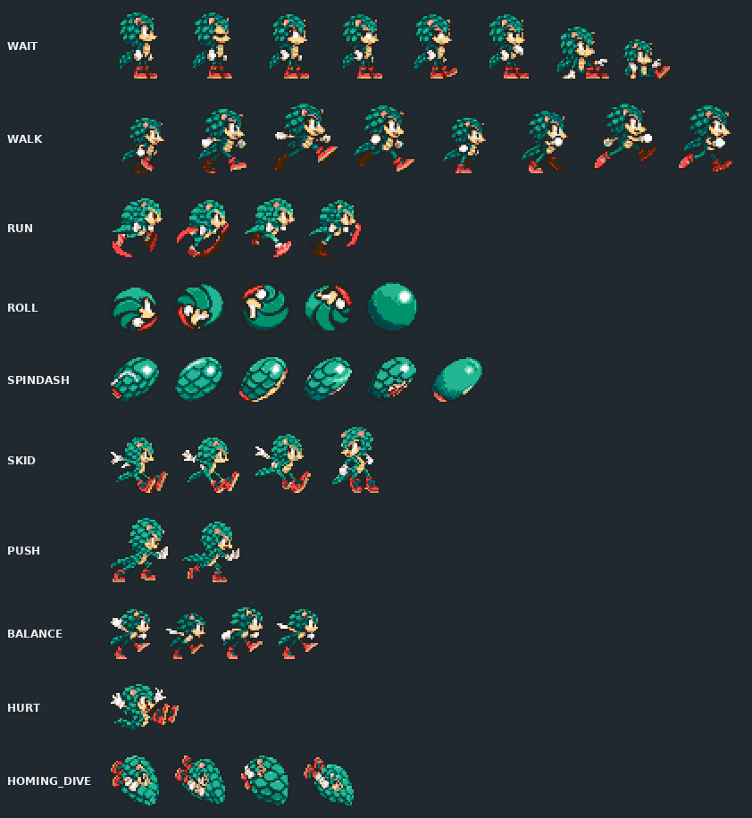
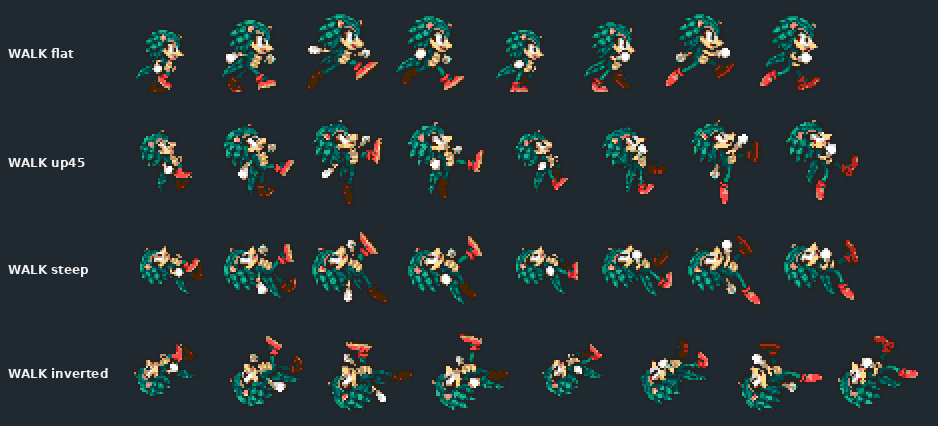
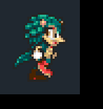

# Part 4: the full sheet

*[MICA and TALON tutorial](README.md), part 4 of 9. Checkpoint: the finished example's
[`art/mica/sheet`](../../../../examples/mica-and-talon/art/mica/sheet).*

| You build | You learn | Checkpoint |
| --- | --- | --- |
| Every animation the games ask for, with slope cycles | Canonical animations, script reuse, shared families, `assemble.py`, the coverage audit and fallbacks | MICA's sheet: 274 frames, 53 animation keys |

Part 2's sheet had four animations. The games ask for many more: skidding, pushing,
balancing on a ledge, hanging from a bar, drowning. This part shows how the sheet grows
to cover them, and how to find out what is still missing.



## Steps

### 1. Draw the core set first

The assembler's default list is the core every character needs. Draw these before
anything rarer:

| Group | Animations |
| --- | --- |
| Moving | `WALK`, `RUN`, `ROLL`, `PUSH`, `SPINDASH`, `SKID`, `STOP` |
| Standing | `WAIT`, `DUCK`, `LOOK_UP`, `BALANCE` |
| Hit and air | `SPRING`, `HURT`, `DEATH`, `DROWN`, `GET_AIR`, `HANG` |

Names describe poses, not permission. Drawing `SPINDASH` does not grant a spindash;
the archetype and the definition do. The full list is the reference's
[canonical vocabulary](../../characters.md#canonical-vocabulary). `WAIT` is
mandatory; there is no `idle` alias.

Follow the native *script*, not just the pose. Sonic's roll alternates every pose with
a solid blur frame, and his spring and hurt are single frames. Check a walk's foot
alternation and every contact phase frame by frame.

### 2. Add slope cycles

On a slope Sonic is drawn leaning, using separate drawings at 45, 90 and 135 degrees.
`WALK` and `RUN` therefore have four equal cycles, in the engine's selector order:
`flat`, `up45`, `steep` and `inverted`. Each frame names its set in `angle_set`.



**Derive slopes from the flat cycle; do not generate them.** The 90-degree set is an
exact quarter turn, and the 45- and 135-degree sets use a RotSprite-style indexed
rotation that never blends colours. MICA's were derived with
[`derive_slopes.py`](../../../../tools/modding/playable_art/derive_slopes.py), then
finished by hand so each foot still touches the slope. The
[slope tests](../../../../tools/modding/test_playable_art_slopes.py) check the result.

### 3. Reuse frames with scripts

A script plays frames in an order, with durations and an end action. It can reuse a
drawing as often as it likes. MICA's `WAIT` is 179 steps over nine drawings. It follows Sonic's idle: stand a while, blink, then the impatient fidget, repeating
its last six steps.

```json
"scripts": {
  "ROLL": { "frames": ["roll-00", "roll-blur", "roll-01", "roll-blur",
                       "roll-02", "roll-blur", "roll-03", "roll-blur"], "end": "loop" }
}
```

End actions are `loop`, `loop-back` (repeat the last N steps), `hold` and `next`
(switch to another animation). `WALK`, `RUN`, `ROLL`, `ROLL2` and `PUSH` take their
timing from the speed; every other animation needs fixed durations. The reference's
[animation table](../../characters.md#authoring-the-animation-table) gives every rule.



### 4. Cover object poses with shared families

Some poses are not animations at all. Objects set them directly: Angel Island's swinging vines,
spinning poles, cranes. The sheet's `nativeFrames`
map names those poses and points each at one of your drawings:

```json
"nativeFrames": { "hang/0": "hang-00", "wait/stand": "wait-00", "twist/0": "native-pose-55" }
```

Families go further. `family-float2/0` is one phase of the floating pose that several
host scripts share. Supply each phase once, and every script that uses it binds to
your drawing with the host's own timing. Reference:
[shared animation families](../../characters.md#shared-animation-families) and
[object-owned native mapping poses](../../characters.md#object-owned-native-mapping-poses).

### 5. Assemble and verify

```bash
python3 tools/modding/playable_art/assemble.py examples/mica-and-talon/art/mica/sheet target/mica-and-talon/generated
python3 tools/modding/playable_art/verify.py examples/mica-and-talon/art/mica/sheet
```

**It worked if** `assemble.py` prints `{"frames": 274, "maxTilesPerFrame": 30, "animations": 53}`
for MICA and `verify.py` reports no failures. `maxTilesPerFrame` matters: each frame
must fit the player's pattern bank, and the converter rejects a sheet that does not.

### 6. Find what is missing with the coverage audit

A sheet can look complete and still leave a native pose to fall back. The audit loads
each game's real scripts and object poses from your ROM, binds your sheet the way the
game does, and reports every pose as authored, aliased, fallen back, or not applicable:

```bash
python3 examples/mica-and-talon/build.py
python3 tools/testing/maven_queue.py -Dmse=off "-Dtest=TestCharacterArtCoverageAudit" "-Dart.audit.output=$HOME/scratch/art-audit" test
python3 tools/modding/character_art_audit.py $HOME/scratch/art-audit
```

The build writes the generated sheets the report reads. Open
`$HOME/scratch/art-audit/index.html`. Its summary counts each character and game; its
backlog lists the exact native frames behind each missing cycle, which is your next
drawing list. No native pixels are written.

**It worked if** the summary has a row for each character and game, and every
`Fallback` row is a pose you chose not to draw.

## How fallbacks work

When a pose is missing, the engine uses the game's stand-in for that animation,
and `WAIT` when the stand-in is missing too. An authored pose that shares a stand-in's
destination can serve it; `STOP` and `SKID`, for example. A fallback never crashes or
shows another character's art, so you can ship a partial sheet and fill it in.

<details>
<summary>Tails-like characters use Tails' vocabulary</summary>

A `TAILS_ALONE` sheet is bound to the host's native Tails scripts, with their own phase
counts and loop points, not Sonic's. TALON's sheet therefore has flight families
(`TAILS_FLY`, `TAILS_FLY_CARRY`, `TAILS_SWIM` and their variants) that MICA's lacks.
Hosts without a native Tails route keep their default vocabulary.

</details>

<details>
<summary>Hotspots, contact and the tile budget</summary>

- The hotspot is the engine centre, measured from the frame's top-left corner:
  `top_left = centre - hotspot`. MICA's standing contact ends at centre + 18, so
  centre + 19 is the exclusive bottom edge. Balls are centred.
- On slopes, a frame's furthest opaque pixel along the slope normal must not cross the
  native frame's. The assembly tests check every slope frame.
- The assembler splits each frame into pieces of at most 32×32 pixels. MICA's largest
  frame uses 30 tiles.

</details>

<details>
<summary>MICA's production records</summary>

Each frame in `frames.yaml` carries a note on how it was made. The records behind them
are in [`production/mica/`](../../../../examples/mica-and-talon/production/mica):
`native-pose-core.json` for the core set, `motion.py` for the run, spring and wait
refinements, and the dated batch folders for later families. Do not rerun superseded
recipes over approved art; some rebuild older manifests.

</details>

**Next: [part 5, moves and the duo](05-moves-and-duo.md).**
