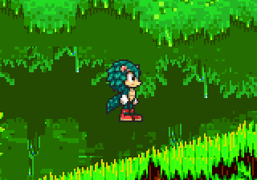
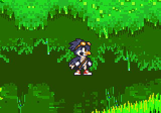
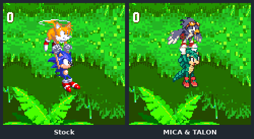

# Part 5: moves and the duo

*[MICA and TALON tutorial](README.md), part 5 of 9. Checkpoint: the finished example's
[`MicaCharacter`](../../../../examples/mica-and-talon/src/main/java/micaandtalon/MicaCharacter.java)
and [`TalonCharacter`](../../../../examples/mica-and-talon/src/main/java/micaandtalon/TalonCharacter.java).*

| You build | You learn | Checkpoint |
| --- | --- | --- |
| MICA's homing attack; TALON's flight, carry and divebomb; TALON following MICA | `onAbilityActivate`, `onMovementTick`, `HomingAttack`, the Tails archetype, default sidekicks, carry contact | the finished example |

A defining action is a small piece of Java. The engine owns the hard parts (targets,
contact, defeat, camera lag, rewind), so a character only decides *when* to act.



## Steps

### 1. MICA's homing attack

Two hooks do it. `onMovementTick` runs every live tick before movement input; MICA
asks for the target reticle whenever she is airborne. `onAbilityActivate` runs when
the player presses jump in the air; MICA starts the strike.

```java
// MicaCharacter.java
@Override
protected void onMovementTick() {
    HomingAttack.requestReticle(this, getAir());
}

@Override
protected boolean onAbilityActivate(boolean up, boolean down, boolean left, boolean right) {
    // The S3K form gate owns an eligible transformation press before her strike.
    if (getSuperStateController() != null && getSuperStateController().activateFromAirAbility())
        return true;
    return HomingAttack.start(
            this, isSuperSonic() ? HomingAttack.Mode.INSTAGIB : HomingAttack.Mode.HOMING);
}
```

Returning `true` consumes the press. With a target, `start` strikes it and refreshes the
air action so strikes can chain; with none, it dashes forward. Use
`HomingAttack.startIfTarget` instead if a native air move should get the press when
nothing is in range.

The strike's frames come from the sheet: `HOMING_DIVE` plus five directional keys from
`HOMING_DIVE_FORWARD` to `HOMING_DIVE_DOWN`. The engine picks one by the strike's
direction, as described in the
[animation table](../../characters.md#authoring-the-animation-table).

**It worked if** in a level MICA jumps, a reticle appears on a nearby badnik, and a
second press sends her into it.

### 2. TALON: the Tails archetype does the flying

TALON's definition differs from MICA's in four places:

```java
// TalonCharacter.java (excerpt)
SidekickRespawnStrategy::tails,          // fly back in when lost, like Tails
PlayerCharacter.TAILS_ALONE,             // Tails' route, touch attacks and rolling rules
SecondaryAbility.FLY,                    // the shared flight model
Set.of(
        CharacterDefinition.MovementAbility.SPINDASH,
        CharacterDefinition.MovementAbility.CROSS_GAME_FLIGHT,   // flight in S1 and S2 too
        CharacterDefinition.MovementAbility.SUPER_FLIGHT_LIFT),  // stronger flaps when Solar
```

Flight, fatigue, swimming and carrying are the engine's; TALON writes none of them.
`CROSS_GAME_FLIGHT` is a mod-defined extension: Sonic 1 and 2 have no flying Tails,
so the same model is switched on for them explicitly.

### 3. TALON's divebomb

TALON shows the reticle only while down is held in the air, and divebombs on
down + jump. Jump alone still flaps, because returning `false` leaves the native move
alone:

```java
@Override
protected boolean onAbilityActivate(boolean up, boolean down, boolean left, boolean right) {
    if (getSuperStateController() != null && getSuperStateController().activateFromAirAbility())
        return true;
    return getAir() && down && HomingAttack.divebomb(
            this, isSuperSonic() ? HomingAttack.Mode.INSTAGIB : HomingAttack.Mode.HOMING);
}
```

With no target, the divebomb dives steeply forward and down.



### 4. TALON follows MICA

The last argument of MICA's definition names her default sidekick:

```java
// MicaCharacter.definition(...), last argument
CharacterKey.mod(owner, "talon"));
```

Choosing MICA in **Game Setup** now selects TALON as her partner, and players can still
choose to play alone. A default sidekick must belong to the same mod and cannot follow
a `SONIC_ALONE` leader. Sonic 1 has no sidekicks at all, so the example's game patch
turns them on there (`supportsSidekick()` in
[`GildedSettings.java`](../../../../examples/mica-and-talon/src/main/java/micaandtalon/GildedSettings.java)).

### 5. The carry

When TALON flies with MICA, he can carry her. The game holds the carried character
28 pixels below the carrier's centre, so both drawings must meet at that distance:
TALON's shoes grip MICA's raised gloves. TALON's `TAILS_FLY_CARRY` frames and MICA's
`TAILS_CARRIED` family were drawn and checked together.



**It worked if** in every wingbeat the carrier's grip and the carried hands touch, with
no gap and no overlap. The example's check is
[`production/mica/carry-contact-check.json`](../../../../examples/mica-and-talon/production/mica/carry-contact-check.json):
it measures the clearance for every pairing of carrier and carried frame.

<details>
<summary>Why TALON redirects his flight animation</summary>

Native flight picks Tails' flight scripts by number. TALON's sheet has its own flight
frames with their own timing, so `TalonCharacter` installs them as private animation
scripts above the native and homing IDs (`0x200` and up) and redirects the flight
pose there. It asks `TailsFlightController.selectAnimation(carrying)` which flight
pose to show, so it never duplicates the fluid, fatigue or carry rules. Read
`installFlightArt` for the details, including the 256-frame relocation for native
pose aliases.

</details>

<details>
<summary>State, rewind and fault boundaries</summary>

Targets, the strike, the air-action latch and their rewind snapshots belong to the
world, not to the character, so neither class stores them. If your action keeps its
own state, put it in instance fields and capture it with the subclass rewind hooks.
Never keep game objects in static fields. Every hook runs inside the mod's fault
boundary: an exception records a finding and disables the mod on the next launch. See
the reference's
[failure, rewind and acceptance checklist](../../characters.md#failure-rewind-and-acceptance-checklist).

</details>

**Next: [part 6, every screen](06-every-screen.md).**
