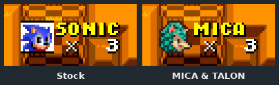
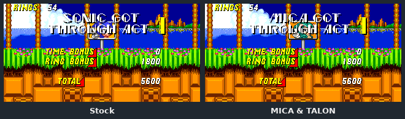
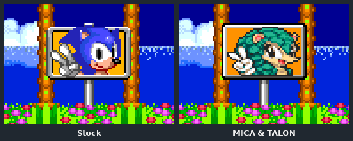
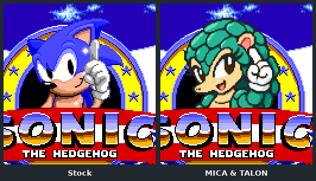
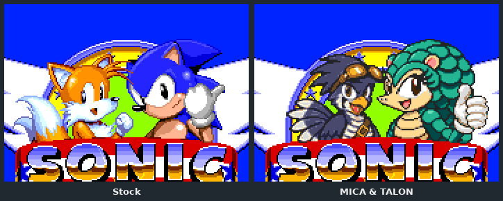
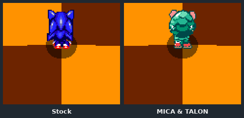

# Part 6: every screen

*[MICA and TALON tutorial](README.md), part 6 of 9. Checkpoint: the finished example's
[`MicaPresentation`](../../../../examples/mica-and-talon/src/main/java/micaandtalon/MicaPresentation.java)
and the folders it reads.*

| You build | You learn | Checkpoint |
| --- | --- | --- |
| MICA on the HUD, lives, signposts, results, titles, special stages, continue and data select | `CharacterPresentation`, frame tables, title mascots, oriented stage drawings, and the native rendering rules | the finished example |

Gameplay is one surface of many. A first playable still shows Sonic's face on the
lives counter and the signpost, and Sonic on the title screen. Each of those is a slot
in `CharacterPresentation`. Fill a slot and the game draws your art there; leave it
empty and the game draws its own.



## The one rule: the game keeps control

Your art replaces pixels, never behaviour. On every surface the game keeps:

- **Which frame is shown, and when**: its selectors, mapping order and animation clocks.
- **Where it is drawn**: native origins and facing. Your hotspots must match the native frames'.
- **What covers what**: sprite priority, plane occlusion and the order of the sprite list.
- **Colour changes**: shadows, palette fades and flashes, applied to your colours too.
- **Everything else on screen**: text, scenery and other characters keep their own palettes.

Each character's art is drawn with its own private palette row, so MICA's jade never
recolours a Sonic 2 signpost's frame or Tails beside her. Work within these rules and
every fade, flash and transition just works.

## Steps

### 1. One presentation, composed

`MicaPresentation.load` builds the whole presentation from the art folders at
registration, then adds the optional surfaces:

```java
// MicaPresentation.java
return new CharacterPresentation("MICA", "MICA", art, glyphs, stages, endings(assets))
        .withReelFaces(ReelPresentation.load(assets, "mica"))
        .withCompetitionPortraits(CompetitionMenuPresentation.load(assets, "mica"))
        .withTitleMascots(TitlePresentation.load(assets, "mica"));
```

The definition passes it through its presentation supplier. Every image is an indexed
PNG read with `PresentationImages.read(assets, path)`, bounded to 256×256 pixels.

### 2. Names and letters

The first two arguments are the display name and the short HUD name (up to five
letters). HUDs and results screens spell them with each game's own font. Where the
font lacks a letter, supply it:

```java
var letters = Map.of('M', image(assets, "s1-name-M"), 'A', image(assets, "s1-name-A"));
var glyphs = Map.of(new Font(Host.S1, Style.HUD), letters);
```

Sonic 1's small HUD font has no M or A, so MICA ships just those two. The game's own
letters always win where they exist. A name that does not fit the HUD's 32×16 cell
keeps the native name. TALON is `TALON` in Sonic 2 and `TALO` in the narrower Sonic 3
& Knuckles cell, chosen per game with `PresentationSupplier.load(code, host)`.



### 3. Lives, monitors and signposts

The `Art` record holds each game's life icon, 1-up monitor face, signpost faces and
spin poses:

```java
return new Art(
        image(assets, prefix + "-hud"),       // 16×16 life icon
        image(assets, prefix + "-monitor"),   // 16×16 1-up face
        face.face(), face.face(),             // signpost and end-sign faces
        sign,                                 // face, alternate and spin poses
        screens);                             // continue, portrait and snowboard banks
```

Each sign pose has a *backing*: the panel behind the face, drawn in the native sign's
own palette line. The pole stays native.



### 4. Frame tables for the bigger banks

Special stages, continue screens and titles have many frames. Their bindings live in
plain-text tables beside the images, not in Java. One row per frame:

```text
# bank selector image hotspotX hotspotY
S2_HALF_PIPE 4 s2-halfpipe-04.png 28 28
```

The bank is a native surface, the selector is the native frame number, and the hotspot
is that frame's origin. The shared `FrameTable` helper reads every table; the example
README explains [the format](../../../../examples/mica-and-talon/README.md#editing-frame-tables).
To change an image, edit its row and rebuild.

### 5. Title mascots

Each game's title screen has a mascot built from native parts. `TitlePresentation`
maps them, per game, to your drawings:

| Game | Parts |
| --- | --- |
| Sonic 1 | `BODY` 0–7: the rise and the finger wag |
| Sonic 2 | Leader `BODY` 5/6/7/18 and `HAND` 9; sidekick `BODY` 0–4 and `HAND` 19 |
| Sonic 3 & Knuckles | Plane halves 1–13, `FINGER` 0/1/4 and `WINK` 2/3 |





Sonic 3 & Knuckles draws Sonic into the background plane, not as sprites. MICA's art
there comes with *plane masks*: one byte per screen pixel saying which native pixels
belong to the mascot and are removed. The masks must never touch the logo or the ring,
and inside the ring's aperture the removed pixels are filled with black rather than
showing the sky. The reference's
[native title mascots](../../characters.md#native-title-mascots) section is the full
contract.

### 6. Special stages

Blue Sphere, the Sonic 2 half-pipe and the slot machine use their own player drawings,
keyed by the native frame numbers in `StageSpriteSet`. The stage keeps the movement,
the jump, the shadow and the flips.



The flips are the trap. Blue Sphere draws half of its run cycle as the other half,
mirrored; the half-pipe also flips vertically. A lit, asymmetric character drawn once
would have its highlight and tail jump sides every half-cycle. `OrientedStageArt` gives
those phases their own drawings, already facing the final direction:

```java
// OrientedStageArt.java
set = set.withOrientationFrames(bank[1].contains("h"), bank[1].contains("v"), drawings);
```

In the table, `S2_HALF_PIPE/n` rows are normal frames and `/h`, `/v` and `/hv` rows are
the flipped variants. The engine uses a variant only when the native flags match, and
then suppresses that flip.

### 7. Continue, data select and snowboard

`MicaScreenFrames` reads three more banks into `Art.screenFrames`: the continue
screen's player and icon, the Sonic 3 & Knuckles data-select portrait (frame 5), and
the Ice Cap snowboard rider (frames 0–12). Each bank carries its own sixteen colours,
so the continue screen's text and Tails keep theirs.

**It worked if** each screen in [part 9's capture list](09-proving-it.md#3-capture-every-surface)
shows MICA where it showed Sonic, at the same place and timing, and nothing else on
screen changes colour.

<details>
<summary>Which surfaces read which slots</summary>

| Surface | Slot | Games |
| --- | --- | --- |
| HUD name and life icon | `hudName`, `Art.hudLifeIcon`, supplementary glyphs | all three |
| 1-up monitor | `Art.oneUpFace` | all three |
| Act and special-stage results | display or HUD name, in the results font | all three |
| Signposts | `Art.signpostFace`, `endSignFace`, `sign` poses | all three |
| Special-stage players | `stages`: `S2_HALF_PIPE`, `S3K_BLUE_SPHERE`, `S3K_SLOT_MACHINE` | S2, S3K (S1 reuses the roll) |
| Continue | `continue/player`, `continue/icon`, `continue/floor`, `continue/team-idle` | all three |
| Data select | `portrait` frame 5; saved-slot life icons | S3K |
| Snowboard | `snowboard` frames 0–12 | S3K |
| Titles | `withTitleMascots` | all three |

The full contract is the reference's [presentation contract](../../characters.md#presentation-contract).

</details>

<details>
<summary>Sidekick-owned surfaces</summary>

Some surfaces belong to the sidekick, not the leader. In Sonic 2 and 3, the Tails-body
banks on Blue Sphere, the half-pipe and the continue screen are drawn from the first
selected follower, or from a Tails-like solo leader. Supplying a Tails body bank also
removes the native separate tail sprite, so draw any tail or wings into the body
frames. TALON's banks rely on this.

</details>

<details>
<summary>Packaging presentation art</summary>

Presentation images are not part of the `.ggfp` sheet. The example's
[`build.py`](../../../../examples/mica-and-talon/build.py) copies each surface folder's
PNGs, masks and tables into the jar, and the loaders read the same paths. A PNG added to
the source tree but not to that inventory is not packaged. Keep the two in step.

</details>

**Next: [part 7, powered forms](07-powered-forms.md).**
