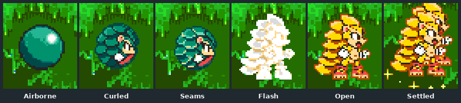
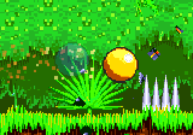

# Part 7: powered forms

*[MICA and TALON tutorial](README.md), part 7 of 9. Checkpoint: the finished example's
[`MicaGilded`](../../../../examples/mica-and-talon/src/main/java/micaandtalon/MicaGilded.java)
and [`TalonSolar`](../../../../examples/mica-and-talon/src/main/java/micaandtalon/TalonSolar.java).*

| You build | You learn | Checkpoint |
| --- | --- | --- |
| MICA's gold Gilded form and TALON's white-gold Solar form, in all three games | `SuperFormProfile`, palette fade and cycle rows, powered sheets, and each game's gates | the finished example |

Sonic's Super form is mostly colour: a fade from blue to gold, then a shimmering
cycle. A powered form for your character is the same idea, built from your own
palette. MICA's jade and cream fade to gold; with every Chaos Emerald and 50 rings,
a press in the air transforms her.



## Steps

### 1. Opt in

Two arguments of the `CharacterDefinition` enable it: `supportsSuperForm` is `true`, and
the super-form supplier returns a profile.

```java
// MicaCharacter.definition(...)
true,                      // supportsSuperForm
...
ignored -> gilded,         // the SuperFormProfile, prepared at registration
```

Build the profile during registration and return the prepared value. The mod's asset
root closes after registration, so the supplier must not read assets later.

### 2. One form per game and tier

A `SuperFormProfile` maps each game to its tiers (`SUPER`, and `HYPER` in Sonic 3 &
Knuckles). Each `Form` holds the colours, timing, physics and art:

```java
// MicaGilded.java: the Sonic 3 & Knuckles form
new SuperFormProfile.Form(
        gold(fade),                              // fade rows, played on transforming
        gold(colors.get("s3k")),                 // cycle rows, repeated while powered
        List.of(),                               // underwater cycle: derived from the zone
        7,                                       // ticks per cycle row
        2,                                       // ticks per fade row
        PhysicsProfile.SONIC_3K_SUPER_SONIC,     // powered physics
        CanonicalAnimation.SUPER_TRANSFORM,      // the transformation animation
        Map.of(),                                // animation overrides
        false, false,                            // no after-images, no stars
        s3kBank,                                 // optional powered drawings
        gilded);                                 // optional strike colours and particles
```

MICA's Hyper form shares these colours and drawings but sets `afterImages` to `true`
for the native Hyper echo trail, and takes the denser `hyper` effects. Her strike is
Instagib only in Hyper; Super Gilded homes as she does normally.

### 3. Write the colour rows

Each row is a full 16-colour palette line in Mega Drive colour words (`0BGR`, each
digit even, 0 to E). The rows live in a table beside the art, one per line:

```text
# bank followed by sixteen Mega Drive colour words, in animation order.
fade 000 222 440 660 680 8A2 AC6 8CE 6AC 68A 44E 22A EEE CCC 88E 024
```

MICA's table, [`art/mica/powered/palettes.txt`](../../../../examples/mica-and-talon/art/mica/powered/palettes.txt),
has six `fade` rows, nine `s2` cycle rows and three `s3k` cycle rows. Only indices 2 to 6
(her jade) change along the fade; Java then sets the pale-gold indices 7 and 8 for the
powered rows. The rows are generated from a production record and checked with:

```bash
python3 tools/modding/playable_art/gilded_java.py --check
```

### 4. Redraw only what must change

A colour change is enough for most poses. Where Gilded MICA's pose itself differs,
a `PoweredPlayableSheet` adds a second baked sheet. MICA's Sonic 2 and Sonic 3 &
Knuckles banks are in [`art/mica/powered/`](../../../../examples/mica-and-talon/art/mica/powered),
and the build bakes them beside the normal sheet. The bank names which normal
animations to reuse whole:

```java
var aliases = EnumSet.allOf(CanonicalAnimation.class);
aliases.removeAll(Set.of(WALK, RUN, PUSH, WAIT, BALANCE, DUCK));   // these are redrawn
return new PoweredPlayableSheet(art, aliases, phaseAliases);
```

Phase aliases do the same for single phases of shared families. Anything the bank
leaves out falls back to the normal drawing, so a palette-only form is valid.
TALON's Solar is palette-only: it uses the `Form` constructor without a bank.

### 5. Know each game's gates

| Game | How the form is reached | Notes |
| --- | --- | --- |
| Sonic 1 | Six emeralds and 50 rings, then the jump-apex trigger | **Mod-defined**: Sonic 1 has no Super form. Plays invincibility music. |
| Sonic 2 | Seven emeralds and 50 rings, then the jump-apex trigger | Native trigger and ring drain |
| Sonic 3 & Knuckles | Seven Chaos Emeralds for Super, seven Super Emeralds for Hyper; the air-ability press | Native shield and invincibility gates |

MICA also registers a settings overlay, `GildedSettings`, that lets players change these
requirements per game. TALON's Solar adds `SUPER_FLIGHT_LIFT`, which doubles his flap
strength only while powered, and has no Hyper tier.

**It worked if** a capture with every emerald and enough rings shows the fade from
your colours to the powered ones, then a steady cycle:

```bash
python3 tools/testing/maven_queue.py exec:java "-Dexec.mainClass=com.openggf.tools.GameplayCaptureTool" \
  "-Dexec.args=--game s3k --zone aiz --act 1 --x 7100 --y 900 --rings 70 --emeralds 1111111 \
    --mod target/mica-and-talon/mica-and-talon.jar --main mica-and-talon:mica \
    --input target/capture/transform.txt --out-dir target/capture/gilded"
```

[Part 9](09-proving-it.md#5-film-it) shows how to write `transform.txt`. The script used
for the animation below was `30 -; 1 A; 20 -; 1 A; 40 -; repeat 8 { 1 R+A; 16 R }; 120 R`:
jump, transform in the air, then strike.



### 6. Give the form its own sparkle

`PoweredEffects` gives a form its strike colours and small particle sprites with the
rules that shed them. MICA keeps all of it in one text table,
`art/mica/powered/effects/effects.txt`, read by `EffectsTable` in the example:

```text
# trail <set> <ember-hot> <ember-mid> <ember-cool> <echo-tint|none> <density%>
trail super FFFFDB FFDB49 DB9224 FFD040 100
front super B66D00 23 5 120 8          # heat front, outer haze first ... to the nose

particle glint 3                       # four-point glint: small, medium, large, medium
frame 2 2
..5..
..7..
57c75
..7..
..5..
# ... three more frames

# emitter <set> <TRIGGER> <particles> <count> <interval> <RING|SCATTER>
#         <offset-x> <offset-y> <radius> <speed-x> <speed-y> <jitter> <gravity> <life>
emitter super TRANSFORM glint 16 1 RING 0 0 6 0x380 0 0x20 0 30
emitter super FAST glint,twinkle 1 5 SCATTER -6 0 10 -0x80 0 0x50 0 24
```

Pixels are hex indices on MICA's own palette line, so in Gilded form they take the gold
cycle's colours and shimmer with it. Her normal jade trail comes from the `normal` set
through `strikeTrailStyle()`. TALON's table gives Solar sun-ember motes in flight, a spray
on each flap, a flare ring as the form arrives and a heat trail behind the divebomb. The
[strike colours and powered effects](../../characters.md#strike-colours-and-powered-effects)
reference lists every trigger and limit.

<details>
<summary>What the controller owns</summary>

The super-state controller owns the palette cursor, phase, tier, ring drain and the
switch between normal and powered drawings. It restores them on rewind and when art is
reloaded. Abilities can ask `isSuperSonic()` (true from the transformation on) and
`poweredTier()` (`SUPER`, `HYPER` or null); MICA's strike becomes Instagib only when
`poweredTier()` is `HYPER`. The reference's
[ability and super-form rules](../../characters.md#ability-and-super-form-rules) list
every field's limits.

</details>

<details>
<summary>Powered art in endings and water</summary>

Powered ending poses use the live form palette, so Gilded MICA's ending is gold too
([part 8](08-competition-reels-endings.md)). With no underwater rows, the engine derives
the water colours from the zone's own dry and water palettes, which follows zone
changes and palette cycles. Supply authored water rows only if that derived look is
wrong for your colours.

</details>

**Next: [part 8, Competition, reels and endings](08-competition-reels-endings.md).**
