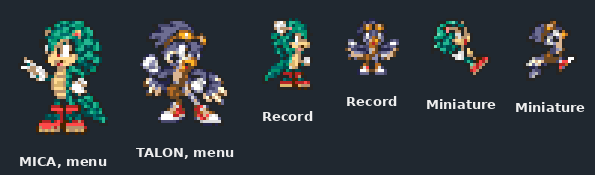
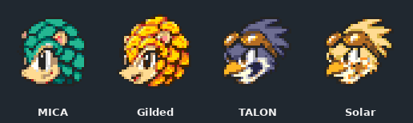
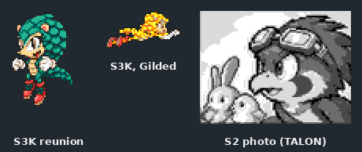

# Part 8: Competition, reels and endings

*[MICA and TALON tutorial](README.md), part 8 of 9. Checkpoint: the finished example's
[`CompetitionPresentation`](../../../../examples/mica-and-talon/src/main/java/micaandtalon/CompetitionPresentation.java),
[`ReelPresentation`](../../../../examples/mica-and-talon/src/main/java/micaandtalon/ReelPresentation.java)
and the ending loaders.*

| You build | You learn | Checkpoint |
| --- | --- | --- |
| MICA and TALON in Sonic 3 & Knuckles Competition, on the slot reels, and in all three endings | Miniature and menu banks, reel faces, ending sets, and which character owns which surface | the finished example |

These are the last surfaces, and the rarest. Each follows part 6's pattern: native frame
numbers in a table, your drawings and palette, and the game in control of everything
else. What is new is *who owns* each one.

## Steps

### 1. Competition miniatures

Sonic 3 & Knuckles' Competition mode draws small players with their own 2P frame set,
separate from the normal sheet. Two stage surfaces carry them: `S3K_COMPETITION` for
the body and `S3K_COMPETITION_TAIL` for an appendage such as Tails' tails.

TALON's wings are part of his body, so his tail bank must go. Omitting a bank means
"use the native art", so `CompetitionPresentation` supplies a transparent frame for
each of the 16 tail frames instead:

```java
// CompetitionPresentation.talon(...)
var blank = new StageSpriteSet.Frame(new CharacterPresentation.Image(1, 1, new byte[] {0}), 0, 0);
var tails = new LinkedHashMap<Integer, StageSpriteSet.Frame>();
for (int i = 0; i < 16; i++) tails.put(i, blank);
```

The race itself stays native. Your configured team fills the existing Sonic, Tails and
Knuckles wheel slots, and the miniature uses that archetype's physics, not your
character's.

### 2. Competition menus

The character wheel, results and records screens show a full-body player sprite and a
small record icon. `withCompetitionPortraits` supplies both, each with its own origin
and 16 colours. The wheel's depth, shadow, scrolling and fades stay native.



### 3. Slot-reel symbols

The Sonic 2 Casino Night slots and the Sonic 3 & Knuckles bonus slots show a 32×32 face
for the player. `ReelFace` holds a normal and a powered image, each with its own
palette:

```java
// ReelPresentation.load(...)
var face = new CharacterPresentation.ReelFace(
        normal.image(), powered == null ? null : powered.image(),
        normal.rgb(), powered == null ? null : powered.rgb());
return Map.of(CharacterPresentation.Host.S2, face, CharacterPresentation.Host.S3K, face);
```

The leader owns Sonic's symbol and the first sidekick owns Tails'. Every other prize
symbol, and how prizes are chosen, stays native.



### 4. Endings

Each game's ending has its own actors, keyed by `EndingSpriteSet.Surface`:

| Game | Surfaces | Owner |
| --- | --- | --- |
| Sonic 1 | `S1_ENDING` | leader |
| Sonic 2 | `S2_ENDING`, `S2_SUPER`, `S2_FLOAT` | leader |
| Sonic 2 | `S2_PHOTOS` (photos 1–3), `S2_TORNADO_PILOT` | first sidekick |
| Sonic 3 & Knuckles | `S3K_NORMAL_POSE`, `S3K_POWERED_POSE`, `S3K_PLAYER`, `S3K_POWERED_PLAYER`, `S3K_PASSENGER`, `S3K_EYECATCH` | leader |
| Sonic 3 & Knuckles | `S3K_TORNADO_PILOT`, `S3K_MINI_TORNADO_PILOT`, the other seat's `S3K_EYECATCH` | first sidekick |

Read what a native scene actually shows before you draw for it. The Sonic 2 photos
show Tails and the animals *searching for* the missing Sonic, so they belong to the
sidekick: TALON draws them, and MICA draws none. The first photo always stays native.

A leader played solo has no sidekick to own the partner's scenes, so the leader's own
table can name its partner's banks under the `SOLO` surfaces (`S2_SOLO_PHOTOS`,
`S2_SOLO_TORNADO_PILOT`, `S3K_SOLO_TORNADO_PILOT`, `S3K_SOLO_MINI_TORNADO_PILOT`,
`S3K_SOLO_EYECATCH`). `MicaEndings` binds TALON's banks this way, so a solo MICA is
still searched for, flown and joined on the final card by TALON. Leave a `SOLO` surface
out to keep the host's own character in that scene.

Seats matter in Sonic 3 & Knuckles. A Sonic-role leader stands in the Sonic seat and
its partner flies from the Tails seat; a Tails-role leader is the other way round. The
cockpit, the mid-size Tornado and the final card each take a different native selector
per seat, listed on `EndingSpriteSet.Surface`.

The ending tables add one kind of row: `palette <bank> <image>`, naming the image whose
16 colours that bank uses. The loader is short:

```java
// MicaEndings.java
result.putAll(FrameTable.read(assets, "art/mica/endings/s1/frames.txt").endings());
result.putAll(FrameTable.read(assets, "art/mica/endings/s2/frames.txt").endings());
```



The vehicles, companions, banners, choreography and timing stay native. Powered ending
poses use the form's live palette, and the ending's fades apply to your colours.

**It worked if** the integration test's ending captures (part 9) show your character in
every pose the scene uses, with native vehicles and text unchanged.

<details>
<summary>The Tornado cockpit crops</summary>

`S2_TORNADO_PILOT` and `S3K_TORNADO_PILOT` replace only the pilot in the plane's cockpit:
24×16 crops at fixed hotspots, using the native pilot's frame numbers. The plane pieces
stay native. Both games share the same side-view cockpit geometry, so one drawing can
serve both. TALON's are the `pilot-*.png` files in
[`art/talon/endings/`](../../../../examples/mica-and-talon/art/talon/endings).

</details>

<details>
<summary>Where to read more</summary>

- [S3K Competition miniature presentation](../../characters.md#s3k-competition-miniature-presentation)
- [S3K Competition menu identity](../../characters.md#s3k-competition-menu-identity), with
  every native screen and its owner in the ROM
- [Optional reel portraits](../../characters.md#optional-reel-portraits)
- The ending paragraphs of the [presentation contract](../../characters.md#presentation-contract)

</details>

**Next: [part 9, proving it](09-proving-it.md).**
