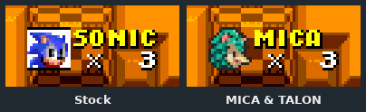

# Part 9: proving it

*[MICA and TALON tutorial](README.md), part 9 of 9. Checkpoint: the finished example and
[`TestMicaCharacterIntegration`](../../../../src/test/java/com/openggf/mods/integration/TestMicaCharacterIntegration.java).*

| You build | You learn | Checkpoint |
| --- | --- | --- |
| Evidence that your character works on every surface it claims | Stock-vs-mod captures, focused tests, the coverage audit, and filming | the finished example |

Art that looks right on a review page can still be wrong in the game: the wrong
palette, a hotspot off by two pixels, a frame that never shows. The only proof is the
game's own pixels and the game's own tests. Each step here shows what it proves, and
what it does not.

## Steps

### 1. Capture stock and mod in lockstep

The most useful picture is the stock game and your mod side by side, at the same
frame, from the same input. MICA moves with Sonic's physics, so with the same input
both runs follow the same path, and any difference is the art.

Write an input script, then capture it twice: once stock and once with the mod.

```bash
python3 tools/testing/maven_queue.py exec:java "-Dexec.mainClass=com.openggf.tools.InputLogAuthorTool" \
  "-Dexec.args=--inline '30 -; 240 R; 660 -' --out target/capture/sign.txt"

for run in stock mod; do
  extra=""; main=sonic
  [ "$run" = mod ] && extra="--mod target/mica-and-talon/mica-and-talon.jar" && main=mica-and-talon:mica
  python3 tools/testing/maven_queue.py exec:java "-Dexec.mainClass=com.openggf.tools.GameplayCaptureTool" \
    "-Dexec.args=--game s2 --zone ehz --act 1 --x 9900 --y 400 --main $main $extra \
      --input target/capture/sign.txt --out-dir target/capture/sign-$run"
done
```

Each run writes numbered PNG frames, a `state.csv` with the player's position and
state per frame, and an MP4 when `ffmpeg` is on your `PATH`. Put the same frame from
both runs next to each other. Every comparison in this tutorial was made this way.



**It worked if** the two runs' `state.csv` positions agree, and the pictures differ only
where your art is. Presentation timing can differ: the Sonic 2 signpost settled a few
frames later in the stock run, so compare the frame where each has landed.

<details>
<summary>Title screens and other menus</summary>

Add `--title-screen --interactive-pacing` to start from the game's real title screen
with menu timing. `--sidekick mica-and-talon:talon` (or `tails`) sets the partner, which
the Sonic 2 title shows. Run the capture with no display: prefix it with
`env -u DISPLAY -u WAYLAND_DISPLAY` and add `-Dopenggf.headless.gl=surfaceless-egl` on
Linux. The [gameplay capture skill](../../../../.agents/skills/gameplay-capture/SKILL.md)
lists every option, including `--emeralds`, `--rings` and `--stills`.

</details>

### 2. Run the focused tests

```bash
python3 tools/testing/maven_queue.py -Dmse=off -Dopenggf.headless.gl=surfaceless-egl \
  "-Dtest=TestMicaCharacterIntegration,TestMicaTalonTutorial" test
python3 -m unittest discover -s tools/modding -p 'test_*.py'
```

`TestMicaCharacterIntegration` packages the example from source exactly as `build.py`
does, then, in each game: launches MICA, checks her physics, crouch and spindash, homing
and Instagib, Gilded, save and reload, rewind, and fallback when the mod is disabled. The
Python tests check sheet assembly, slopes, palettes and the title art.

**It worked if** Maven reports no failures *and no skips*. A skipped ROM test proved
nothing; read the wrapper's `ROM properties found=` line.

### 3. Capture every surface

Many of the integration test's methods render a surface and save PNGs. Run one at a time:

```bash
python3 tools/testing/maven_queue.py -Dmse=off -Dopenggf.headless.gl=surfaceless-egl \
  "-Dtest=TestMicaCharacterIntegration#micaBlueSphereCapture" test
```

| Surface | Methods | Output |
| --- | --- | --- |
| Special stages | `micaMazeCapture`, `micaHalfPipeCapture`, `micaBlueSphereCapture`, `micaSlotsCapture` | `target/mica-stage-captures` |
| HUD, 1-up and icons | `sonic2SessionHudAndOneUpCapture`, `iconPaletteS1`/`S2`/`S3k` | `target/mica-screen-captures`, `target/mica-icon-palettes` |
| Continue and snowboard | `continuePixelsS1`/`S2`/`S3k`, `snowboardPixelsS3k` | `target/mica-screen-captures` |
| Endings | `micaS1EndingCapture`, `micaS2EndingCapture`, `micaS2SuperEndingCapture`, `micaS3kEndingNormal`/`Super`/`Hyper` | `target/mica-ending-captures` |
| Competition | `competitionMiniaturesRenderBothCharactersAndNativeReference`, `competitionMenusRenderAuthoredPortraitsBesideNative` | `target/competition-capture`, `target/competition-menu-capture` |
| TALON | `talonSurfacesS1`/`S2`/`S3k`, `talonFlightArtS2`, `talonS2EndingCapture`, `talonS3kReunionCapture` | `target/talon-presentation`, `target/talon-endings` |

Each output root can be moved with a system property; the test source names them
(for example `-Dmica.stage.captureRoot=...`).

### 4. Run the coverage audit

The audit from [part 4](04-full-sheet.md#6-find-what-is-missing-with-the-coverage-audit)
is your list of what is left. Run it after every art merge. Run the size check from
[part 3](03-drawing-in-style.md#5-run-the-size-check) yourself on every new family as
well; a per-frame landmark table can miss a whole family drawn too small.

### 5. Film it

The same capture tool makes footage. Give it a longer input script and keep the MP4:

```bash
python3 tools/testing/maven_queue.py exec:java "-Dexec.mainClass=com.openggf.tools.InputLogAuthorTool" \
  "-Dexec.args=--inline '30 -; 22 - / R; 1 - / A; 2 -; 1 - / A; repeat 15 { 8 -; 1 - / A }; 120 -' --out target/capture/carry.txt"
python3 tools/testing/maven_queue.py exec:java "-Dexec.mainClass=com.openggf.tools.GameplayCaptureTool" \
  "-Dexec.args=--game s3k --zone aiz --act 1 --x 6040 --y 1040 --main mica-and-talon:mica \
    --sidekick mica-and-talon:talon --mod target/mica-and-talon/mica-and-talon.jar \
    --input target/capture/carry.txt --out-dir target/capture/carry"
```

In a script, `/` separates player 1's input from player 2's; this one has the second
player fly TALON and pick MICA up. The [input authoring skill](../../../../.agents/skills/bk2-input-authoring/SKILL.md)
documents the script language. Review motion from the MP4 or a full-rate animation,
not a low-rate GIF, which can mangle translucent after-images.

## What each kind of evidence proves

| Evidence | Proves | Does not prove |
| --- | --- | --- |
| A passing registration or build | The mod loads and validates | That any surface looks right |
| A positioned capture | The art at that place and moment | That a player can reach it from the title |
| A surface capture method | The surface's art and palette | The physical trigger that opens it |
| The coverage audit | Which poses bind to your art | That the drawings are good |
| A title-first capture | The real route from the title | Other routes |

Say which kind you have when you share results. The example's own captures are
positioned or surface captures; full title-to-ending routes are not certified.

## Where to go next

- Make your own character: copy the part 2 checkpoint, change the id and the art, and
  follow parts 3 to 8 in order.
- The [character reference](../../characters.md) is the contract for everything above.
- [Mod scenes](../mod-scenes.md) and [Flappy Tails](../flappy-tails/README.md) show
  the other way to use these characters: in a game of your own.

**Back to the [series contents](README.md).**
