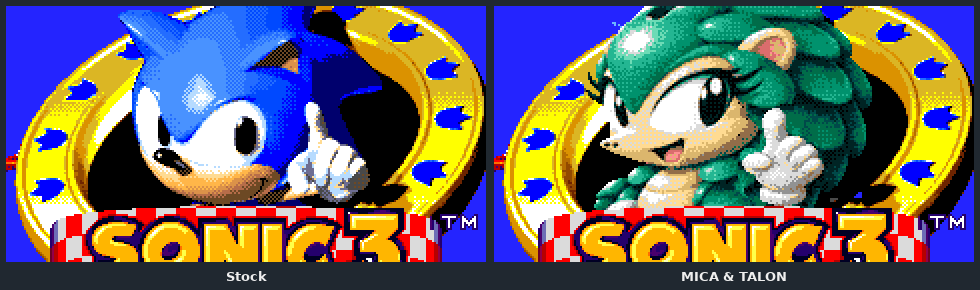
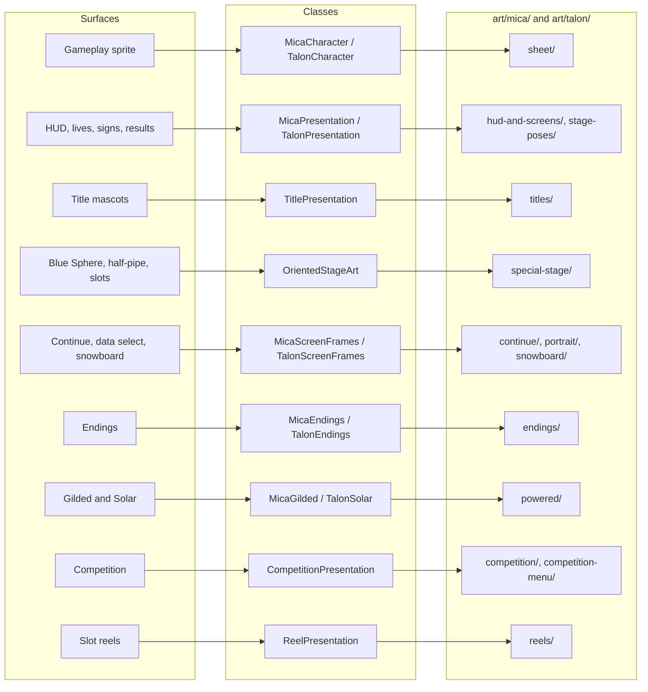
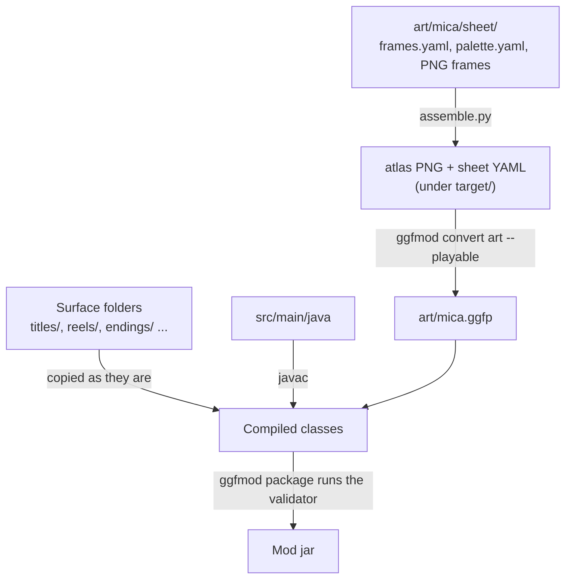

# MICA and TALON: an original character in nine parts

This tutorial teaches you to put a character of your own into Sonic 1, Sonic 2 and
Sonic 3 & Knuckles. The characters are drawn in each game's style, play on the game's
own physics, and appear on every screen the game shows. It follows the official example,
[`examples/mica-and-talon`](../../../../examples/mica-and-talon/README.md):

- **MICA** is a jade pangolin who stands in for Sonic. She has a homing attack and a
  gold Gilded form.
- **TALON** is a slate falcon who stands in for Tails. He can fly, carry MICA, divebomb,
  and turn Solar.



You start with nothing and build a playable MICA in part 2. The later parts walk
through the finished example. By the end you can make your own character in one game,
and you know how to take it to every screen of all three.

The example is a framework demonstration on the unpublished Mod API 0.7 candidate,
not a released mod. All its art is original. It never ships a pixel taken from a ROM.

## What you need

- Java 25 (a JDK), Maven, and Python 3 with Pillow.
- An OpenGGF source checkout, built once as the [getting started guide](../../../guide/playing/getting-started.md#option-b-build-from-source) describes.
- Your own ROMs, set up for the engine, for each game you want to play. Drawing,
  reducing and assembling art needs no ROM.
- For part 3, an image model that takes reference images. The example used GPT Image.

Run every command from the repository root.

## The parts

| Part | You build | You learn | Checkpoint |
| --- | --- | --- | --- |
| [1. The design contract](01-design-contract.md) | A one-page design for your character | What the engine gives you and what you must draw | none |
| [2. A first playable](02-first-playable.md) | MICA running and rolling in Sonic 2 | Registration, `CharacterDefinition`, physics, a minimal sheet | [`tutorial/part-2-first-playable`](../../../../examples/mica-and-talon/tutorial/part-2-first-playable) |
| [3. Drawing in the game's style](03-drawing-in-style.md) | One frame, from native pose to indexed sprite | The native-pose method, the size check, style per surface | the finished example |
| [4. The full sheet](04-full-sheet.md) | Every animation, slopes included | Canonical animations, families, `assemble.py`, the coverage audit | the finished example |
| [5. Moves and the duo](05-moves-and-duo.md) | MICA's homing attack, TALON's flight, carry and divebomb | `onAbilityActivate`, `HomingAttack`, default sidekick | the finished example |
| [6. Every screen](06-every-screen.md) | HUD, signs, results, titles, special stages | `CharacterPresentation` and the native rendering rules | the finished example |
| [7. Powered forms](07-powered-forms.md) | Gilded and Solar | `SuperFormProfile` and palette cycles | the finished example |
| [8. Competition, reels and endings](08-competition-reels-endings.md) | The last surfaces | Miniatures, slot symbols, ending actors | the finished example |
| [9. Proving it](09-proving-it.md) | Evidence that it all works | Stock-vs-mod captures, focused tests, the audit, filming | the finished example |

Part 2 comes with a complete checkpoint mod. A test keeps its frames identical to the
finished sheet's, so the checkpoint never drifts from the example. From part 3 on,
the finished example is the checkpoint, and each part points into its source.

```bash
# Part 2's checkpoint
python3 examples/build_example.py mica-and-talon/tutorial/part-2-first-playable --run
# The finished example
python3 examples/mica-and-talon/build.py --run
```

## Where everything lives

Each screen the game shows is a *surface*. Every surface has one Java class that binds
it, and one art folder that holds its drawings:



The example's [class map](../../../../examples/mica-and-talon/README.md#class-map) lists
every class, and each character's art README ([MICA](../../../../examples/mica-and-talon/art/mica/README.md),
[TALON](../../../../examples/mica-and-talon/art/talon/README.md)) lists every folder.

## How the build works

Art becomes a mod jar in four steps. Parts 2 to 4 cover them in order.



The playable sheet is baked into a `.ggfp` file. The other surfaces stay as indexed
PNGs, which the presentation classes read at registration.

## Reading alongside

- The [character reference](../../characters.md) is the API contract. This tutorial
  links into it and does not repeat it.
- The [playable-art pipeline notes](../../../../tools/modding/playable_art/README.md)
  record every art tool and review.
- The [design audit](../../../architecture/designs/2026-11-08-original-character-mod.md)
  records every decision the owner approved.
- [Flappy Tails](../flappy-tails/README.md) is the other multi-part tutorial. It builds
  a game from ROM parts instead of a character.

**Start: [part 1, the design contract](01-design-contract.md).**
