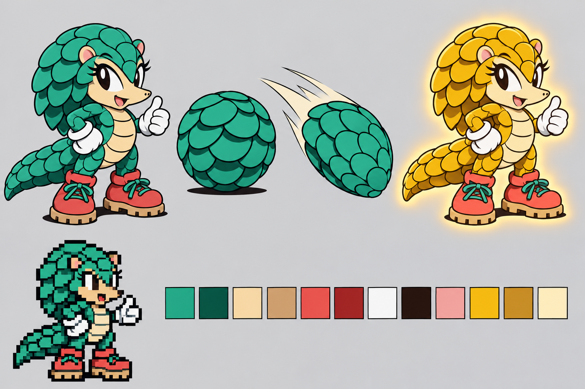
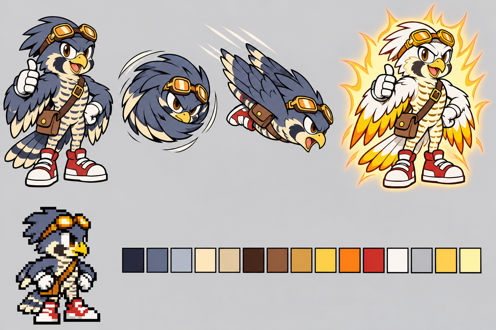
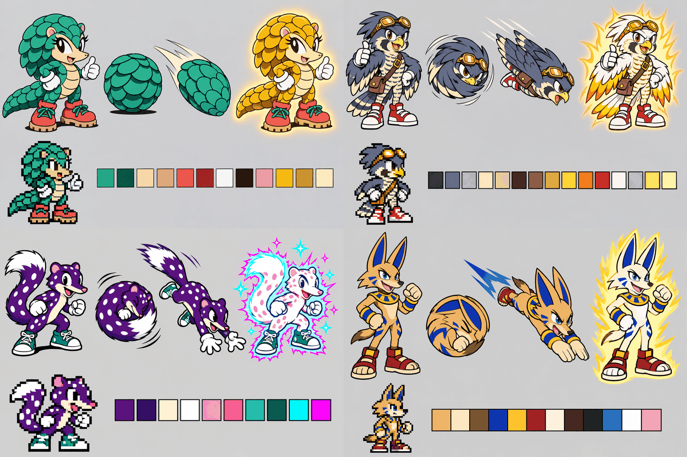

# MICA and TALON character reference

These are the approved model sheets for the example's two original characters. Every
sprite, presentation image and ending frame in the example was generated against
these sheets. They were made with built-in GPT Image on 2026-11-08 and chosen by the
project owner from four candidates (see [Selection](#selection)).

Each sheet shows, left to right:
1. the hero pose
2. the spin-ball
3. the homing dive
4. the powered form

Below these are a 4× pixel inset of the hero pose and the concept palette. The inset
and swatches are concept guidance only. The in-game palettes are listed below, and the
approved sprites are under `../art/<character>/frames/`.

## MICA

MICA is a pangolin who stands in for Sonic. She uses Sonic's route and physics, and
her own move is the airborne homing attack.

| Feature | Reference |
|---|---|
| Scales | Jade, overlapping, covering the back, the crest over the head and the long tail. They are drawn light-on-dark so they read as plates, never as quills. |
| Face and belly | Sand-cream, with a soft round face, a pointed snout, pink ears and large brown eyes. The belly is ridged. |
| Hands and feet | White gloves. Coral-red boots with tan treaded soles and jade laces. |
| Spin-ball | A closed ball of scale armour. In motion the plates are simplified so the spin reads; the solid blur frame keeps a specular highlight. |
| Homing dive | Scales first, like a spinning shell. In game it is a missile shape, rotated per direction. |
| Gilded form | **Open Cone** (owner pick, 2026-11-11). Every plate lifts on its hinge like an opening pine cone: a sawtooth of broad gold plates over a deep amber underside, the crown plates rising straight with no curl, the roll a saw-toothed ball. Face, belly, gloves and coral boots keep their colours. **Hyper** uses the same drawings and flashes Prism Gilt (gold, white-hot, jade, rose-gold), with matching echoes, trail and denser glints; only Hyper strikes are Instagib. |

In-game palette, `../art/mica/palette.yaml` (index 0 is transparent):

| Index | Name | Colour |
|---|---|---|
| 1 | ink | `#242424` |
| 2 | jade-deep | `#004949` |
| 3 | jade-shadow | `#006D6D` |
| 4 | jade | `#00926D` |
| 5 | jade-light | `#24B692` |
| 6 | jade-highlight | `#6DDBB6` |
| 7 | sand-cream | `#FFDB92` |
| 8 | sand-shade | `#DBB66D` |
| 9 | tan-sole | `#B6926D` |
| 10 | coral | `#FF4949` |
| 11 | coral-shadow | `#B62424` |
| 12 | white | `#FFFFFF` |
| 13 | glove-shade | `#DBDBDB` |
| 14 | ear-pink | `#FF9292` |
| 15 | eye-brown | `#492400` |

The Gilded and Prism Gilt cycles are generated by `../production/powered_palettes.py` into
`../production/mica/presentation/gilded.yaml` and `../art/mica/powered/palettes.txt`; the form is
assembled in `../src/main/java/micaandtalon/MicaGilded.java`.

## TALON

TALON is a peregrine falcon courier who stands in for Tails. He uses Tails' route,
physics and flight. Holding down while airborne shows the target reticle, and
down+jump starts a divebomb.

| Feature | Reference |
|---|---|
| Plumage | Slate blue-grey back and wings, with pale feather tips. A swept-back crest and a falcon's dark "moustache" stripe under each eye. |
| Chest | Cream, barred with slate. |
| Head | A yellow hooked beak, brown eyes, and amber aviator goggles pushed up on the head. |
| Gear | A brown courier satchel on a strap across the chest. |
| Hands and feet | White gloves on the feathered wing-hands. Red-and-white high-top shoes. |
| Wings | Part of his body. He has no separate tail sprite and no rotor; flight is drawn with flapping wings. |
| Spin-ball | Wings wrapped around the body, with the goggles still showing. |
| Homing dive | A raptor's stoop with the wings folded back. |
| Solar form | **Corona Crest** (owner pick, 2026-11-11). The crest becomes three tall flame-feathers, the goggles come down with glowing lenses, and the outer flight feathers and tail fan get flame tips (white, amber, orange, red). His chest bars and moustache stripe stay dark bronze. Each flap lifts twice as hard. He has no Flickies and no Hyper tier. |

In-game palette, `../art/talon/palette.yaml` (index 0 is transparent):

| Index | Name | Colour |
|---|---|---|
| 1 | ink | `#242424` |
| 2 | slate-deep | `#242449` |
| 3 | slate-shadow | `#49496D` |
| 4 | slate | `#6D6D92` |
| 5 | slate-light | `#9292B6` |
| 6 | feather-tip | `#DBDBDB` |
| 7 | cream | `#FFFFDB` |
| 8 | cream-shade | `#DBB692` |
| 9 | satchel-brown | `#6D4924` |
| 10 | shoe-red | `#FF4949` |
| 11 | shoe-shadow | `#B62424` |
| 12 | white | `#FFFFFF` |
| 13 | glove-shadow | `#B6B6B6` |
| 14 | amber | `#FFB624` |
| 15 | amber-shadow | `#B66D24` |

The Solar palette is generated by `../production/powered_palettes.py` into
`../production/talon/presentation/solar.yaml`; the form is assembled in
`../src/main/java/micaandtalon/TalonSolar.java`.

## Keeping the characters on model

These rules came from owner reviews of the generated sprites:
- **Use one identity.** Generate every pose against the model sheet and the approved
  frames. Do not let scales drift into quills, or let TALON pick up parts of Tails. A
  thin mast grew above TALON's head in early flight frames because Tails' rotor was
  in the reference image.
- **Use one scale.** Each character's approved `wait-00` frame is the reference for
  size. Scale every other frame by head and torso landmarks, never by its bounding box
  or wingspan. The landmarks are in `../art/<character>/consistency-landmarks.json`.
- **Match the native motion, not just the pose.** Use the native animation script's
  frame order and timing, and include every contact phase of a walk or run.

The full method is in the
[playable-art pipeline notes](../../../tools/modding/playable_art/README.md).

## Selection

Four candidates were drawn from the same brief: MICA (top left), TALON (top right),
COMET (bottom left) and SCION (bottom right). They were chosen to suit a spin-ball body
and a homing strike, and to be spelled from letters the three games' ROM fonts already
contain.
- **MICA** was chosen first. Her silhouette is unlike any Sega character, scale armour
  makes a natural spin-ball, and Gilded is a simple palette change.
- **TALON** was added as the Tails stand-in. His sprites cost more to draw because of
  the wings, barring and satchel.
- **COMET** was not chosen. This spotted quoll read more like a skunk or a squirrel.
  The species had been changed from a flying squirrel to avoid Ray the Flying Squirrel.
- **SCION** was not chosen. This desert jackal read too close to Anubis, and its long
  limbs suit a spin-ball less well. The species had been changed from a fennec fox,
  which read as Tails.

### Brief

The shared art direction given to GPT Image was:
- a 1990s 16-bit mascot-platformer model sheet, with bold ink outlines, flat cel
  shading with at most two shade steps, a chunky readable silhouette and big eyes
- about 2.5–3 heads tall, so the character reads at a 40-pixel in-game height
- no more than 15 flat colours for the normal form, on a plain light-grey background
- a body that can curl into a tight spin-ball
- no text, Sega logos or rings, and no resemblance to any existing Sega character

The character briefs were:
- **MICA:** a pangolin with overlapping armour scales on her back, head crest and long
  tail, and a soft round face. Jade scales, warm sand-cream face and underbelly,
  coral-red shoes and white gloves. Her homing dive is scales first, like a spinning
  shell. Gilded lifts the scales into gold Open Cone plates.
- **TALON:** a peregrine falcon courier with a swept-back crest and feathered wing-hands
  that wear gloves. He has a tail fan, a satchel strap across the chest and aviator
  goggles pushed up on his head. Slate blue-grey back, cream chest with dark barring,
  amber goggles, a yellow beak and red-and-white shoes. He must not look like Jet the
  Hawk. His spin-ball has the wings tucked around him, and his homing dive is a stoop
  with the wings folded back. Solar (Corona Crest) gives white-gold plumage, a flame crest, goggles down and flame-tipped wings.
