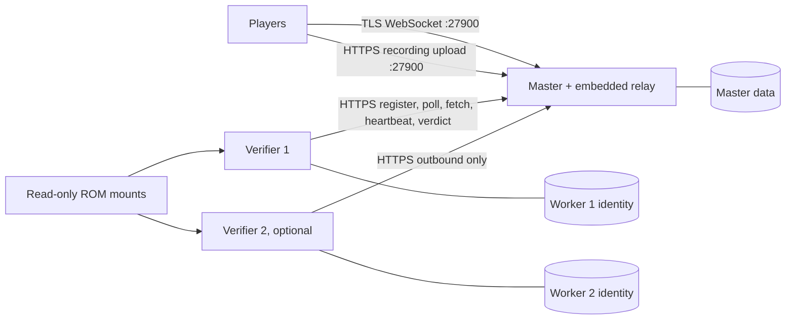

# Docker deployment

Build two images from this repository: **master** runs the browser, admission,
embedded relay rooms, recording store and verification queue; **verifier** runs
one replay at a time against operator-supplied ROMs. The same images run with
individual `docker run` commands or the optional [Compose example](compose.yaml).
Initial deployment is one Linux x86-64 server. Move verifiers to other machines
by changing their master URL and supplying their own persistent data volumes.

Keep this code under `racing/`: the server uses shared engine networking and the
verifier must match the clients' engine build. A new source repository would add
version coordination without making the services independent. Image storage can
use a separate OCI registry later; these instructions build local images and do
not assume published OpenGGF images exist.



The master does not push connections to verifiers. Each worker registers its
public identity and supported engine/ROM fingerprints, then polls for work.
Verification does not carry live race traffic. Relay rooms currently live inside
the master process; a separate relay image would need a new relay-service contract.
Player-hosted direct rooms remain on the player's host.

The master limits communication in its relay rooms with `chatModeLimit`, default
`QUICK_CHAT`. `FULL_CHAT` permits typed and quick messages; `QUICK_CHAT` permits
only canned messages; `"OFF"` disables both. Quote `"OFF"` in YAML so it remains a
string. A room owner's requested mode is intersected with the maximum at creation
and on later changes. Owners may restrict further, and cannot enable typed chat
above a Quick Chat maximum. This policy applies to master-hosted relay rooms;
the browser reports the actual mode of player-hosted direct rooms. Profanity
censorship and personal chat hiding remain client preferences. Deploy protocol
version 6 clients, hosts and master together.

## Build the images

Use a Linux x86-64 build host with a Java 25 JDK, Python 3.11+, Maven, Docker with
Buildx, and optionally Docker Compose. The native dependency set comes from the
build host; the initial image builder rejects other platforms. Build from the exact
source revision used for your clients:

```bash
export JAVA_HOME=/path/to/jdk-25
python3 racing/deploy/build-images.py --tag local
```

Use a revision-specific tag for a deployment. `--image-prefix` changes the default
`openggf-racing`; `--docker /path/to/docker` selects a CLI wrapper or installation.
`--java-image eclipse-temurin:25-jre-noble@sha256:...` pins an operator-selected
Java 25 base digest when reproducible base-image selection is required.
The images are named `openggf-racing-master:local` and
`openggf-racing-verifier:local`. The build first creates a relocatable distribution
in `target/racing-server/dist/`. Its original `version.properties` travels with the
classes: Docker tags do not change the engine fingerprint. Dirty builds retain
their dirty identity. Build compatible clients and verifiers from the same clean
revision for real deployments.

The generated image context contains only that distribution and the Dockerfile.
ROMs, operator files and development references are not image inputs. Supply ROMs
at runtime; never add them to an image or registry. The distribution can also run
on a compatible host with Java 25 using `bin/racing-server` after relocation.

## Prepare one host

Use a DNS hostname such as `racing.example.org` and a valid TLS certificate whose
SAN includes that hostname. Point public DNS at the server and allow TCP 27900.
Players use `wss://racing.example.org:27900/master`; workers use
`https://racing.example.org:27900`. Both endpoints share the master's TLS listener.
There are no verifier ports to open, and the admin listener stays on container
loopback at 27901. Do not publish the admin port.

Stage operator inputs outside the checkout. Replace these example paths with your
own existing certificate and key; token generation below writes directly to files:

```bash
export OPERATOR_DIR="$HOME/racing-operator"
install -d -m 700 "$OPERATOR_DIR"
install -m 644 racing/deploy/master.example.yaml "$OPERATOR_DIR/master.yaml"
install -m 644 /path/to/fullchain.pem "$OPERATOR_DIR/fullchain.pem"
install -m 644 /path/to/privkey.pem "$OPERATOR_DIR/privkey.pem"
openssl rand -hex 32 > "$OPERATOR_DIR/admin-token"
openssl rand -hex 32 > "$OPERATOR_DIR/verifier-token"
chmod 644 "$OPERATOR_DIR/admin-token" "$OPERATOR_DIR/verifier-token"
cp racing/deploy/.env.example "$OPERATOR_DIR/deployment.env"
```

Edit `deployment.env`: set the absolute operator and existing ROM paths, image tag
and certificate hostname. Edit `master.yaml` for limits as needed. File contents
are readable by container UID 10001; the enclosing host directory is mode 0700,
and only individual files are mounted into the containers. Preserve that directory
protection. An ACL granting the mapped container user read access is an alternative.
Compose file-backed secrets use bind mounts; they do not encrypt host files or
remap their ownership. Do not put token values in environment variables or command
arguments. See [Docker's secrets guide](https://docs.docker.com/compose/how-tos/use-secrets/).

ROM files must already be readable by the mapped container user; grant read access
with your host's file permissions or ACLs. The mount is read-only. A worker may
advertise several ROMs by adding a mount and `--rom /roms/other.gen` for each.

The example caps the master at four CPUs/4 GiB with a 1 GiB Java heap, and each
verifier at two CPUs/4 GiB with a 2 GiB heap. Allow additional host memory and
storage headroom. These are initial limits, not a measured capacity guarantee.
On rootless Docker, check cgroup delegation actually enforces the limits.
Check the source IP seen by the server too: a rootless port forwarder or reverse
proxy may collapse clients onto one address, affecting per-IP admission. The
master does not trust forwarded-IP headers. Prefer direct TLS publication with
preserved client addresses for a public service.

## Option A: Compose

From the repository root:

```bash
docker compose --env-file "$OPERATOR_DIR/deployment.env" -f racing/deploy/compose.yaml config --quiet
docker compose --env-file "$OPERATOR_DIR/deployment.env" -f racing/deploy/compose.yaml up -d --wait
docker compose --env-file "$OPERATOR_DIR/deployment.env" -f racing/deploy/compose.yaml ps
```

Compose starts the master and `verifier-1`, with separate named data volumes.
The master's certificate hostname is also a private network alias, so the worker
reaches it directly while performing ordinary hostname/certificate validation.
Leave `publicBaseUrl` blank for upload paths relative to the player's master URL,
or set an externally reachable HTTPS URL. A private Docker hostname is not a
public upload address. For private test CAs, mount a Java truststore and add the
standard `-Djavax.net.ssl.trustStore=...` JVM option to workers and test clients;
do not disable TLS validation.

Enable a second worker with its own volume:

```bash
docker compose --env-file "$OPERATOR_DIR/deployment.env" -f racing/deploy/compose.yaml --profile second-verifier up -d --wait
```

Do not use `--scale verifier-1=2`: replicas would share one signing identity.
Add explicit services with unique data volumes, or run standalone workers.
`service_healthy` gates initial startup; workers also retry registration and later
connection failures. An unhealthy flag alone does not cause Docker to restart a
running container. See [Compose service semantics](https://docs.docker.com/reference/compose-file/services/).

## Option B: standalone containers

These commands use the same images, file locations and network alias. Set the
non-secret values explicitly; they need not come from a Compose environment file:

```bash
export MASTER_HOSTNAME=racing.example.org
export IMAGE_TAG=local
export ROM_PATH='/absolute/path/to/your existing game.gen'
docker network create openggf-racing
docker volume create openggf-master-data
docker volume create openggf-verifier-1-data

docker run -d --name openggf-master --restart unless-stopped \
  --network openggf-racing --network-alias "$MASTER_HOSTNAME" \
  -p 27900:27900 --read-only --cap-drop ALL --security-opt no-new-privileges \
  --pids-limit 256 --cpus 4 --memory 4g --stop-timeout 30 \
  --tmpfs /tmp:rw,exec,size=128m,mode=1777 \
  --log-driver json-file --log-opt max-size=10m --log-opt max-file=3 \
  -e JAVA_TOOL_OPTIONS='-Xms256m -Xmx1g' \
  --mount type=volume,src=openggf-master-data,dst=/data \
  --mount "type=bind,src=$OPERATOR_DIR/master.yaml,dst=/config/master.yaml,readonly" \
  --mount "type=bind,src=$OPERATOR_DIR/fullchain.pem,dst=/config/fullchain.pem,readonly" \
  --mount "type=bind,src=$OPERATOR_DIR/privkey.pem,dst=/run/secrets/tls_key,readonly" \
  --mount "type=bind,src=$OPERATOR_DIR/admin-token,dst=/run/secrets/admin_token,readonly" \
  --mount "type=bind,src=$OPERATOR_DIR/verifier-token,dst=/run/secrets/verifier_registration_token,readonly" \
  "openggf-racing-master:$IMAGE_TAG"

docker run -d --name openggf-verifier-1 --restart unless-stopped \
  --network openggf-racing --read-only --cap-drop ALL --security-opt no-new-privileges \
  --pids-limit 256 --cpus 2 --memory 4g --stop-timeout 45 \
  --tmpfs /tmp:rw,exec,size=128m,mode=1777 \
  --log-driver json-file --log-opt max-size=10m --log-opt max-file=3 \
  -e JAVA_TOOL_OPTIONS='-Xms256m -Xmx2g' \
  --mount type=volume,src=openggf-verifier-1-data,dst=/data \
  --mount "type=bind,src=$ROM_PATH,dst=/roms/game.gen,readonly" \
  --mount "type=bind,src=$OPERATOR_DIR/verifier-token,dst=/run/secrets/verifier_registration_token,readonly" \
  "openggf-racing-verifier:$IMAGE_TAG" \
  --master "https://$MASTER_HOSTNAME:27900" \
  --registration-token-file /run/secrets/verifier_registration_token \
  --rom /roms/game.gen --data /data --shutdown-grace-seconds 30
```

The verifier retries if the master is still starting. Inspect master readiness
with `docker inspect --format '{{.State.Health.Status}}' openggf-master` and
inspect each service's logs. Master health checks authenticated loopback readiness;
it does not certify a matching registered verifier or an end-to-end replay.
The image healthcheck assumes `/config/master.yaml`; override the healthcheck if
you change that path. Runtime Java options use `JAVA_TOOL_OPTIONS`.

For a verifier on another machine, create a fresh local identity volume, mount its
local ROM and registration token, omit `--network openggf-racing`, and keep the
public HTTPS master URL. No shared filesystem or Compose installation is required.
Transfer built images through a private registry or `docker save`/`docker load`.
If using a registry with Compose, change the image prefix and pull policy explicitly.

## Deployment witness

`deployment-smoke` is an operator test for an isolated deployment. It drives the
checked-in S1 GHZ1 BK2 controller inputs through the verifier's normal replay boot,
requires natural completion, streams the resulting poses over a TLS relay room,
uploads the real input recording, and waits for an independently running worker's
accepted signed verdict. It never synthesizes a successful verdict.

Build the portable distribution, choose a new scratch path, and prepare the fixture
**before starting its master**:

```bash
target/racing-server/dist/bin/racing-server deployment-smoke prepare --data /absolute/new-smoke-fixture
```

Preparation refuses an existing directory. It creates `client/`, a marker, and
`master/master-identities.db` with only the smoke client's trusted account, so a
verified room can be exercised without waiting weeks for normal trust promotion.
Use that `master/` as the isolated master's writable `/data`, with permissions for
UID 10001; keep `client/` outside its mount. Never use a production data directory.
Configure TLS and start a separately running verifier with the S1 ROM and matching
build. Then, from the repository root:

```bash
target/racing-server/dist/bin/racing-server deployment-smoke run \
  --data /absolute/new-smoke-fixture --master https://racing.example.org:27900 \
  --rom '/absolute/existing/Sonic The Hedgehog (W) (REV01) [!].gen' \
  --movie "$PWD/src/test/resources/traces/s1/ghz1_fullrun/ghz1_fullrun.bk2"
```

The fixture's master must use the default trust thresholds and a blank
`publicBaseUrl` or the same HTTPS origin as `--master`. For a private test CA,
configure the Java truststore on both client and verifier. `replay` instead of
`run`, omitting `--data` and `--master`, checks the ROM/controller route alone.
The default movie start is frame 840; only controller inputs enter the engine.
Successful network execution emits a JSON line with `"phase":"verified"` after
`replayed` and `uploaded`. A healthy master alone is a narrower check. Delete only
the isolated fixture's containers, volumes and generated data after inspection.

## Multiplayer testbed (AMP)

The project's own testbed runs the master (no verifier) as
[CubeCoders AMP](https://cubecoders.com/AMP) instances on a shared host, from the
`openggf-multi` template in
[OpenGGF/openggf-amp-templates](https://github.com/OpenGGF/openggf-amp-templates).
Routing is by port: the master terminates TLS itself and enforces per-IP limits, so
an SNI or HTTP reverse proxy in front of it would hide client addresses.

| Branch | Player URL | AMP instance | Rolling prerelease |
|---|---|---|---|
| master | `wss://multi.openggf.com:27900/master` | not yet created | `multi-latest` |
| develop | `wss://multi-dev.openggf.com:27910/master` | OpenGGF Multi-Dev | `multi-dev-latest` |
| next | `wss://multi-next.openggf.com:27920/master` | OpenGGF Multi-Next | `multi-next-latest` |

All three names share one Let's Encrypt certificate; a certbot deploy hook on the host
copies it into each instance's `openggf-multi/tls/`, and a master loads it at its
next start. Each instance reserves Master Port + 1 for the loopback-only admin
listener.

After smoke passes on a develop or next push, CI's `deploy-multiplayer` job builds
`target/racing-server/dist`, replaces the branch's rolling prerelease asset
`openggf-racing-server.zip` (moving its tag to the tested commit), and runs:

```bash
AMP_URL=https://amp.example.org AMP_USERNAME=... AMP_PASSWORD=... \
  python3 racing/deploy/amp_deploy.py --instance-id <AMP instance ID> \
  --endpoint wss://multi-dev.openggf.com:27910/master
```

The script stops the instance's application, runs AMP's update (Temurin 25 JRE plus
the prerelease zip), starts it and requires a certificate-validated WebSocket
upgrade. Credentials come only from the environment and the panel URL must be HTTPS.
The CI account belongs to an ADS role limited to Manage/Start/Stop/Restart on the
OpenGGF instances and, inside each instance, a role limited to application
start/stop/restart/update and console reading. The branch's GitHub environment
(`multiplayer-dev`, `multiplayer-next`) admits only that branch and holds
`AMP_INSTANCE_ID`, `MULTI_ENDPOINT`, `RELEASE_TAG` and the `AMP_PASSWORD` secret.
Every deploy restarts the master, which disconnects rooms (see below).

## Operation and updates

- Back up the entire master `/data` volume while the master is stopped, including
  SQLite state, master identity, retained recordings and audit log. Back up each
  verifier's identity volume separately. New volumes inherit image UID/GID 10001;
  restored/bind-mounted volumes must be writable by that container user.
- Never share a worker's identity directory between concurrent processes. Reuse it
  only when replacing that same worker. Do not copy a production data volume into
  a running duplicate master.
- Drain verifiers before stopping the master: stop workers with a 45-second Docker
  timeout, then stop the master. The worker stops taking new jobs, lets an active
  cycle finish for up to its configured grace, then exits. A killed or overlong job
  can be requeued after lease expiry while the master stays up. Heartbeats report
  liveness; they do not extend leases.
- Rooms, live sessions, worker registrations and queued/leased jobs are in memory.
  Restarting the master disconnects rooms and loses those jobs. Preserved SQLite
  and recordings do not provide job recovery or seamless master failover.
- Build a new revision tag, schedule a maintenance window, stop workers then master,
  back up data, replace images, and start master then workers. Keep the previous
  image and compatible data backup for rollback. Do not change verifier builds
  independently of clients expecting their fingerprints.
- Renew TLS files and restart the master to load them. Rotate file-backed tokens by
  replacing the host files and recreating affected containers; a replaced inode is
  not guaranteed to update an existing bind mount. Restart workers after changing
  the registration token. Do not overwrite backups or remove volumes as an update
  shortcut; `docker compose down` preserves volumes unless `--volumes` is supplied.

Verified rooms still require an eligible trusted creator and a live verifier with
the correct build/ROM fingerprint. The current menu creates casual rooms; Docker
does not change that UI or its admission rules. See [server configuration](../../CONFIGURATION.md#racing-server-master-verifier-settings)
and the [deployment design and validation record](../../docs/architecture/plans/2026-10-23-racing-docker-deployment.md).
